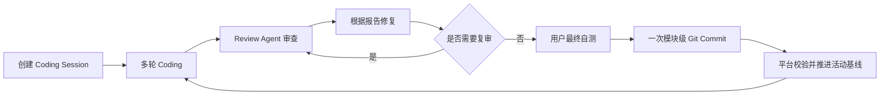
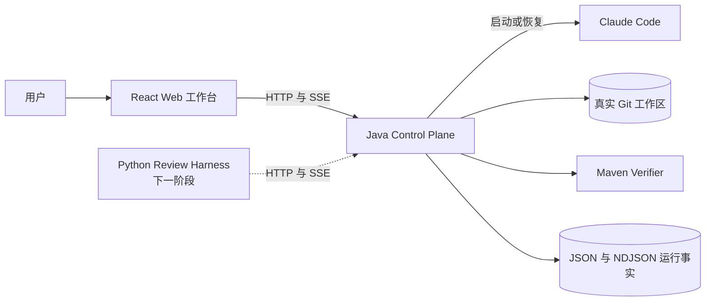

# Code Weave

Code Weave 是一个面向本地 Git 项目的 Coding–Review 一体化 Agent 平台。Coding 侧复用 Claude Code，平台负责长期会话、真实工作区保护、过程可观测、独立验证和模块级 Git 基线；Review Harness 将由 Python、LangGraph 与 LangChain 独立实现。

## 当前状态

| 能力 | 状态 | 当前边界 |
|---|---|---|
| 多轮 Coding Session | 已实现 | 同一 Session 串行执行 Turn，并复用 Claude 原生上下文 |
| 真实 Git 工作区 | 已实现 | Agent 直接修改用户仓库，不再为正式 Session 创建 Worktree |
| Git Diff 与路径门禁 | 已实现 | 每轮相对活动审查基线采集并检查变更 |
| Maven 验证 | 已实现 | 当前只支持 Spring Boot 3.x + Maven 项目 |
| SSE 可观测 | 已实现 | 支持历史补发、实时事件和游标恢复 |
| 模块级基线推进 | 已实现 | 用户完成 Review、自测和正式 Commit 后确认推进 |
| Review Harness | 待开发 | 当前尚未接入 Review Agent 与报告交互 |
| 桌面端 | 待开发 | 当前先提供本机 Web 工作台 |

当前正式业务流程：



> 当前代码已经实现 Coding、验证与基线推进；图中的 Review Agent 是下一阶段目标。Review Harness 接入前，Review 和最终自测是否完成由用户确认。

## 架构概览



| 模块 | 技术 | 职责 |
|---|---|---|
| `apps/web-console` | React、TypeScript、Vite | 多轮对话、阶段投影、Diff 和模块完成入口 |
| `services/control-plane` | Java 21、Spring Boot | Session、Turn、Claude 调用、Git 门禁、Maven 验证和 SSE |
| `services/review-harness` | Python，待搭建 | Review Agent Loop、上下文、记忆、Skills、Tools 和报告 |
| `fixtures/spring-boot-demo` | Spring Boot、Maven | 本地链路与自动化验证目标项目 |
| `runtime` | 本地文件，Git 忽略 | Session/Turn 快照、事件和 Maven 产物 |

完整设计见 [当前系统架构](docs/architecture/current-architecture.md)，文档入口见 [项目文档索引](docs/README.md)。

## 环境要求

- JDK 21
- Maven 3.9+
- Git 2.40+
- Node.js 20.19+ 或 22.12+
- Claude Code CLI 2.1+

Windows 应将 Claude 可执行文件配置为 Java 可以直接启动的 `claude.cmd`、`.bat` 或 `.exe`，不要使用 PowerShell 优先解析到的 `claude.ps1`。

## 本地启动

启动 Control Plane：

```powershell
$env:CODE_WEAVE_RUNTIME_ROOT = "D:/code-weave-runtime"
$env:CODE_WEAVE_CLAUDE_EXECUTABLE = "D:/develop/nodejs/claude.cmd"
.\mvnw.cmd -pl services/control-plane spring-boot:run
```

启动 Web 工作台：

```powershell
cd apps/web-console
npm install
npm run dev
```

浏览器访问 `http://127.0.0.1:5173`。前端会将 `/api` 代理到 `http://127.0.0.1:8080`，两个服务都只监听本机。

详细步骤、常见故障和验证命令见 [本地开发指南](docs/guides/local-development.md)。

## 验证项目

```powershell
.\mvnw.cmd -pl services/control-plane -am clean test

cd apps/web-console
npm test -- --run
npm run build
```

## 当前边界

- 正式 Session 直接修改真实仓库，平台不会自动 Commit、Push 或 Merge。
- 同一真实仓库同一时间只允许绑定一个活动 Session。
- 同一 Session 同一时间只运行一个 Coding Turn。
- 旧 `/api/v1/m0/runs` 单轮 Worktree 链路暂时保留用于回归验证，但不属于正式前端入口。
- 旧 Session Worktree 自动合并接口已经删除；历史 `MERGED` 快照仅作为兼容数据读取。
- 当前持久化面向本机单进程，不支持多实例并发或远程多用户。

## 文档导航

- [当前系统架构](docs/architecture/current-architecture.md)
- [HTTP API](docs/api/http-api.md)
- [本地开发指南](docs/guides/local-development.md)
- [开发路线图](docs/roadmap.md)
- [架构决策记录](docs/decisions/README.md)
