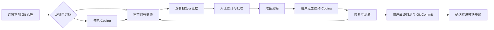
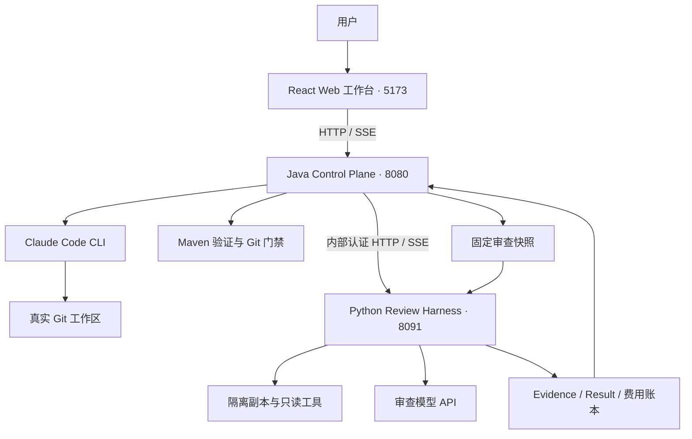

# Code Weave

**面向本地 Git 项目的 AI 开发、代码审查与修复工作台。**

Code Weave 将 Coding Agent、独立 Review Harness 和人工审阅串成可追溯的工作流：开发代码或直接审查已有变更，查看带源码依据的问题报告，选择需要修复的问题，再显式交给 Coding Agent 处理。

Coding 侧复用 Claude Code，Review 侧通过 Python Harness 调用真实模型；平台负责会话、工作区保护、审查编排、预算控制、报告版本和交接，而不是重新实现一个 Coding Agent。

[核心功能](#核心功能) · [使用流程](#使用流程) · [快速开始](#快速开始) · [架构](#架构) · [当前边界](#当前边界) · [文档](#文档)

> 当前处于本地试用与持续迭代阶段，主要验证环境为 Windows。真实模型审查链路已接通，但执行成功不等于审查充分，也不保证模型判断正确。请在人工确认和测试后采纳修改。

## 核心功能

### 开发与审查，一处完成

- **多轮开发会话**：围绕本地仓库持续提交 Coding 指令，复用 Claude 原生会话上下文。
- **直接启动审查**：已有代码变更时，无需先发起 Coding 指令，即可从工作台进入 Review。
- **实时过程展示**：通过 SSE 查看阶段、工具活动、执行结果和 Diff，支持历史事件补发。
- **黑白科技风界面**：统一暗色工作台、中文状态展示、响应式布局，支持减少动态效果偏好。

### 六个维度的代码审查

按所选维度串行运行 Review Pass（审查轮次）：

| 维度 | 关注点 |
| --- | --- |
| 正确性 | 逻辑错误、边界条件、异常路径 |
| 一致性 | 实现与约定、相邻逻辑之间的冲突 |
| 安全 | 输入处理、权限与敏感数据风险 |
| 性能 | 不必要的开销与潜在性能问题 |
| 架构 | 职责划分、依赖关系与变更影响 |
| 测试 | 回归覆盖、测试缺口与可验证性 |

审查基于固定代码快照和独立执行副本，通过只读工具获取源码、搜索结果和 Diff，不在审查过程中修改用户仓库。候选问题进入独立验证请求；跨 Pass 的潜在重复项可进入语义去重，不能确认时保持分立。

### 从问题回到源码依据

- **证据关联**：问题关联源码位置和 Evidence，可查看对应材料，而不只是阅读模型结论。
- **中文报告**：新请求默认要求模型使用简体中文；代码、路径、标识符和协议字段保持原样。历史英文原文不会自动翻译。
- **覆盖透明**：区分完成、不完整与跳过，保留预算、来源覆盖和模型输出失败等原因，不把“没有问题”与“没有完成检查”混为一谈。
- **上下文管理**：长工具结果支持外置与分页，结合结构化状态和摘要压缩控制上下文体积。

### 人工决定修什么，Agent 再动手

- 修订问题标题、描述、修改要求和备注，保存为新的报告版本。
- 对问题作出批准修改、暂缓、接受风险或不采纳等裁决。
- 选择本轮批准交付的问题，生成不可变交接包。
- **点击「启动 Coding」后才执行修复**：平台将批准的问题、修改要求、原始判断及关联证据作为新 Coding Turn 的输入。
- 启动前检查工作区是否仍与审查依据一致；原始 Result 不被人工修订覆盖。

### 可控的运行与工程保护

- Coding 直接操作真实仓库，Review 使用隔离副本；同一 Session 串行执行 Coding Turn。
- 发送前进行 Token 估计与余量检查，结合费用预留、Usage 结算、时限和模型调用预算保护运行。
- 工具累计调用次数不设硬上限，但不代表无限时长、无限费用或无限模型请求。
- 明确的局部模型输出错误可收敛为当前 Pass 不完整，保留其他 Pass 成果；存储、资源、身份或费用不确定等故障仍阻断。
- 支持 Maven 验证和模块级 Git 基线推进；平台工作流不会自动提交、推送或合并代码。

## 使用流程



1. 创建 Session，选择本地仓库；如有既有未提交变更，明确决定是否纳入。
2. 提交开发指令，或直接启动 Review，选择审查维度及预算。
3. 查看各维度完成情况、问题和证据，确认是否存在覆盖缺口。
4. 在人工审阅中修订内容，将需要处理的问题设为「批准修改」，保存并选择交付。
5. 准备交接，确认范围后点击「启动 Coding」。审查结束本身不会自动触发修复。
6. 检查修改、运行测试并按需复审；最终由用户执行 Git Commit，再推进活动基线。

## 快速开始

### 环境要求

| 依赖 | 要求 |
| --- | --- |
| Java | JDK 21 |
| Maven | 3.9+，仓库提供 Maven Wrapper |
| Git | 2.40+ |
| Node.js | 20.19+ 或 22.12+ |
| Python | 3.12，运行 Review Harness 时需要 |
| Claude Code CLI | 2.1+，需自行完成可用配置 |

以下命令使用 PowerShell，均从仓库根目录起步。运行目录应在被审查仓库之外。当前内置构建验证器面向 **Spring Boot 3.x + Maven**，不能将其理解为已支持所有语言和构建系统。

### 1. 启动 Java 控制服务

将示例路径替换为实际路径：

```powershell
$env:CODE_WEAVE_RUNTIME_ROOT = "D:/code-weave-runtime"
$env:CODE_WEAVE_CLAUDE_EXECUTABLE = "D:/tools/nodejs/claude.cmd"
.\mvnw.cmd -pl services/control-plane spring-boot:run
```

Windows 下请配置 Java 可直接启动的 `.cmd`、`.bat` 或 `.exe`，不要使用 `claude.ps1`。

### 2. 启动 Web 工作台

在另一个终端，从仓库根目录执行：

```powershell
cd apps/web-console
npm ci
npm run dev
```

访问 <http://127.0.0.1:5173/sessions>。前端将 `/api` 代理到本机 `8080` 端口。以上两步可启动 Coding 工作台，**尚不包含真实 Review 服务配置**。

### 3. 配置并启动 Review Harness

Review 是独立 Python 服务，默认监听 `127.0.0.1:8091`。首次使用需要：

1. 创建 Python 3.12 虚拟环境，按锁文件安装依赖。
2. 配置数据库及独立的 Snapshot、Execution、Artifact 根目录，显式执行 Alembic 迁移。
3. 为 Java 与 Python 配置一致的内部 Bearer Token、Snapshot Root 和 Execution Root。
4. 使用真实审查时，显式启用 Java／Python 的 REAL 模式，并配置模型 API Key、独立 Checkpoint 数据库和经核验的价格档案。
5. 启动 Python 服务并确认就绪；模拟模式的空结果不代表完成真实审查。

安装命令和配置入口见 [Review Harness README](services/review-harness/README.md)，费用配置见 [费用账本说明](docs/review-harness-batch-6a2-fee-ledger-handoff.md)。服务 README 中带日期或批次的段落包含演进历史，不应直接套用旧预算与旧迁移版本。

**不要把 API Key、内部凭证或真实运行材料写进 Git。** 密钥通过进程环境配置；真实模型请求会产生费用。本地运行不代表源码只留在本机：Coding 和 Review 使用的模型服务可能接收代码，请先确认仓库的数据使用许可。

## 架构



| 模块 | 技术栈与职责 |
| --- | --- |
| `apps/web-console` | React、TypeScript、Vite、TanStack Query、GSAP／Motion；会话、Diff、报告、人工审阅与交接 |
| `services/control-plane` | Java 21、Spring Boot；Coding 调度、工作区保护、快照、报告版本与交接 |
| `services/review-harness` | Python 3.12、FastAPI、LangGraph、SQLAlchemy、SQLite；审查编排、上下文、证据、预算与结果 |
| `contracts` | 跨服务 JSON Schema 与契约夹具 |
| `fixtures/spring-boot-demo` | 本地链路与回归验证示例项目 |
| `runtime` | 本地运行数据，不作为源码提交 |

当前真实 Review Adapter 接入 DeepSeek；其他 Provider 的即插即用接入尚不作为已交付能力。

## 开发与验证

Java，在仓库根目录执行：

```powershell
.\mvnw.cmd -pl services/control-plane -am clean test
```

前端，在 `apps/web-console` 执行：

```powershell
npm test
npm run build
```

Python，完成依赖安装后在 `services/review-harness` 执行：

```powershell
.\.venv\Scripts\python -m pytest -q
.\.venv\Scripts\python -m ruff check .
.\.venv\Scripts\python -m ruff format --check .
```

离线测试不替代真实模型质量验收。真实验收应另行确认范围和费用预算，不需要为了修改文档或界面而调用模型。

## 当前边界

- **本地单用户优先**：当前持久化与调度面向本机单进程，不提供远程多用户或多实例并发部署保障；Python 官方入口使用单 Worker。
- **审查不是证明**：独立验证请求不等于独立质量保证，同模型仍可能沿用错误前提、漏报、误报或保留重复项。
- **完整度要单独看**：Result 交付成功不等于六个维度全部完成；必须结合各 Pass 状态、覆盖与诊断判断。
- **不承诺自动恢复执行**：事件可回放、Checkpoint 可持久化，不代表服务重启后会自动续跑模型任务。
- **人工审阅关闭后只读**：报告及已保存版本保留，目前尚无重新打开入口，关闭前请确认无需继续编辑和交接。
- **真实仓库需要保护**：Coding 会直接修改文件，建议在独立开发分支试用；平台不会替代最终代码检查、测试或备份。
- **部分外围能力仍在演进**：桌面客户端、广泛跨平台验证和更多模型 Provider 不作为当前已完成能力。

## 文档

| 入口 | 内容 |
| --- | --- |
| [文档索引](docs/README.md) | 设计、指南与历史决策入口 |
| [本地开发指南](docs/guides/local-development.md) | Coding 启动、验证与排障 |
| [Review Harness](services/review-harness/README.md) | Python 安装、认证、迁移与配置 |
| [来源提交与 Pass 故障隔离](docs/review-harness-source-intake-and-pass-recovery.md) | 最新审查可用性策略与限制 |
| [报告修订](docs/review-harness-batch-6b-report-revisions-handoff.md) | 人工裁决、版本和批准选择 |
| [修复交接](docs/review-harness-batch-6c-handoff-delivery.md) | 不可变交接包与用户显式启动 |
| [前端工作台](docs/frontend-workspace-maturity.md) | 界面改造、主题及第三方复用说明 |
| [架构决策](docs/decisions/README.md) | 技术取舍和演进依据 |

部分架构、路线图和批次文档保留历史阶段描述；判断当前能力时，请结合日期、后续交付记录与实现核对。

## 反馈与第三方说明

欢迎通过仓库 Issue 反馈问题。请附复现步骤、预期／实际行为及脱敏后的诊断信息；不要上传 API Key、内部 Token、私有源码或完整运行目录。

前端复用组件及动画依赖的来源和许可证见 [第三方声明](apps/web-console/THIRD_PARTY_NOTICES.md)。不同依赖的许可条件并不相同，请在分发或商业使用前分别核对。
