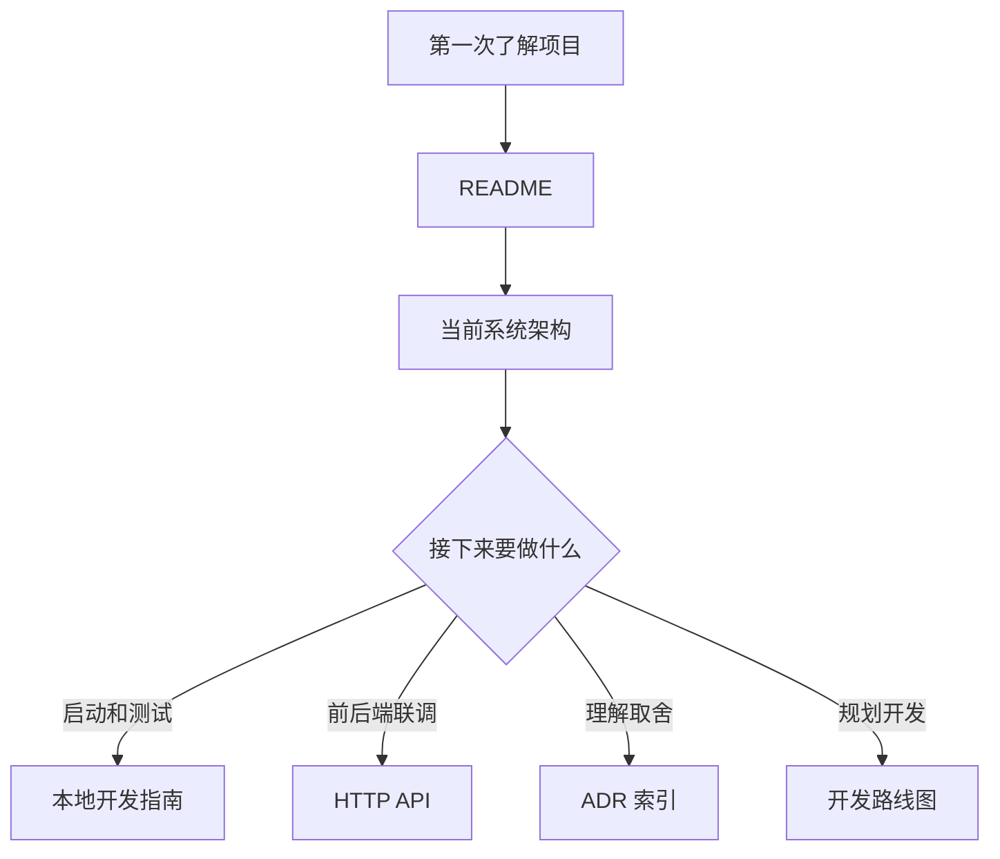

# Code Weave 文档索引

项目文档分为“当前事实、使用说明、演进计划、历史决策”四类。阅读时应优先相信当前架构和代码；ADR 用于解释当时为什么作出某个决定，不保证仍代表现状。

| 文档 | 解决的问题 | 更新时机 |
|---|---|---|
| [当前系统架构](architecture/current-architecture.md) | 系统现在如何运行、核心类如何协作 | 主链路或服务边界变化时 |
| [HTTP API](api/http-api.md) | 前后端目前可以调用哪些接口 | Controller 契约变化时 |
| [本地开发指南](guides/local-development.md) | 如何配置、启动、测试和排障 | 环境或命令变化时 |
| [开发路线图](roadmap.md) | 已完成、正在做和下一阶段是什么 | 每个里程碑完成时 |
| [工程落地复盘](engineering/engineering-practice-log.md) | 工程难点、解决方案、验证结果和剩余边界 | 每次确认并完成一个问题修复后 |
| [ADR 索引](decisions/README.md) | 技术决策如何演进、哪些已被替代 | 新增或替代决策时 |

## 文档维护规则

1. README 只提供入口、当前状态和最短启动路径，不堆放实现细节。
2. “当前系统架构”只描述已落地事实，未来设计必须显式标记。
3. ADR 原则上不重写历史正文；决策变化时标记为“已被替代”并新增 ADR。
4. API 文档必须能从 Controller 和 DTO 反向核对，不能记录已删除接口。
5. 不在文档中写未经测试的性能数字、容量结论或简历数据。
6. 架构、状态和时序关系使用 Mermaid；代码块只放真实命令、配置或协议示例。

- [Review Harness 批次 2 开发交付与复审入口](review-harness-batch-2-development-handoff.md)
