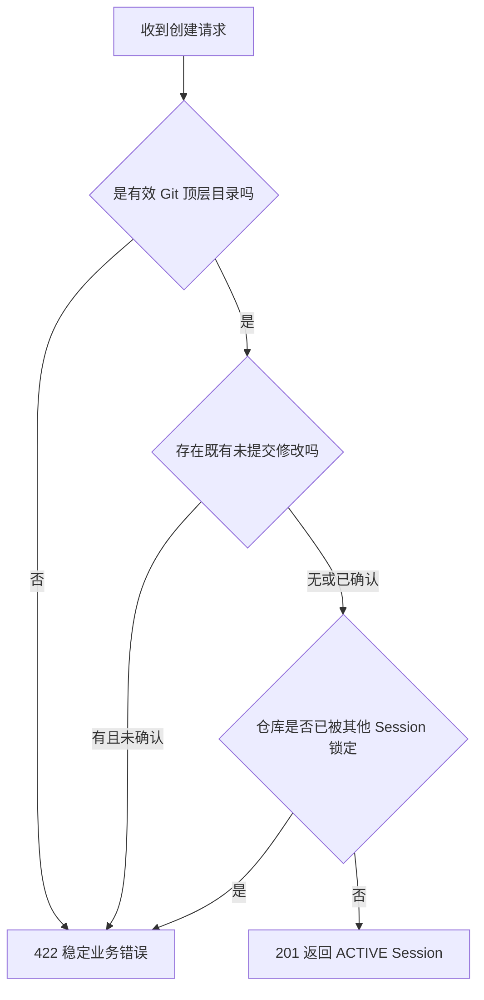
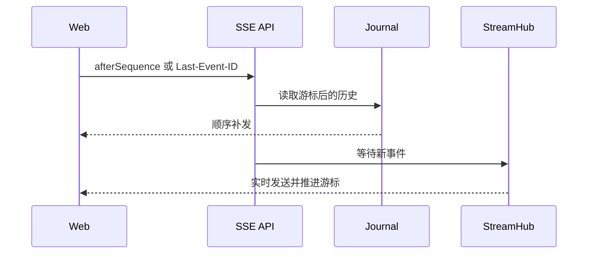

# Code Weave HTTP API

Control Plane 默认监听 `127.0.0.1:8080`。正式 Web 工作台只使用 Coding Session API；默认服务不暴露旧版 Worktree Run 接口。

## 1. 接口总览

| 方法 | 路径 | 用途 | 正式前端使用 |
|---|---|---|---|
| GET | `/api/v1/system/readiness` | 检查 Git、Java、Maven、Claude 和 runtime | 是 |
| POST | `/api/v1/coding-sessions` | 创建真实工作区 Session | 是 |
| GET | `/api/v1/coding-sessions?limit=20` | 查询最近 Session | 是 |
| GET | `/api/v1/coding-sessions/{sessionId}` | 查询 Session 详情 | 是 |
| POST | `/api/v1/coding-sessions/{sessionId}/turns` | 提交 Coding Turn | 是 |
| GET | `/api/v1/coding-sessions/{sessionId}/turns` | 查询多轮历史 | 是 |
| GET | `/api/v1/coding-sessions/{sessionId}/turns/{turnId}` | 查询单轮状态 | 是 |
| GET | `/api/v1/coding-sessions/{sessionId}/changes` | 查询相对活动审查基线的当前累计 Diff | 是 |
| GET | `/api/v1/coding-sessions/{sessionId}/turns/{turnId}/changes` | 兼容旧版按 Turn 查询累计 Diff | 否 |
| POST | `/api/v1/coding-sessions/{sessionId}/turns/{turnId}/cancel` | 停止当前 Turn | 是 |
| GET | `/api/v1/coding-sessions/{sessionId}/turns/{turnId}/stream` | 消费 Turn SSE | 是 |
| GET | `/api/v1/coding-sessions/{sessionId}/review-baseline-readiness` | 预览模块提交门禁 | 是 |
| POST | `/api/v1/coding-sessions/{sessionId}/review-baseline/advance` | 确认推进活动基线 | 是 |

已删除的旧 Session 接口：`/merge-readiness`、`/merge`、`/integration`。

## 2. 创建 Session

```http
POST /api/v1/coding-sessions
Content-Type: application/json
```

```json
{
  "title": "用户模块开发",
  "repository": "D:/personal_project/demo",
  "baseRef": "HEAD",
  "allowedPaths": ["src/**", "pom.xml"],
  "deniedPaths": [".git/**", "target/**"],
  "includeExistingChanges": false
}
```

| 字段 | 必填 | 说明 |
|---|---|---|
| `title` | 否 | 最长 120 字符；为空时使用仓库目录名 |
| `repository` | 是 | 本地 Git 顶层目录的绝对路径 |
| `baseRef` | 否 | 当前兼容字段，正式 Session 实际记录当前分支与 HEAD |
| `allowedPaths` | 是 | 至少一条允许修改规则 |
| `deniedPaths` | 是 | 可以为空数组，但字段不能缺失 |
| `includeExistingChanges` | 否 | 默认 false；仓库已有未提交修改时必须显式确认 |



## 3. 提交 Coding Turn

```http
POST /api/v1/coding-sessions/{sessionId}/turns
Content-Type: application/json
```

```json
{
  "prompt": "新增用户查询接口，并补充对应单元测试"
}
```

通常返回 `201 Created` 和已持久化的 `QUEUED` Turn。同一 Session 已有 `QUEUED` 或 `RUNNING` Turn 时返回 `409`。如果执行器在接收任务时拒绝，但失败 Turn 已可靠保存，响应仍携带该 Turn 身份和真实 `FAILED` 状态；状态无法确认时返回服务错误，前端不能把它当成“任务一定没有创建”而自动重试。

单 Turn 状态接口供页面终态确认与低频对账使用，不读取或返回完整历史正文：

```http
GET /api/v1/coding-sessions/{sessionId}/turns/{turnId}
```

运行中取消不会提前伪造 `CANCELLED`：

```http
POST /api/v1/coding-sessions/{sessionId}/turns/{turnId}/cancel
```

排队任务可直接保存为 `CANCELLED`；运行中任务先登记取消请求并返回当时的真实状态，只有执行资源确认清理后才由统一终态逻辑保存 `CANCELLED`。重复取消或完成后取消返回已有真实终态，不覆盖结果。

## 4. 查询当前累计代码变更

```http
GET /api/v1/coding-sessions/{sessionId}/changes
```

该接口返回真实工作区相对 `activeReviewBaselineCommit` 的当前累计变更，不表示某个 Turn 的不可变历史快照。用户手工修改、多个 Coding Turn 的修改，以及提交后尚未推进活动基线的修改，都会按当前工作区事实返回。

存在 `QUEUED` 或 `RUNNING` Turn 时返回 `409 TURN_NOT_FINISHED`，避免将执行中的混合状态描述为稳定快照。分支切换或当前 HEAD 不是活动基线后继提交时也会返回明确的 `409` 业务错误。

从读取 Session、检查活动 Turn、执行工作区读取门禁到完成 Git 采集，后端始终持有同一 Session 操作锁。这能阻止平台内部的 Turn 提交或基线推进穿透查询窗口；它不锁定操作系统文件，外部 IDE 修改仍由工作区指纹和后续验证负责发现。

响应不包含 `runId` 或 `turnId`：

```json
{
  "baseCommit": "abc123",
  "workspaceRoot": "D:/personal_project/demo",
  "totalFiles": 1,
  "unifiedDiffBytes": 128,
  "files": [
    {
      "path": "src/main/java/demo/App.java",
      "oldPath": null,
      "changeType": "MODIFIED",
      "binary": false
    }
  ],
  "unifiedDiff": "diff --git ..."
}
```

## 4. SSE 事件

```http
GET /api/v1/coding-sessions/{sessionId}/turns/{turnId}/stream?afterSequence=0
Accept: text/event-stream
```

客户端也可以使用 `Last-Event-ID`。服务端取两个游标的较大值，先补发历史，再发送实时事件；SSE 事件名固定为 `run-event`，`id` 是事件序号。

终态 SSE 是“可能需要确认状态”的通知，不是覆盖 Turn 状态的命令。前端收到终态通知后有限退避查询单 Turn；活动任务每五秒对账一次。查询失败显示连接或确认异常，不转换成 `FAILED/CANCELLED`，也不开放下一轮提交。



## 5. 查询与推进活动基线

先查询 readiness，获得服务端刚刚计算的事实：

```json
{
  "sessionId": "...",
  "ready": true,
  "activeBaselineCommit": "aaaaaaaa...",
  "currentHead": "bbbbbbbb...",
  "branch": "main",
  "changedFiles": 4,
  "workspaceFingerprint": "sha256:...",
  "blockers": []
}
```

再使用同一组事实确认：

```http
POST /api/v1/coding-sessions/{sessionId}/review-baseline/advance
Content-Type: application/json
```

```json
{
  "expectedActiveBaselineCommit": "aaaaaaaa...",
  "expectedHead": "bbbbbbbb...",
  "workspaceFingerprint": "sha256:..."
}
```

如果预览后 Git 状态发生变化，返回 `409 BASELINE_PREVIEW_EXPIRED`，客户端必须重新查询，不能盲目重试旧请求。

## 6. 统一错误结构

```json
{
  "timestamp": "2026-08-31T06:00:00Z",
  "status": 409,
  "code": "BASELINE_NOT_READY",
  "message": "当前提交不满足基线推进条件",
  "path": "/api/v1/coding-sessions/...",
  "runId": null,
  "fieldErrors": {}
}
```

| HTTP 状态 | 类别 | 典型场景 |
|---:|---|---|
| 400 | 请求格式或字段错误 | JSON 无法解析、路径参数非法 |
| 404 | 资源不存在 | Session、Turn 或旧 Run 不存在 |
| 409 | 当前事实冲突 | Turn 正在运行、基线预览过期 |
| 422 | Session 创建业务失败 | 仓库无效、已有修改未确认、仓库被占用 |
| 503 | 本机运行依赖不可用 | Claude、Git、Java 或 Maven 未就绪 |
| 500 | 未分类系统错误 | 诊断写服务日志，响应不泄露内部命令 |

## 7. 阶段与 Agent 事件协议

### 正式 Turn 新增的诊断与事件协议

单 Turn 状态及历史列表新增可选 `failedStage`、`failureKind`，旧记录可为 null；`failureCode` 也用于正常执行结束但业务门禁失败的结果。例如 `COMPLETED / VERIFICATION_FAILED` 可以携带 `maven / VERIFICATION / MAVEN_VERIFICATION_FAILED`。

SSE 外层信封不变。五阶段标识为 `workspace`、`coding`、`change-collection`、`change-policy`、`maven`，`attempt = 1`。新增 `STAGE_SKIPPED`，阶段载荷统一 `stageProtocolVersion = 1`，失败包含 `failureCode/failureKind/message`，跳过包含 `reasonCode/message`。

Agent 载荷使用 `agentProtocolVersion = 1`、`agentEventType`、`externalId`、原始字节大小和 SHA-256；超过 16 KiB 时只提供 `payloadPreview` 文本，不提供完整 `payload`。客户端不得解析预览为 JSON。历史字段兼容由客户端集中适配。

终态事件只是通知，客户端仍查询持久 Turn 确认最终状态。阶段完成不等于 Turn 成功；缺失阶段记录不能按终态补全。详细契约见 [ADR-0012](../decisions/0012-coding-stage-facts-and-agent-protocol.md)。

历史事件通过 `GET /api/v1/coding-sessions/{sessionId}/turns/{turnId}/events` 一次性读取，返回事件数组。该接口先校验 Session/Turn 身份，再读取已有日志，不等待终态通知、不补齐阶段、不作为定时轮询接口。前端仅在加载已结束 Turn 或确认终态后读取；失败可手动重试。

## 8. Legacy 接口

以下接口只在显式启用 Spring Profile `legacy-worktree-run` 时存在，用于早期链路回归，不应成为新页面或 Review Harness 的依赖：

| 方法 | 路径 |
|---|---|
| POST | `/api/v1/legacy/worktree-runs` |
| GET | `/api/v1/legacy/worktree-runs/{runId}` |
| GET | `/api/v1/legacy/worktree-runs/{runId}/events` |
| GET | `/api/v1/legacy/worktree-runs/{runId}/stream` |
| GET | `/api/v1/legacy/worktree-runs/{runId}/result` |
| GET | `/api/v1/legacy/worktree-runs/{runId}/changes` |

## 正常关闭持续会话

`POST /api/v1/coding-sessions/{sessionId}/close`，无请求体。200 返回完整 Session DTO，新增可选 `closedAt`，旧快照为空。

200 同时确认 CLOSED 已保存及目标仓库所有权释放。409：SESSION_NOT_CLOSABLE、TURN_IN_PROGRESS、SESSION_EXECUTION_BLOCKED 或历史错误；503：SESSION_CLOSE_STATE_WRITE_FAILED、SESSION_CLOSE_RELEASE_PENDING。超时可安全重试。CLOSED 查询结果不单独证明释放完成。

关闭不取消任务、不修改代码、不提交、不回滚。关闭后的 Session changes 与 Turn changes 兼容入口返回 409 SESSION_CLOSED；历史、事件和助手回复仍可读取。

## Harness Artifact 内部接口（批次 3）

以下为 Python Harness 的受内部 Bearer 认证接口，前缀 `/internal/v1`，不经过 Java 公共 API：

| 方法与路径 | 成功响应 |
|---|---|
| `GET /review-runs/{runId}/artifacts/{artifactId}` | 200，Artifact 元数据，无宿主路径 |
| `GET /review-runs/{runId}/artifacts/{artifactId}/content?cursor=opaque` | 200，UTF-8 text、摘要、coverage、redactionState、nextCursor、hasMore |

每页先完整验证内容大小和 SHA-256，整个 JSON 默认最多 32 KiB；Cursor 绑定 Run、Artifact、摘要及字节偏移，不能跨身份复用。跨 Run/未知材料统一 404 ARTIFACT_NOT_FOUND，伪造 Cursor 为 422 ARTIFACT_CURSOR_INVALID，损坏为 503 ARTIFACT_INTEGRITY_FAILED，二进制内容为 415 ARTIFACT_CONTENT_UNSUPPORTED，认证错误为 401。PARTIAL 到末页仍不代表来源完整。无 Artifact 创建 HTTP 或工具执行 HTTP 入口，发布与工具身份均由受信 Runtime 注入。

协议见 `contracts/schemas/review-artifact-metadata-v1.schema.json` 与 `review-artifact-content-page-v1.schema.json`；实现及资源失败边界见 [批次 3 交付](../review-harness-batch-3-development-handoff.md)。既有 Run/Event/Result v1 不变。

## Harness 图能力诊断（批次 4）

受内部Bearer认证的 `GET /internal/v1/graph-capabilities` 返回200：checkpoint为DISABLED/READY/NOT_READY，model为TEST_ONLY，productionGraphEnabled为false。Checkpoint表/列及写访问在查询时重新检查；默认模拟 `/health` READY不代表真实模型或图能力就绪。没有图执行、恢复、继承或完整Prompt读取HTTP入口。

显式注入的测试图运行失败时，Run Failure保留CONTEXT_/COMPACTION_/CHECKPOINT_稳定码；模型调用前最低锚点/完整请求超限、Manifest不完整/存储失败、引用Checkpoint未确认等拒绝调用。摘要失败保持旧有效视图且旧请求超预算时不能继续调用。实际任务清理未知仍按既有FAILED+UNCERTAIN门禁处理，终态及Result v1未扩展。详情见[批次4交付](../review-harness-batch-4-development-handoff.md)及ADR-0016。
