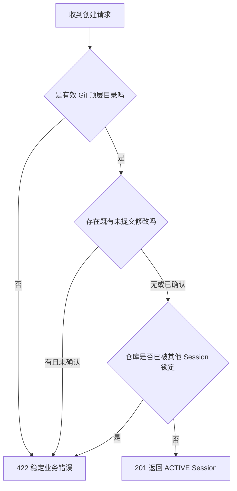
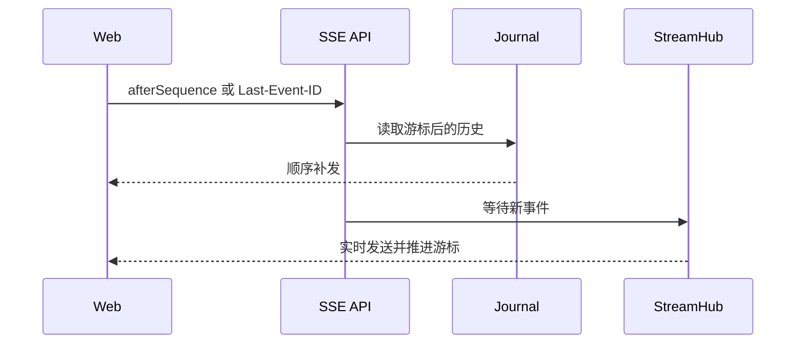

# Code Weave HTTP API

Control Plane 默认监听 `127.0.0.1:8080`。正式 Web 工作台只使用 Coding Session API；默认服务不暴露旧版 Worktree Run 接口。

## 1. 接口总览

| 方法 | 路径 | 用途 | 正式前端使用 |
|---|---|---|---|
| GET | `/api/v1/system/readiness` | 检查 Git、Java、Maven、Claude 和 runtime | 是 |
| POST | `/api/v1/coding-sessions` | 创建真实工作区 Session | 是 |
| GET | `/api/v1/coding-sessions?limit=20` | 查询最近 Session | 是 |
| GET | `/api/v1/coding-sessions/{sessionId}` | 查询 Session 详情 | 是 |
| POST | `/api/v1/coding-sessions/{sessionId}/turns` | 提交 Coding Turn | 是 |
| GET | `/api/v1/coding-sessions/{sessionId}/turns` | 查询多轮历史 | 是 |
| GET | `/api/v1/coding-sessions/{sessionId}/turns/{turnId}` | 查询单轮状态 | 是 |
| GET | `/api/v1/coding-sessions/{sessionId}/turns/{turnId}/changes` | 查询累计 Diff | 是 |
| POST | `/api/v1/coding-sessions/{sessionId}/turns/{turnId}/cancel` | 停止当前 Turn | 是 |
| GET | `/api/v1/coding-sessions/{sessionId}/turns/{turnId}/stream` | 消费 Turn SSE | 是 |
| GET | `/api/v1/coding-sessions/{sessionId}/review-baseline-readiness` | 预览模块提交门禁 | 是 |
| POST | `/api/v1/coding-sessions/{sessionId}/review-baseline/advance` | 确认推进活动基线 | 是 |

已删除的旧 Session 接口：`/merge-readiness`、`/merge`、`/integration`。

## 2. 创建 Session

```http
POST /api/v1/coding-sessions
Content-Type: application/json
```

```json
{
  "title": "用户模块开发",
  "repository": "D:/personal_project/demo",
  "baseRef": "HEAD",
  "allowedPaths": ["src/**", "pom.xml"],
  "deniedPaths": [".git/**", "target/**"],
  "includeExistingChanges": false
}
```

| 字段 | 必填 | 说明 |
|---|---|---|
| `title` | 否 | 最长 120 字符；为空时使用仓库目录名 |
| `repository` | 是 | 本地 Git 顶层目录的绝对路径 |
| `baseRef` | 否 | 当前兼容字段，正式 Session 实际记录当前分支与 HEAD |
| `allowedPaths` | 是 | 至少一条允许修改规则 |
| `deniedPaths` | 是 | 可以为空数组，但字段不能缺失 |
| `includeExistingChanges` | 否 | 默认 false；仓库已有未提交修改时必须显式确认 |



## 3. 提交 Coding Turn

```http
POST /api/v1/coding-sessions/{sessionId}/turns
Content-Type: application/json
```

```json
{
  "prompt": "新增用户查询接口，并补充对应单元测试"
}
```

成功返回 `201 Created` 和已持久化的 `QUEUED` Turn。同一 Session 已有 `QUEUED` 或 `RUNNING` Turn 时返回 `409`。

## 4. SSE 事件

```http
GET /api/v1/coding-sessions/{sessionId}/turns/{turnId}/stream?afterSequence=0
Accept: text/event-stream
```

客户端也可以使用 `Last-Event-ID`。服务端取两个游标的较大值，先补发历史，再发送实时事件；SSE 事件名固定为 `run-event`，`id` 是事件序号。



## 5. 查询与推进活动基线

先查询 readiness，获得服务端刚刚计算的事实：

```json
{
  "sessionId": "...",
  "ready": true,
  "activeBaselineCommit": "aaaaaaaa...",
  "currentHead": "bbbbbbbb...",
  "branch": "main",
  "changedFiles": 4,
  "workspaceFingerprint": "sha256:...",
  "blockers": []
}
```

再使用同一组事实确认：

```http
POST /api/v1/coding-sessions/{sessionId}/review-baseline/advance
Content-Type: application/json
```

```json
{
  "expectedActiveBaselineCommit": "aaaaaaaa...",
  "expectedHead": "bbbbbbbb...",
  "workspaceFingerprint": "sha256:..."
}
```

如果预览后 Git 状态发生变化，返回 `409 BASELINE_PREVIEW_EXPIRED`，客户端必须重新查询，不能盲目重试旧请求。

## 6. 统一错误结构

```json
{
  "timestamp": "2026-08-31T06:00:00Z",
  "status": 409,
  "code": "BASELINE_NOT_READY",
  "message": "当前提交不满足基线推进条件",
  "path": "/api/v1/coding-sessions/...",
  "runId": null,
  "fieldErrors": {}
}
```

| HTTP 状态 | 类别 | 典型场景 |
|---:|---|---|
| 400 | 请求格式或字段错误 | JSON 无法解析、路径参数非法 |
| 404 | 资源不存在 | Session、Turn 或旧 Run 不存在 |
| 409 | 当前事实冲突 | Turn 正在运行、基线预览过期 |
| 422 | Session 创建业务失败 | 仓库无效、已有修改未确认、仓库被占用 |
| 503 | 本机运行依赖不可用 | Claude、Git、Java 或 Maven 未就绪 |
| 500 | 未分类系统错误 | 诊断写服务日志，响应不泄露内部命令 |

## 7. 旧版 Worktree Run API

以下接口只在显式启用 Spring Profile `legacy-worktree-run` 时存在，用于早期链路回归，不应成为新页面或 Review Harness 的依赖：

| 方法 | 路径 |
|---|---|
| POST | `/api/v1/legacy/worktree-runs` |
| GET | `/api/v1/legacy/worktree-runs/{runId}` |
| GET | `/api/v1/legacy/worktree-runs/{runId}/events` |
| GET | `/api/v1/legacy/worktree-runs/{runId}/stream` |
| GET | `/api/v1/legacy/worktree-runs/{runId}/result` |
| GET | `/api/v1/legacy/worktree-runs/{runId}/changes` |
