# Code Weave 当前系统架构

> 本文只描述当前分支已经落地的事实。Review Harness 相关节点使用虚线或“下一阶段”标记，不代表已经实现。

## 1. WHY：系统要解决什么问题

普通 Coding Agent 擅长快速生成代码，但只依赖模型回复，很难持续回答三个工程问题：改了什么、代码是否真的可运行、一个模块何时可以安全结束。Code Weave 在保留 Claude Code 原生 Coding 能力的同时，把长期会话、Git 事实、独立验证和 Review 流程组织成可追溯闭环。

| 问题 | 只使用 CLI 对话 | Code Weave 当前能力 | 尚未完成 |
|---|---|---|---|
| 多轮上下文 | CLI 自己维护 | Session 持久化 Claude 原生会话 ID | 跨 Session 经验记忆 |
| 修改范围 | 用户手工看 Git | 平台采集 Diff 并检查路径策略 | 全语言语义级范围策略 |
| 可运行性 | 相信 Agent 描述或手工测试 | 平台独立执行 Maven | 更丰富的测试策略 |
| 过程可见性 | 终端原始输出 | 持久事件 + SSE + 五阶段投影 | Review 阶段投影 |
| 代码质量 | 依赖 Coding Agent 自检 | 尚未实现专精 Review | Review Harness 是下一阶段核心 |
| 模块完成 | 容易每轮都提交 | 活动基线支持模块级正式 Commit | Review 事实接入门禁 |

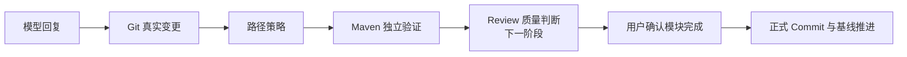

## 2. WHAT：当前系统由哪些部分组成

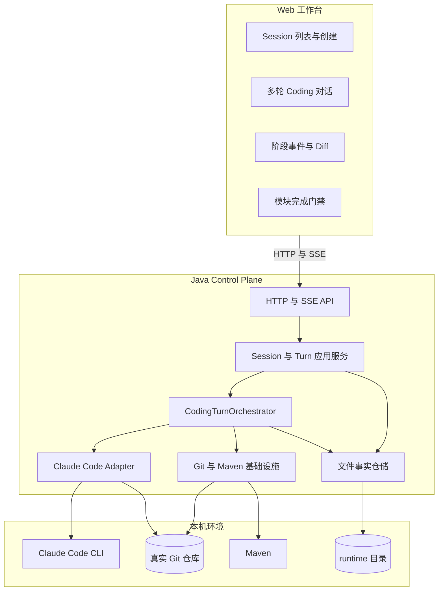

### 2.1 核心职责

| 类或模块 | 单一职责 | 不负责什么 |
|---|---|---|
| `CodingSessionApplicationService` | 检查仓库、获取仓库写锁、创建和查询 Session | 不执行 Coding Turn |
| `CodingTurnApplicationService` | Turn 排队、串行执行、停止、恢复和持久化 | 不实现 Claude 协议和 Maven 细节 |
| `CodingTurnOrchestratorImpl` | 按顺序组织 Claude、Diff、策略和 Maven | 不处理 HTTP，也不直接写前端状态 |
| `ClaudeCodeAdapter` | 构造 CLI 调用、解析 NDJSON、输出统一 AgentEvent | 不判断 Git Diff 或构建成功 |
| `SessionWorkspaceGuard` | 检查真实仓库分支与 HEAD 是否漂移 | 不修改或恢复 Git 状态 |
| `ReviewBaselineApplicationService` | 校验模块正式提交并推进活动基线 | 不自动 Commit、Push 或 Merge |
| `RunEventJournal` | 持久化运行事实并为 SSE 提供历史 | 不决定业务阶段 |
| React 工作台 | 将事实投影为用户可读的对话、阶段和 Diff | 不重新解释或改写后端事实 |

### 2.2 正式链路与历史链路

| 链路 | 工作区 | 前端入口 | 定位 |
|---|---|---|---|
| Coding Session | 用户真实 Git 仓库 | `/sessions` | 当前正式产品链路 |
| 旧版 Worktree Run | 每次创建隔离 Worktree | 无正式路由 | `legacy/worktreerun` 中的显式回归链路，默认不装配 |

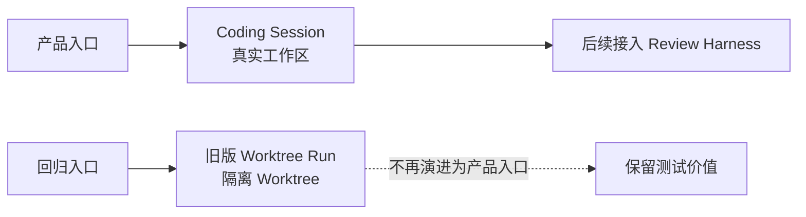

旧版 Worktree Run 采用物理目录与运行 Profile 双重隔离。正式代码可以复用共享基础设施，但禁止依赖 `legacy.worktreerun`；只有启用 `legacy-worktree-run` Profile 时才会创建旧版 API、编排器、Worktree 管理器和线程池。

## 3. HOW：核心数据模型

### 3.1 Session、Turn 与事件

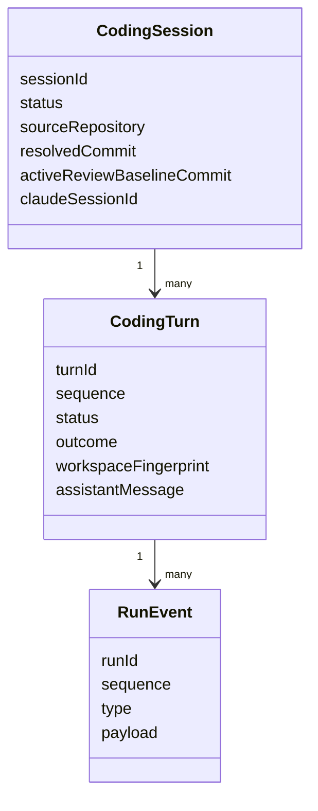

`CodingTurn.status` 表示执行生命周期，`outcome` 表示业务结论。两者分开是为了表达“流程正常结束但质量不通过”的场景。

| Status | 含义 | 典型 Outcome |
|---|---|---|
| `QUEUED` | 已持久化，等待执行 | 空 |
| `RUNNING` | 已占用 Session 执行权 | 空 |
| `COMPLETED` | 编排正常得到结论 | `NO_CHANGES`、`CHANGES_VERIFIED`、`VERIFICATION_FAILED`、`POLICY_VIOLATION` |
| `FAILED` | Agent 或系统执行失败 | `AGENT_FAILED`、`WORKSPACE_DRIFT` |
| `CANCELLED` | 取消请求已登记且执行资源确认清理 | 由取消消息说明 |
| `INTERRUPTED` | 服务重启时仍未得到可靠终态 | 启动恢复生成 |

### 3.2 两类 Git 基线

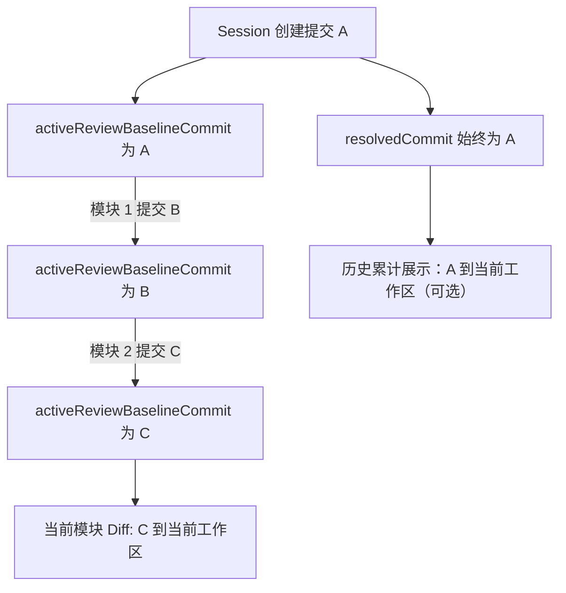

| 基线 | 为什么存在 | 如果只保留一个会怎样 |
|---|---|---|
| 初始基线 | 保留整个 Session 的累计成果 | 正式当前模块查询不使用它 |
| 活动审查基线 | 隔离当前模块的 Coding、Review 和验证范围 | 下一模块会重复审查旧修改 |

## 4. 完整运行链路

### 4.1 创建 Coding Session

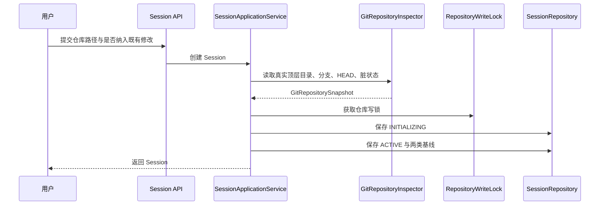

已有未提交修改默认阻止创建；用户可以显式选择纳入。本选择只决定 Session 创建是否继续，初始 Git 提交仍作为累计 Diff 基线。

### 4.2 执行一个 Coding Turn

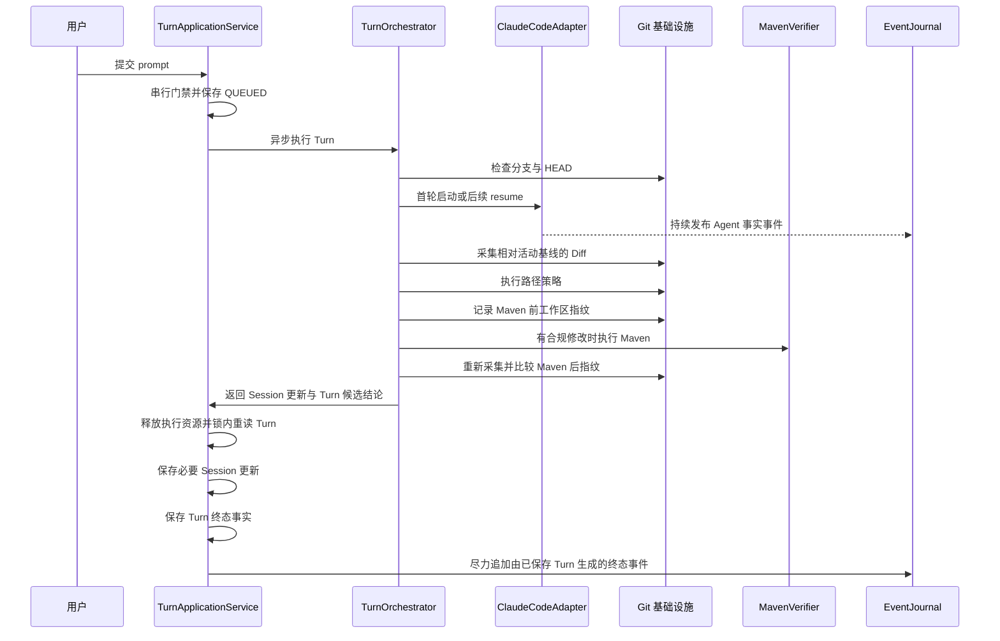

累计 Diff 查询、Turn 提交和活动审查基线推进共享同一 Session 进程内操作锁。查询会把 Session 读取、活动 Turn 检查、工作区门禁和 Git 采集作为一个互斥区间，防止平台内部并发请求返回混合状态；外部 IDE 不受该锁控制，仍通过最终状态指纹与验证前后指纹暴露漂移。

### 4.3 SSE 可观测链路

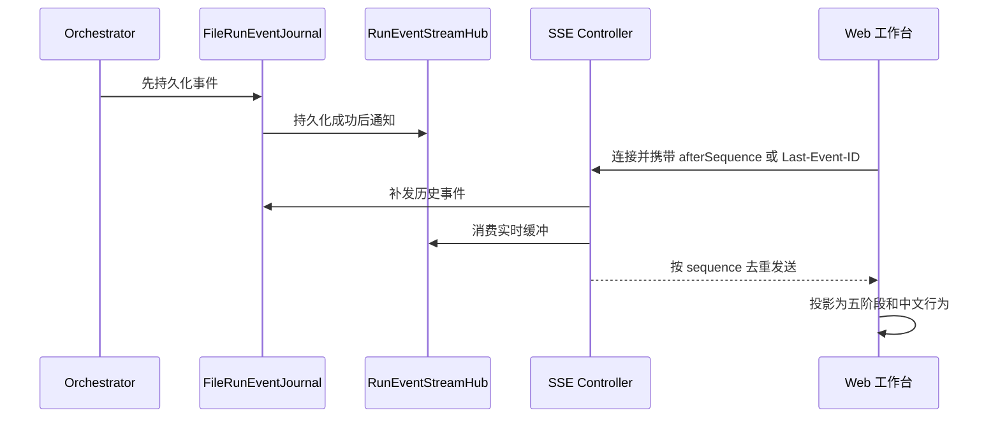

Turn 快照是当前状态事实源，事件日志是历史事实，SSE 只是实时传输。如果浏览器断开，重新连接后可根据序号恢复；SSE 失败不会反向导致 Coding Turn 失败。前端收到终态通知后查询单 Turn 状态确认，活动任务还会每五秒低频对账。

### 4.4 模块完成与基线推进

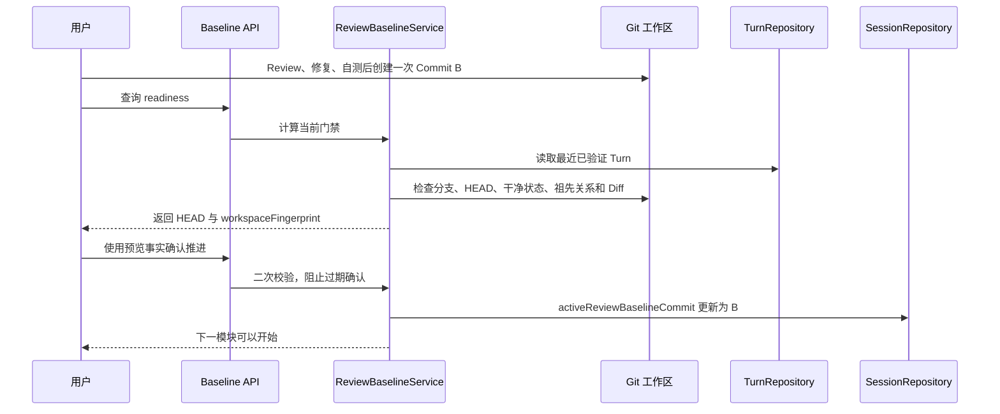

## 5. 持久化与恢复

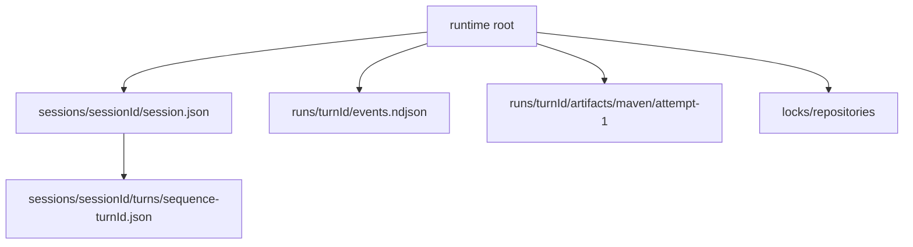

| 数据 | 策略 | 可靠性边界 |
|---|---|---|
| Session 快照 | schema v4、临时文件、刷盘、原子替换 | 单文件损坏不会阻止其他 Session 恢复 |
| Turn 快照 | schema v1、每轮独立 JSON | 单 Turn 可直接定位；启动时将 `QUEUED/RUNNING` 修正为 `INTERRUPTED` |
| 事件 | 追加 NDJSON、严格 sequence | 先持久化再实时发布 |
| Maven 产物 | 每个 Turn/attempt 独立目录 | 日志和 Surefire 汇总保留用于追溯 |
| 仓库锁 | runtime 锁文件 | 当前面向单机进程恢复，不是分布式锁 |

损坏 Turn 历史不会静默跳过：仓储区分数据损坏、版本不支持和暂时 I/O 故障，恢复服务只隔离受影响 Session，原文件保持原位。因历史损坏或进程清理不确定而失败的 Session 在第二次启动仍恢复仓库保护，避免同一仓库被新会话接管。

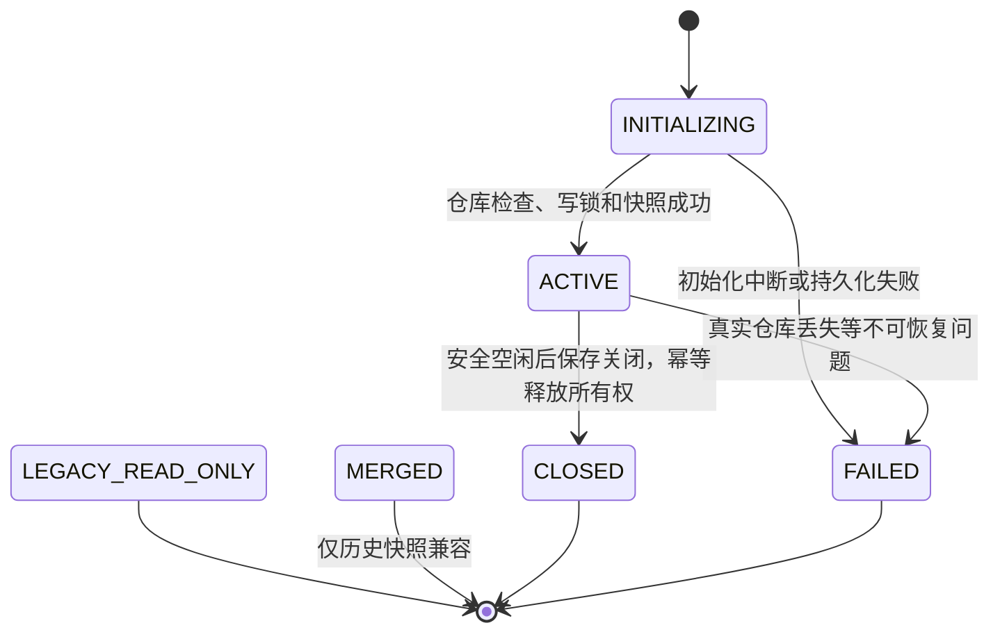

## 6. 设计取舍与技术债务

### 阶段事实与任务状态分离

正式链路现在由每 Turn 独立的 `CodingStageLifecycle` 记录工作区、Agent、采集、路径门禁、Maven 五阶段。编排器只返回带可选诊断的候选结果，应用层保持锁内裁决、持久化后通知；进程资源失败继续优先保护 Session。

前端 `eventProtocol` 统一读取历史和新版 Agent 载荷，`turnProjection` 只使用阶段事实；活动详情与阶段结果分离。历史缺证据与已终结但记录不完整均明确展示，不再根据 Agent 输出或 Turn 结果猜测阶段。共享 Mapper 由正式链路和 Legacy 单向依赖。详见 [ADR-0012](../decisions/0012-coding-stage-facts-and-agent-protocol.md)。

| 主题 | 当前选择 | 收益 | 代价或后续工作 |
|---|---|---|---|
| 工作区 | 直接操作真实仓库 | 避免 Worktree 合并冲突，符合本地 Agent 心智 | 必须严格执行分支、HEAD 和并发门禁 |
| 持久化 | JSON/NDJSON 文件 | 易检查、易恢复、适合单机 MVP | 组合查询与多实例能力弱 |
| 实时通道 | Spring MVC + SSE | 浏览器原生、单向事件足够 | 不适合客户端高频双向控制 |
| Agent 能力 | Claude Code 自主 Coding + 外层验证 | 保留模型能力，同时有确定事实 | 当前工具权限仍是受限 Profile |
| 验证 | Maven 独立执行 | 不采信 Agent 自报测试结果 | 当前只覆盖 Maven 项目 |
| Review | 独立 Python Harness | 可专注上下文、记忆和代码质量 | 尚未实现，是下一阶段核心 |

下一阶段不会重写 Coding 链路，而是在同一 Session、活动基线、事件基础设施和模块完成门禁上接入 Review Harness。

## Session 正常关闭

关闭服务使用与 Turn/基线相同的操作锁：安全门禁 → CLOSED 保存 → 所有者匹配释放。Turn 服务仅提供安全空闲断言，不暴露或清空执行保护集合。锁文件稳定保留，启动时补偿 CLOSED 残留所有权。详见 [ADR-0013](../decisions/0013-session-close-and-repository-release.md)。关闭不提供 Diff 快照，历史只读界面不再读取可变工作区 Diff。
