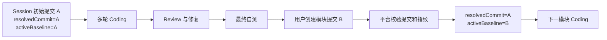
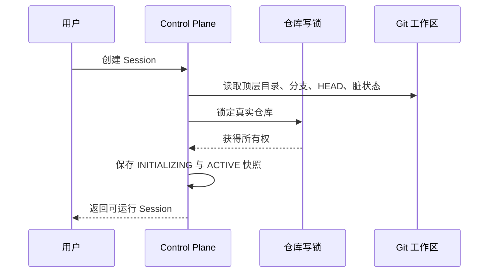

# ADR-0008：真实工作区与活动审查基线

- 状态：当前有效
- 日期：2026-08-31

## 背景：为什么替换长期 Worktree

长期 Worktree 能隔离 Agent 修改，但正式产品最终仍要把代码写回用户仓库。对个人开发者而言，这引入了额外的提交、Fast-forward、冲突处理和目录认知成本；同时 Coding 与 Review 实际审查的是平台副本，而不是用户正在使用的真实工作区。

| 方案 | 优点 | 主要问题 | 结论 |
|---|---|---|---|
| 每轮创建临时 Worktree | 隔离最强 | 无法承载持续上下文，提交非常碎 | 仅保留旧 M0 回归链路 |
| Session 长期拥有 Worktree | 可持续开发，保护原仓库 | 仍需要合并与冲突处理，目录模型复杂 | 已放弃 |
| Session 绑定真实仓库 | 与主流本地 Agent 一致，Git 操作自然 | 必须增加仓库锁和漂移门禁 | 正式方案 |

## 决策

正式 Coding Session 直接绑定用户选择的真实 Git 仓库。平台记录两个不同用途的提交：

| 字段 | 生命周期 | 用途 |
|---|---|---|
| `resolvedCommit` | Session 内永久不变 | 展示整个 Session 从创建以来的累计 Diff |
| `activeReviewBaselineCommit` | 每个模块完成后推进 | 新 Turn、Review 范围、路径门禁、Maven 验证和 HEAD 防漂移 |

## 工作区保护

直接修改真实仓库不代表取消工程边界：

1. 仓库级文件锁保证同一仓库只有一个活动 Session。
2. `SessionWorkspaceGuard` 在启动 Turn 前确认分支和 HEAD 仍等于活动基线。
3. 用户未提交修改可以参与 Coding，但用户自行切分支或创建提交后必须先处理基线。
4. Turn 提交与基线推进共享 Session 操作锁，避免同一时刻穿透两条写路径。
5. Git Diff、路径门禁和 Maven 结果仍由平台独立计算，不采信模型文本声明。

## 模块完成边界

Coding Turn 不等于 Git Commit。用户可以进行任意数量的 Coding、Review 和整改轮次，最后只创建一次模块级正式提交。平台不会自动 Commit、Push 或 Merge。

基线推进必须满足：

- Session 为 `ACTIVE` 且直接绑定真实仓库；
- 没有运行中的 Turn；
- 最近一轮 Coding 通过平台验证；
- 分支未变化，当前 HEAD 是活动基线的后继；
- 工作区干净且存在相对活动基线的变更；
- 当前变更指纹等于最近验证 Turn 的指纹；
- POST 确认时基线、HEAD 和指纹仍与预览一致。

Review Harness 接入后，还要在同一门禁上增加“Review 报告已由用户确认”和“整改后最终验证通过”的事实，不新建第二套模块完成流程。

## 兼容与删除策略

- schema v1–v3 Session 快照缺少活动基线时，读取时回退到 `resolvedCommit`。
- 旧 Worktree Session 被标记为 `LEGACY_READ_ONLY`，避免误当成真实工作区继续执行。
- 历史 `MERGED` 状态继续可读，但新代码不再生成该状态。
- 旧 Integration JSON 和 runtime Worktree 不自动删除，避免破坏用户历史数据。
- `/merge-readiness`、`/merge` 和 `/integration` 已从正式 API 删除。

## Trade-off

| 牺牲 | 收益 | 接受理由 |
|---|---|---|
| Agent 与用户共享一个工作区 | 不再需要复制、合并和处理平台分支 | 本项目面向本地个人开发，符合用户心智 |
| Session 期间限制切分支和擅自提交 | 能保证 Diff、验证和 Review 范围可靠 | 用户仍可在模块完成门禁中显式推进基线 |
| 暂时保留旧状态兼容代码 | 领域枚举不是最小集合 | 避免旧快照因升级无法读取 |

## 后续

Review Harness 使用当前活动基线到真实工作区的累计修改作为审查范围。Coding 与 Review 在 UI 中互斥，但共享同一 Session、真实仓库和模块边界。
