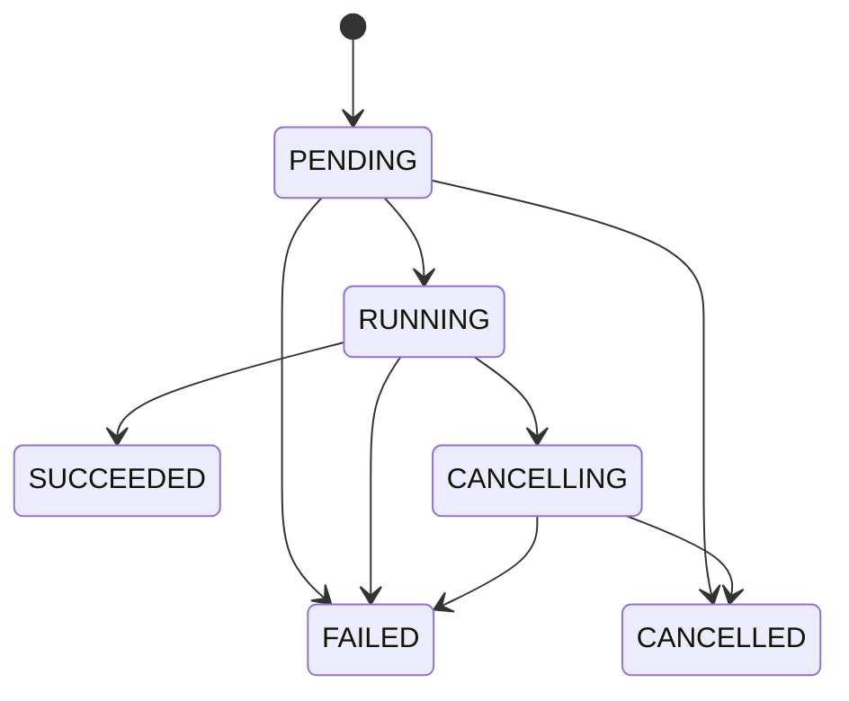
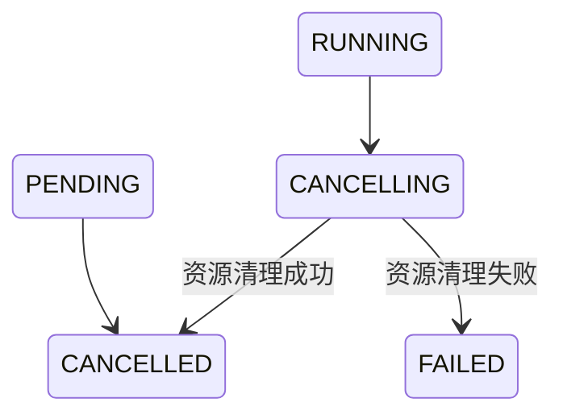

# ADR-0009：Review Harness 跨服务运行契约

- 状态：部分冻结，持续补充
- 范围：Java Control Plane 与 Python Review Harness 的内部通信契约
- 当前阶段：Review Harness 服务骨架与确定性模拟执行器

## 1. 背景

Code Weave 使用 Java Control Plane 承载产品 API、运行事实持久化和前端 SSE，使用独立的 Python Review Harness 承载后续 Review Agent。服务骨架阶段先验证两个服务之间的运行生命周期，不接入真实模型、LangGraph、LangChain、Tools、Skills、MCP 或记忆系统。

Python 服务采用 FastAPI 与 Uvicorn。它只向 Java 提供内部接口，不直接面向浏览器，也不主动回调 Java。

## 2. 已冻结的接口职责

Python 接口统一使用 `/internal/v1` 前缀：

```http
GET  /internal/v1/health
POST /internal/v1/review-runs
GET  /internal/v1/review-runs/{runId}
GET  /internal/v1/review-runs/{runId}/events
POST /internal/v1/review-runs/{runId}/cancel
```

| 接口 | 职责 |
|---|---|
| `GET /health` | 判断 Python 服务及其基础依赖是否可用 |
| `POST /review-runs` | 幂等创建一次 Review Agent 实际执行 |
| `GET /review-runs/{runId}` | 查询该次执行的真实状态 |
| `GET /review-runs/{runId}/events` | 向 Java 提供可恢复的 SSE 事件流 |
| `POST /review-runs/{runId}/cancel` | 请求终止执行并释放模型、工具和子进程资源 |

前端始终只调用 Java。Java 负责鉴权、业务门禁、运行持久化、事件投影和向浏览器统一转发 SSE。

## 3. Review Run 状态模型



| 状态 | 含义 |
|---|---|
| `PENDING` | Python 已接受请求，等待开始执行 |
| `RUNNING` | Agent 正在执行 |
| `CANCELLING` | 已收到取消请求，正在释放资源 |
| `SUCCEEDED` | 本次执行正常结束 |
| `FAILED` | 本次执行异常结束 |
| `CANCELLED` | 本次执行已取消并完成资源清理 |

`WAITING_USER` 不属于 Review Run 状态。一次 Run 只描述 Agent 的一次实际执行；输出报告后，该 Run 已经成功结束。用户后续继续交流时，由持续存在的 Review 对话创建新的 Run。

## 4. 身份与幂等

`runId` 由 Java Control Plane 生成，并同时作为幂等键：

```text
Java 生成 runId
→ Java 持久化 PENDING
→ Java 携带 runId 调用 Python
→ Python 创建或返回对应 Review Run
```

- 相同 `runId`、相同请求：返回已有 Run，不重复执行。
- 相同 `runId`、不同请求：返回 `409 Conflict`。
- 不额外增加 `idempotencyKey`，避免两个字段表达同一概念。

该规则用于处理“Python 已经创建 Run，但 Java 因网络问题没有收到响应”的场景。Java可以使用原 `runId` 安全重试。

## 5. 创建 Run 请求

```json
{
  "protocolVersion": "1.0",
  "runId": "07c1...",
  "codingSessionId": "session-123",
  "reviewThreadId": "review-thread-456",
  "workspace": {
    "repositoryPath": "D:\\projects\\demo",
    "activeReviewBaselineCommit": "a1b2c3d4..."
  },
  "input": {
    "message": "请审查当前模块的累计修改"
  }
}
```

| 字段 | 职责 |
|---|---|
| `protocolVersion` | 标识 Java/Python 跨服务协议版本 |
| `runId` | 标识一次实际执行并承担幂等职责 |
| `codingSessionId` | 关联 Code Weave 的整体 Coding Session |
| `reviewThreadId` | 关联持续 Review 对话和未来的 LangGraph Checkpoint |
| `repositoryPath` | 指向 Agent 可以调查的真实工作区 |
| `activeReviewBaselineCommit` | 标识当前模块累计审查的起点 |
| `message` | 表达用户本轮对 Review Agent 的要求 |

Java 不向 Python 拼装模型密钥、Tool/Skill/MCP 列表、Prompt 模板、Memory 内容或 Agent Loop 参数。这些内容属于 Review Harness 的内部能力，避免 Control Plane 侵入 Agent 核心实现。

首版不增加 `INITIAL_REVIEW`、`FOLLOW_UP` 等重复状态。Python 根据 `reviewThreadId` 是否已有上下文判断首次审查或继续交流。

仅使用 Commit 无法完整表达“排除 Session 创建前已有未提交修改”的工作区快照语义。该问题留到真正实现审查范围读取时专项设计，服务骨架阶段模拟执行器不提前制造不完整实现。

## 6. Run 状态响应

创建接口和状态查询接口复用以下轻量结构：

```json
{
  "protocolVersion": "1.0",
  "runId": "07c1...",
  "status": "RUNNING",
  "createdAt": "2026-08-31T10:00:00Z",
  "startedAt": "2026-08-31T10:00:01Z",
  "finishedAt": null,
  "lastEventSequence": 12
}
```

- 时间统一使用 UTC ISO-8601 格式。
- `lastEventSequence` 是该 Run 已生成的最大事件序号，用于判断遗漏和恢复 SSE。
- 状态接口不回传仓库路径和原始用户消息。
- Review 报告不塞入状态接口，后续由事件和报告资源承载。
- 失败详情的结构和对外边界尚未冻结。

## 7. HTTP 语义

| 场景 | HTTP 状态 | 语义 |
|---|---:|---|
| 首次成功接受异步 Run | `202 Accepted` | 已接受，但不表示执行完成 |
| 相同 `runId`、相同请求重试 | `200 OK` | 返回现有 Run，不重复执行 |
| 相同 `runId`、不同请求 | `409 Conflict` | 拒绝复用已被占用的运行身份 |
| 查询存在的 Run | `200 OK` | 返回当前真实状态 |
| 查询不存在的 Run | `404 Not Found` | 当前服务没有该 Run |

Java 不根据 `200/202` 判断 Run 是否完成，而是始终读取响应中的 `status`。

实现时应在 FastAPI 路由方法和 Java `ReviewHarnessClient` 对应方法上添加一句中文注释，说明 `202/200/409` 的业务语义；同时使用契约测试锁定这些规则，避免语义只存在于注释中。

## 8. SSE 事件信封与恢复规则

Python 使用统一的 SSE 事件信封：

```text
id: 12
event: review-run-event
data: {
  "protocolVersion": "1.0",
  "runId": "07c1...",
  "sequence": 12,
  "eventType": "RUN_STARTED",
  "occurredAt": "2026-08-31T10:00:01Z",
  "payload": {}
}
```

- `sequence` 在每个 Run 内从 `1` 开始严格递增。
- SSE 的 `id` 直接等于 `sequence`。
- `(runId, sequence)` 是跨服务事件的唯一键，Java 根据该组合去重。
- 未携带 `Last-Event-ID` 时，从第一个事件开始补发，然后进入实时流。
- 携带 `Last-Event-ID: N` 时，只补发 `sequence > N` 的事件，然后进入实时流。
- `payload` 始终是 JSON 对象，不使用 `null`。
- 心跳使用 SSE 注释 `: heartbeat`，不占用序号、不持久化，也不作为业务事件转发。
- 终态事件发送完成后，Python 关闭当前 SSE 连接。
- 如果连接在终态前中断，Java 使用最后已持久化的序号重新连接。

当前只冻结通用信封。具体 `eventType` 目录、各类型 Payload 和用户侧投影需要单独讨论。

## 9. 服务骨架阶段生命周期事件目录

服务骨架阶段只定义与 Review Run 生命周期直接对应的事件：

| 事件 | 状态变化 |
|---|---|
| `REVIEW_RUN_ACCEPTED` | 创建 `PENDING` |
| `REVIEW_RUN_STARTED` | `PENDING → RUNNING` |
| `REVIEW_RUN_CANCELLING` | `RUNNING → CANCELLING` |
| `REVIEW_RUN_SUCCEEDED` | `RUNNING → SUCCEEDED` |
| `REVIEW_RUN_FAILED` | `PENDING/RUNNING → FAILED` |
| `REVIEW_RUN_CANCELLED` | `PENDING/CANCELLING → CANCELLED` |

服务骨架阶段不增加笼统的 `PROGRESS`、`LOG`、`TOKEN` 或 `STDOUT` 事件，避免产生大量无法直接解释的用户侧事件。确定性模拟执行器只验证生命周期、事件顺序、断线补发和取消，不伪造尚未设计的 Review 行为。

LangGraph 阶段、Agent 调查、Tool 调用、证据发现和报告生成事件，必须等对应核心组件经过专项调研并冻结职责后再设计。

## 10. 取消语义与竞态



`CANCELLED` 只表示取消完成且资源清理成功。如果模型调用、工具或子进程未能释放，Run 必须进入 `FAILED`，不能用 `CANCELLED` 隐藏清理失败。

状态转换必须原子执行：

- 取消先获得状态转换权时，Run 进入 `CANCELLING`，执行器之后不得再写入 `SUCCEEDED`。
- 执行完成先获得状态转换权时，保持 `SUCCEEDED` 或 `FAILED`，后到的取消不得覆盖真实终态。
- 每个 Run 最多产生一个终态事件。
- 取消从当前 Tool 或子进程开始，逐层退出 Agent Loop，最后结束 Run Supervisor。

取消接口暂时不接收请求体。用户身份、取消原因和用户侧提示由 Java 持久化；Python 只负责停止执行和释放资源。

| 当前状态 | HTTP 响应 | 结果 |
|---|---:|---|
| `PENDING` | `200 OK` | 直接进入 `CANCELLED` |
| `RUNNING` | `202 Accepted` | 原子进入 `CANCELLING` 并异步清理 |
| `CANCELLING` | `200 OK` | 幂等返回当前状态 |
| `CANCELLED` | `200 OK` | 幂等返回当前状态 |
| `SUCCEEDED/FAILED` | `200 OK` | 不覆盖终态，返回真实状态 |
| Run 不存在 | `404 Not Found` | 不创建或推断 Run |

已经结束的 Run 不返回 `409 Conflict`，因为执行完成与用户取消之间存在正常竞态。Java 必须读取响应体中的真实状态。

实现时需要使用并发测试验证“完成与取消只能有一个终态”，不能只覆盖顺序调用。

## 11. 失败协议

### 11.1 同步 HTTP 失败

请求尚未成功创建或定位 Run 时，Python 使用 RFC 9457 Problem Details：

```json
{
  "type": "urn:code-weave:problem:review-run-conflict",
  "title": "Review Run 请求冲突",
  "status": 409,
  "detail": "相同 runId 已对应另一份创建请求",
  "instance": "/internal/v1/review-runs/07c1...",
  "errorCode": "REVIEW_RUN_CONFLICT",
  "diagnosticId": "diag-123"
}
```

| HTTP 状态 | `errorCode` |
|---:|---|
| `400 Bad Request` | `PROTOCOL_VERSION_UNSUPPORTED` |
| `404 Not Found` | `REVIEW_RUN_NOT_FOUND` |
| `409 Conflict` | `REVIEW_RUN_CONFLICT` |
| `422 Unprocessable Content` | `REQUEST_VALIDATION_FAILED` |
| `503 Service Unavailable` | `REVIEW_HARNESS_NOT_READY` |
| `500 Internal Server Error` | `REVIEW_HARNESS_INTERNAL_ERROR` |

FastAPI 默认的 `422` 响应也必须转换为统一 Problem Details，不能形成第二套错误格式。同步失败不伪造 Python 生命周期事件，因为 Python 可能没有创建该 Run。Java 将调用失败记录为自身的集成失败事实。

### 11.2 异步执行失败

创建接口返回 `202 Accepted` 后发生的失败，通过 Run 状态和事件表达：

```text
Run → FAILED
→ 追加 REVIEW_RUN_FAILED
→ Java 消费并持久化
→ GET 状态可以查询 failure
```

```json
{
  "status": "FAILED",
  "finishedAt": "2026-08-31T10:03:00Z",
  "failure": {
    "code": "REVIEW_EXECUTION_FAILED",
    "message": "Review 执行器未能完成本次运行",
    "diagnosticId": "diag-456"
  }
}
```

服务骨架阶段只定义以下异步失败码：

- `REVIEW_EXECUTION_FAILED`
- `REVIEW_CANCELLATION_FAILED`
- `REVIEW_HARNESS_INTERNAL_ERROR`

模型、Tool、工作区、预算和上下文失败码，等对应核心组件经过专项设计后再扩展。

- `code` 供 Java 判断和映射。
- `message` 必须准确、可读，但不能包含密钥、完整 Prompt 或堆栈。
- `diagnosticId` 用于关联 Python 结构化日志，完整异常链只保留在日志中。
- `REVIEW_RUN_FAILED.payload` 与状态接口复用同一个 `failure` 结构。
- Java 不自动重跑已经接受的 Review Run，避免重复模型调用和副作用；用户可以发起新的 Run。

## 12. 持久化职责分层

Code Weave 不使用一个存储同时承载产品历史、执行状态、Agent 内部进度和长期经验。四个层级按业务职责分离：

| 层级 | 持久化的业务内容 | 不负责的内容 |
|---|---|---|
| Java Control Plane | 用户工作历史，包括 Coding Session、Review Thread、对话、用户确认的 Review 报告、报告交接记录和前端业务状态 | 不保存 LangGraph 节点内部状态 |
| Python Review Harness | 一次 Review Run 的真实执行事实，包括幂等身份、运行/取消/终态、生命周期事件和失败信息 | 不作为用户长期工作历史的唯一来源 |
| LangGraph Checkpoint | Review Agent 内部工作进度，包括当前节点、Graph State、已收集证据和中断恢复位置 | 不代替 Run 状态、SSE 事件历史和用户确认报告 |
| Memory | 跨 Run 保留的项目经验和全局通用经验，并按项目隔离项目专属知识 | 不记录某次 Run 的实时状态或工作流节点 |

Python 执行层与 LangGraph 状态层是外层任务管理和内层 Agent 工作进度的关系：

```text
Python 创建并管理 Review Run
→ 启动或恢复 LangGraph
→ LangGraph 保存 Agent 内部执行位置
→ LangGraph 返回执行结果
→ Python 将 Run 原子更新为成功、失败或取消
```

- Python 执行层回答“任务是否被接受、是否仍在运行、最终结果是什么”。
- LangGraph 状态层回答“Agent 正在调查什么、已经获得什么、恢复后从哪里继续”。
- Python 决定一个中断 Run 是否允许恢复；只有允许恢复时，LangGraph Checkpoint 才提供恢复位置。
- 服务骨架阶段只实现 Java 业务层与 Python 执行层。LangGraph Checkpoint 在接入真实 Review Workflow 时引入，Memory 在长期经验模块开发时引入。
- SSE Hub、内存队列和 Stream Bridge 只负责实时传输已经形成的事实，不属于持久化事实源。

## 13. Python 执行事实物理存储选型

Python Review Harness 的执行事实使用单文件 SQLite 持久化，通过 SQLAlchemy 2.x Async 访问，并由 Alembic 管理数据库结构版本。

冻结以下实现边界：

- SQLite 保存 Review Run 与对应的生命周期事件，服务重启后不得丢失已经接受的运行身份和已提交事件。
- 服务骨架阶段采用单进程、单 Uvicorn Worker，避免把 SQLite 用于未经设计的多进程并发写入。
- SQLite 开启 WAL 模式，使 SSE 历史读取与 Run 状态写入可以合理并行。
- Java Control Plane 和 Python Review Harness 各自管理自己的数据库，不共享表，也不跨数据库执行事务。
- 后续 LangGraph Checkpoint 使用框架自己的 Checkpointer 和独立存储边界，不写入 Review Run/Event 业务表。
- 内存 Hub 只负责在新事件提交后唤醒 SSE 订阅者，不保存事件历史，也不作为断线补发来源。
- 服务骨架阶段不引入 Redis 和 PostgreSQL；出现多 Worker、多进程或多节点部署需求时，再切换 PostgreSQL，并重新设计跨进程实时通知。
- 不使用 JSON 文件替代 SQLite，因为幂等创建、状态竞态、事件序号和状态/事件原子提交需要可靠事务与唯一约束。

该决策只冻结技术选型和部署边界。表结构、索引、事务操作及重启恢复规则仍需分别讨论。

## 14. Python 执行事实 Run/Event 表结构

服务骨架阶段使用两张表分别保存 Review Run 当前执行快照和仅追加的生命周期历史：

### 14.1 `review_runs`

| 字段 | 业务含义 |
|---|---|
| `run_id` | 主键，由 Java 生成，同时承担幂等身份职责 |
| `protocol_version` | 创建该 Run 时使用的跨服务协议版本 |
| `request_fingerprint` | 规范化创建请求的摘要，用于区分幂等重试和 ID 冲突 |
| `request_payload` | Python 恢复和核验本次执行所需的规范化结构化请求，不通过状态接口返回 |
| `coding_session_id` | 所属 Coding Session |
| `review_thread_id` | 所属持续 Review 对话 |
| `status` | Review Run 当前状态 |
| `created_at` | Python 接受 Run 的 UTC 时间 |
| `started_at` | 实际开始执行的 UTC 时间，未开始时为空 |
| `finished_at` | 进入终态的 UTC 时间，未结束时为空 |
| `last_event_sequence` | 已提交的最大事件序号，初始为 `0` |
| `failure_code` | 异步失败码，仅失败时存在 |
| `failure_message` | 可安全向上游返回的失败说明，仅失败时存在 |
| `diagnostic_id` | 关联 Python 结构化日志的诊断标识，仅失败时存在 |

`request_payload` 用于服务重启后的执行识别和恢复判断，也用于精确验证相同 `runId` 是否对应同一请求。`request_fingerprint` 不设置全局唯一约束：不同 `runId` 可以合法提交内容相同的新任务。

### 14.2 `review_run_events`

| 字段 | 业务含义 |
|---|---|
| `run_id` | 所属 Review Run，外键指向 `review_runs.run_id` |
| `sequence` | Run 内从 `1` 开始严格递增的事件序号 |
| `event_type` | 生命周期事件类型 |
| `occurred_at` | 事件形成的 UTC 时间 |
| `payload` | 事件的结构化 JSON 对象 |

`review_run_events` 使用 `(run_id, sequence)` 联合主键，不增加没有当前消费者的全局事件 ID。该联合主键同时服务于事件唯一性、Java 幂等消费和 `Last-Event-ID` 补发查询。

### 14.3 数据不变量与索引

- `review_runs` 是当前状态快照，`review_run_events` 是仅追加历史；已有事件不得修改或覆盖。
- `sequence` 必须大于 `0`，`last_event_sequence` 必须大于等于 `0`。
- 状态只能使用已冻结的 Review Run 状态枚举。
- 终态必须具有 `finished_at`；`FAILED` 必须具有失败信息，其他状态不得携带失败信息。
- 状态更新、`last_event_sequence` 递增和对应事件插入必须在同一数据库事务提交。
- 服务骨架阶段除主键索引外，只为 `review_runs.status` 建立启动恢复扫描索引，不为当前不存在的 Session、Thread 或时间查询提前增加索引。
- 复杂的跨字段业务不变量由领域代码和测试共同保证，不强行全部编码为难以演进的 SQLite `CHECK`。

这两张表不保存 LangGraph Graph State、Tool 完整历史、Evidence、Finding、ReviewReport、Memory、前端中文投影、完整异常堆栈、Token 增量或 SSE 心跳。

## 15. Run 事务操作与并发竞争

所有 Review Run 状态变化必须通过具有明确业务语义的 RunStore 原子操作完成。应用层和执行器不得直接修改 ORM 模型，也不提供可绕过状态机的通用 `update_run`。

服务骨架阶段至少定义以下持久化操作：

| 操作 | 允许的原状态 | 目标状态 |
|---|---|---|
| 创建 Run | 不存在 | `PENDING` |
| 启动 Run | `PENDING` | `RUNNING` |
| 取消未启动 Run | `PENDING` | `CANCELLED` |
| 请求取消运行中 Run | `RUNNING` | `CANCELLING` |
| 完成取消 | `CANCELLING` | `CANCELLED` |
| 执行成功 | `RUNNING` | `SUCCEEDED` |
| 执行失败 | `PENDING/RUNNING` | `FAILED` |
| 取消清理失败 | `CANCELLING` | `FAILED` |

### 15.1 幂等创建

首次创建必须在一个事务内插入 `PENDING` Run 和 `sequence=1` 的 `REVIEW_RUN_ACCEPTED`。相同 `runId` 再次到达时：

- 请求指纹和规范化请求均相同：返回已有 Run，不追加第二个接受事件，也不重复启动执行器。
- 请求不同：返回 `409 Conflict`。
- 指纹仅用于快速比较，最终仍比较规范化请求本身，避免把理论上的哈希碰撞视为同一请求。

任一写入失败时整个事务回滚，不允许形成只有 Run 或只有接受事件的半成品。

### 15.2 条件状态转换

状态转换采用“目标 Run 仍处于允许原状态”作为数据库更新条件，不采用先读状态、再无条件更新的内存竞争方式。更新成功时在同一事务内：

1. 写入目标状态及对应时间、失败信息；
2. 将 `last_event_sequence` 原子加一；
3. 使用更新后的序号插入对应生命周期事件；
4. 提交事务。

事件序号不得通过查询 `MAX(sequence)` 分配。若事件插入或事务提交失败，状态更新和序号递增必须一并回滚。

### 15.3 完成与取消竞争

当 Run 处于 `RUNNING` 时，执行成功尝试 `RUNNING → SUCCEEDED`，取消请求尝试 `RUNNING → CANCELLING`。二者通过原状态条件竞争，只有一方能够成功：

- 取消先获得转换权：后到的成功操作不得写入成功状态或成功事件。
- 成功先获得转换权：后到的取消返回真实终态，不覆盖成功，也不追加取消事件。
- 执行失败和取消清理失败使用不同操作及不同允许原状态，不提供可从任意状态写入 `FAILED` 的通用入口。
- 每个 Run 最多产生一个终态事件。

### 15.4 重复操作与实时通知

重复命令发现 Run 已经处于目标状态或终态时，幂等返回当前快照，不重复追加事件。发现其他不兼容状态时，由应用层根据调用语义返回真实状态或错误，但不得强行覆盖。

数据库事务提交成功后才通知内存 SSE Hub。Hub 只表示“可能有新事件”，SSE 必须重新查询持久事件；Hub 通知失败不得回滚已经提交的执行事实。

## 16. 尚未冻结

- 生命周期事件的 Payload 与用户侧投影。
- Java“先持久化再转发”的具体落地方式。
- Python 服务重启后的未完成 Run 恢复策略。
- 健康检查的响应字段和就绪判定。
