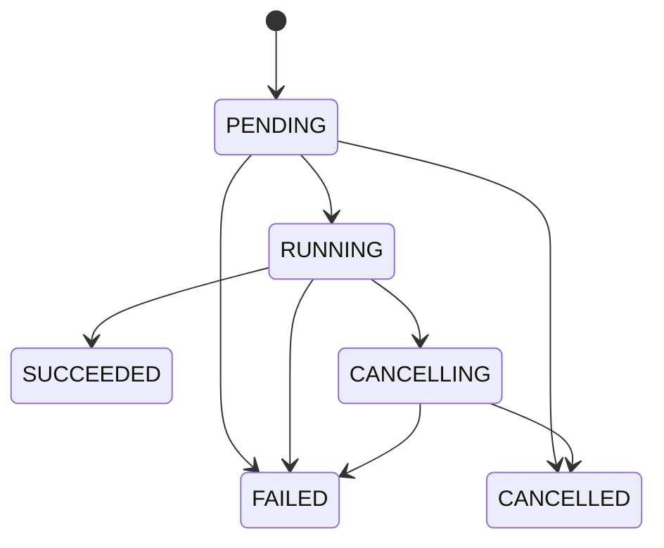
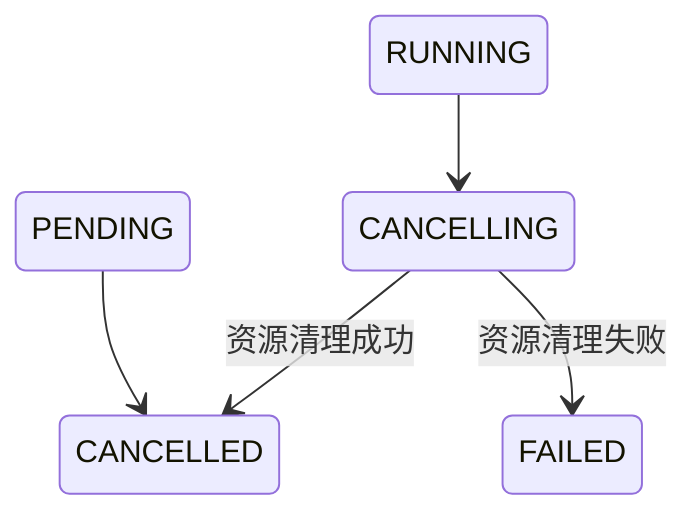

# ADR-0009：Review Harness 跨服务运行契约

- 状态：已冻结；Python 批次 1 Runtime 已实现，待独立审查；Java 集成尚未实现
- 范围：Java Control Plane 与 Python Review Harness 的内部通信契约
- 实施阶段：Review Harness 服务骨架与确定性模拟执行器已落地；见 `services/review-harness/DEVELOPMENT-HANDOFF.md`
- 最近核对：2026-10-09，完成批次 1 字段级协议、SQLite 列、事件 Payload 与排队/恢复边界审定；Snapshot 输入遵循 ADR-0014，Context/Artifact/Evidence 遵循 ADR-0015

## 1. 背景

Code Weave 使用 Java Control Plane 承载产品 API、运行事实持久化和前端 SSE，使用独立的 Python Review Harness 承载后续 Review Agent。服务骨架阶段先验证两个服务之间的运行生命周期，不接入真实模型、LangGraph、LangChain、Tools、Skills、MCP 或记忆系统。

Python 服务采用 FastAPI 与 Uvicorn。它只向 Java 提供内部接口，不直接面向浏览器，也不主动回调 Java。

本文冻结跨服务契约。Python 服务、Run/Event/Result 表与模拟生命周期已在批次 1 落地，Java Review 集成尚未实现。当前正式 Coding 使用单 Control Plane 进程、Session/Turn 文件快照与事件日志；Python 的 SQLite 选型不意味着 Java 已迁移数据库。

## 2. 已冻结的接口职责

Python 接口统一使用 `/internal/v1` 前缀：

```http
GET  /internal/v1/health
POST /internal/v1/review-runs
GET  /internal/v1/review-runs/{runId}
GET  /internal/v1/review-runs/{runId}/events
GET  /internal/v1/review-runs/{runId}/result
GET  /internal/v1/review-runs/{runId}/artifacts/{artifactId}
GET  /internal/v1/review-runs/{runId}/artifacts/{artifactId}/content?cursor=opaque
POST /internal/v1/review-runs/{runId}/cancel
```

| 接口 | 职责 |
|---|---|
| `GET /health` | 返回 Readiness，判断是否可以接受新 Run |
| `POST /review-runs` | 幂等创建一次 Review Agent 实际执行 |
| `GET /review-runs/{runId}` | 查询该次执行的真实状态 |
| `GET /review-runs/{runId}/events` | 向 Java 提供可恢复的 SSE 事件流 |
| `GET /review-runs/{runId}/result` | 返回成功 Run 的不可变 Result 原始字节 |
| `GET /review-runs/{runId}/artifacts/{artifactId}` | 返回受控 Artifact 元数据；在 Artifact 批次实现 |
| `GET /review-runs/{runId}/artifacts/{artifactId}/content` | 按服务端 Cursor 有界读取文本内容；在 Artifact 批次实现 |
| `POST /review-runs/{runId}/cancel` | 请求终止执行并释放模型、工具和子进程资源 |

前端始终只调用 Java。Java 负责鉴权、业务门禁、运行持久化、事件投影和向浏览器统一转发 SSE。

批次 1 的机器可读 Wire Contract 位于 [`contracts/schemas`](../../contracts/schemas/README.md)。DTO、事件和契约测试必须遵循这些 Schema；Schema 无法表达的字节上限、时间顺序、身份一致性和事务不变量继续由本文及应用测试约束。

## 3. Review Run 状态模型



| 状态 | 含义 |
|---|---|
| `PENDING` | Python 已接受请求，等待开始执行 |
| `RUNNING` | Agent 正在执行 |
| `CANCELLING` | 已收到取消请求，正在释放资源 |
| `SUCCEEDED` | 本次执行正常结束 |
| `FAILED` | 本次执行异常结束 |
| `CANCELLED` | 本次执行已取消并完成资源清理 |

`WAITING_USER` 不属于 Review Run 状态。一次 Run 只描述 Agent 的一次实际执行；输出报告后，该 Run 已经成功结束。用户后续继续交流时，由持续存在的 Review 对话创建新的 Run。

Run 状态只回答执行结果，不回答资源是否安全。每个 Run 同时保存独立 `resourceState`：

| 状态 | 含义 |
|---|---|
| `NOT_ACQUIRED` | 执行体从未获得运行权 |
| `ACTIVE` | 可能持有模型、工具或进程资源 |
| `RELEASING` | 正在取消或清理 |
| `RELEASED` | 已确认本 Run 的本地资源收敛 |
| `UNCERTAIN` | 重启或清理失败后无法证明资源释放 |

只有 `terminal(status) && resourceState in [NOT_ACQUIRED, RELEASED]` 才能解除执行资源门禁。`FAILED + UNCERTAIN` 可在取得可靠证据后单调变为 `FAILED + RELEASED` 并追加 `REVIEW_RUN_RESOURCES_RELEASED`；Run 终态不改变。

## 4. 身份与幂等

`runId` 由 Java Control Plane 生成，并同时作为幂等键：

```text
Java 生成 runId
→ Java 持久化 PENDING
→ Java 携带 runId 调用 Python
→ Python 创建或返回对应 Review Run
```

- 相同 `runId`、相同请求：返回已有 Run，不重复执行。
- 相同 `runId`、不同请求：返回 `409 Conflict`。
- 不额外增加 `idempotencyKey`，避免两个字段表达同一概念。

该规则用于处理“Python 已经创建 Run，但 Java 因网络问题没有收到响应”的场景。Java可以使用原 `runId` 安全重试。

## 5. 创建 Run 请求

```json
{
  "protocolVersion": "1.0",
  "runId": "07c1...",
  "codingSessionId": "session-123",
  "reviewThreadId": "review-thread-456",
  "snapshot": {
    "snapshotId": "snapshot-123",
    "manifestSha256": "sha256:value"
  },
  "input": {
    "message": "请审查当前模块的累计修改"
  }
}
```

| 字段 | 职责 |
|---|---|
| `protocolVersion` | 标识 Java/Python 跨服务协议版本 |
| `runId` | 标识一次实际执行并承担幂等职责 |
| `codingSessionId` | 关联 Code Weave 的整体 Coding Session |
| `reviewThreadId` | 关联持续 Review 对话和未来的 LangGraph Checkpoint |
| `snapshotId` | 指向 Java 已发布的不可变 Review Snapshot |
| `manifestSha256` | 固定并校验跨服务读取的 Manifest 原始字节 |
| `message` | 表达用户本轮对 Review Agent 的要求 |

Java 不向 Python 拼装模型密钥、Tool/Skill/MCP 列表、Prompt 模板、Memory 内容或 Agent Loop 参数。这些内容属于 Review Harness 的内部能力，避免 Control Plane 侵入 Agent 核心实现。

首版不增加 `INITIAL_REVIEW`、`FOLLOW_UP` 等重复状态。Python 根据 `reviewThreadId` 是否已有上下文判断首次审查或继续交流。

真实 Review 不接收 `repositoryPath`、`snapshotRoot` 或重复的 baseline/fingerprint。Java 按 ADR-0014 在 Session 操作锁内捕获并发布 Snapshot；Python 只使用自身配置的受管根和 `snapshotId + manifestSha256` 定位、校验。服务骨架的确定性模拟器也使用同一请求 Envelope，允许以测试 Snapshot Fixture 验证协议，但不得重新引入可变仓库路径。

## 6. Run 状态响应

创建接口和状态查询接口复用以下轻量结构：

```json
{
  "protocolVersion": "1.0",
  "runId": "07c1...",
  "status": "RUNNING",
  "resourceState": "ACTIVE",
  "createdAt": "2026-08-31T10:00:00Z",
  "startedAt": "2026-08-31T10:00:01Z",
  "finishedAt": null,
  "updatedAt": "2026-08-31T10:00:01Z",
  "lastEventSequence": 12,
  "result": null,
  "failure": null,
  "recoveryCode": null
}
```

- 时间统一使用 UTC ISO-8601 格式。
- `lastEventSequence` 是该 Run 已提交的最大事件序号，不包含内存中尚未提交的事件，用于判断遗漏和恢复 SSE。
- 状态接口不回传仓库路径和原始用户消息。
- `result` 只在 `SUCCEEDED` 时包含 `resultId/resultVersion/resultSha256`；`failure` 只在 `FAILED` 时存在。
- 完整 Review Result 不塞入状态接口，由 Result 资源承载。
- 服务骨架的失败详情已在第 11 节冻结；模型、Tool 等核心组件的细分失败协议仍待专项设计。

批次 1 的线路格式进一步冻结为：规范小写 UUID；UTC 时间固定六位微秒和 `Z`；SHA-256 使用 `sha256:` 加 64 位小写十六进制；JSON 拒绝未知字段。创建请求最大 64 KiB，`input.message` 最大 32 KiB 且必须包含非空白字符。经过验证的规范请求使用稳定排序、无多余空白、UTF-8、非 ASCII 不转义的 JSON 字节计算请求指纹。

## 7. HTTP 语义

| 场景 | HTTP 状态 | 语义 |
|---|---:|---|
| 首次成功接受异步 Run | `202 Accepted` | 已接受，但不表示执行完成 |
| 相同 `runId`、相同请求重试 | `200 OK` | 返回现有 Run，不重复执行 |
| 相同 `runId`、不同请求 | `409 Conflict` | 拒绝复用已被占用的运行身份 |
| 查询存在的 Run | `200 OK` | 返回当前真实状态 |
| 查询不存在的 Run | `404 Not Found` | 当前服务没有该 Run |

Java 不根据 `200/202` 判断 Run 是否完成，而是始终读取响应中的 `status`。

实现时应在 FastAPI 路由方法和 Java `ReviewHarnessClient` 对应方法上添加一句中文注释，说明 `202/200/409` 的业务语义；同时使用契约测试锁定这些规则，避免语义只存在于注释中。

### 7.1 内部认证

- Java 使用配置注入的 Bearer Token 调用 Python。
- Python 对全部 `/internal/v1` 接口执行认证，包括 Health、SSE、Result 和 Artifact。
- Token 不进入 URL、事件、异常详情或普通日志。
- 缺失或错误凭证返回 `401 REVIEW_HARNESS_UNAUTHENTICATED`；认证成功但无权限返回 `403 REVIEW_HARNESS_FORBIDDEN`。
- 第一版不冻结 Token 轮换、多租户 OAuth 或 mTLS，但部署仍须限制监听地址和操作系统访问权限。

### 7.2 Readiness

`GET /internal/v1/health` 是 Readiness，不只是 Liveness。HTTP `200` 表示可接受新 Run，`503 REVIEW_HARNESS_NOT_READY` 表示当前不能接受：

```json
{
  "protocolVersion": "1.0",
  "status": "READY",
  "acceptingRuns": true,
  "checks": {
    "database": "READY",
    "schema": "READY",
    "recovery": "READY",
    "supervisor": "READY",
    "snapshotStore": "READY"
  }
}
```

数据库不可读写、Schema 不兼容、启动恢复未完成、Supervisor 不接受任务或 Snapshot Root 不可用时不得 Ready。单个 Run 的 `UNCERTAIN` 只阻断其 Session，不让整个服务永久 Not Ready。Readiness 通过后，创建请求仍须处理随后的竞态失败。

## 8. SSE 事件信封与恢复规则

Python 使用统一的 SSE 事件信封：

```text
id: 12
event: review-run-event
data: {
  "protocolVersion": "1.0",
  "runId": "07c1...",
  "sequence": 12,
  "eventType": "REVIEW_RUN_STARTED",
  "occurredAt": "2026-08-31T10:00:01Z",
  "payload": {}
}
```

- `sequence` 在每个 Run 内从 `1` 开始严格递增。
- SSE 的 `id` 直接等于 `sequence`。
- `(runId, sequence)` 是跨服务事件的唯一键，Java 根据该组合去重。
- 未携带 `Last-Event-ID` 时，从第一个事件开始补发，然后进入实时流。
- 携带 `Last-Event-ID: N` 时，只补发 `sequence > N` 的事件，然后进入实时流。
- `payload` 始终是 JSON 对象，不使用 `null`。
- 心跳使用 SSE 注释 `: heartbeat`，不占用序号、不持久化，也不作为业务事件转发。
- 终态事件发送完成后，Python 关闭当前 SSE 连接。
- 如果连接在终态前中断，Java 使用最后已持久化的序号重新连接。

本节冻结通用信封，第 9 节冻结服务骨架生命周期事件目录，第 11 节冻结失败载荷。其他生命周期 Payload 细节及用户侧投影仍待讨论。此处是 Python → Java 的 Review 协议，不是正式 Coding 的 `RunEvent` 信封或 Agent 展示载荷，不能直接混用两者的字段与版本。

## 9. 服务骨架阶段生命周期事件目录

服务骨架阶段只定义与 Review Run 生命周期直接对应的事件：

| 事件 | 状态变化 |
|---|---|
| `REVIEW_RUN_ACCEPTED` | 创建 `PENDING` |
| `REVIEW_RUN_STARTED` | `PENDING → RUNNING` |
| `REVIEW_RUN_CANCELLING` | `RUNNING → CANCELLING` |
| `REVIEW_RUN_SUCCEEDED` | `RUNNING → SUCCEEDED` |
| `REVIEW_RUN_FAILED` | `PENDING/RUNNING/CANCELLING → FAILED` |
| `REVIEW_RUN_CANCELLED` | `PENDING/CANCELLING → CANCELLED` |
| `REVIEW_RUN_RESOURCES_RELEASED` | `FAILED + UNCERTAIN → FAILED + RELEASED`，不是第二个终态 |

批次 1 Payload 只携带有界状态事实：ACCEPTED/STARTED/CANCELLING 携带 `status/resourceState`；SUCCEEDED 另携带 Result Descriptor；FAILED 另携带 Failure；CANCELLED 携带真实资源状态；RESOURCES_RELEASED 携带 `previousResourceState=UNCERTAIN`、`resourceState=RELEASED` 和可选 recoveryCode。未使用字段省略，Payload 不使用 `null`。

服务骨架阶段不增加笼统的 `PROGRESS`、`LOG`、`TOKEN` 或 `STDOUT` 事件，避免产生大量无法直接解释的用户侧事件。确定性模拟执行器只验证生命周期、事件顺序、断线补发和取消，不伪造尚未设计的 Review 行为。

LangGraph 阶段、Agent 调查、Tool 调用、证据发现和报告生成事件，必须等对应核心组件经过专项调研并冻结职责后再设计。

## 10. 取消语义与竞态



`CANCELLED` 只表示取消完成且资源清理成功。如果模型调用、工具或子进程未能释放，Run 必须进入 `FAILED`，不能用 `CANCELLED` 隐藏清理失败。

状态转换必须原子执行：

- 取消先获得状态转换权时，Run 进入 `CANCELLING`，执行器之后不得再写入 `SUCCEEDED`。
- 执行完成先获得状态转换权时，保持 `SUCCEEDED` 或 `FAILED`，后到的取消不得覆盖真实终态。
- 每个 Run 最多持久化一个终态事件；SSE 仍可能重放同一事件，不承诺恰好一次网络交付。
- 取消从当前 Tool 或子进程开始，逐层退出 Agent Loop，最后结束 Run Supervisor。
- 清理失败或无法确认时写入 `FAILED + UNCERTAIN`，不能以失败终态或无内存句柄推断安全。

取消接口暂时不接收请求体。用户身份、取消原因和用户侧提示由 Java 持久化；Python 只负责停止执行和释放资源。

| 当前状态 | HTTP 响应 | 结果 |
|---|---:|---|
| `PENDING` | `200 OK` | 直接进入 `CANCELLED` |
| `RUNNING` | `202 Accepted` | 原子进入 `CANCELLING` 并异步清理 |
| `CANCELLING` | `200 OK` | 幂等返回当前状态 |
| `CANCELLED` | `200 OK` | 幂等返回当前状态和资源状态 |
| `SUCCEEDED/FAILED` | `200 OK` | 不覆盖终态，返回真实状态和资源状态 |
| Run 不存在 | `404 Not Found` | 不创建或推断 Run |

已经结束的 Run 不返回 `409 Conflict`，因为执行完成与用户取消之间存在正常竞态。Java 必须读取响应体中的真实状态。

实现时需要使用并发测试验证“完成与取消只能有一个终态”，不能只覆盖顺序调用。

## 11. 失败协议

### 11.1 同步 HTTP 失败

请求尚未成功创建或定位 Run 时，Python 使用 RFC 9457 Problem Details：

```json
{
  "type": "urn:code-weave:problem:review-run-conflict",
  "title": "Review Run 请求冲突",
  "status": 409,
  "detail": "相同 runId 已对应另一份创建请求",
  "instance": "/internal/v1/review-runs/07c1...",
  "errorCode": "REVIEW_RUN_CONFLICT",
  "diagnosticId": "diag-123"
}
```

| HTTP 状态 | `errorCode` |
|---:|---|
| `400 Bad Request` | `PROTOCOL_VERSION_UNSUPPORTED` |
| `400 Bad Request` | `REVIEW_EVENT_CURSOR_INVALID` |
| `401 Unauthorized` | `REVIEW_HARNESS_UNAUTHENTICATED` |
| `403 Forbidden` | `REVIEW_HARNESS_FORBIDDEN` |
| `404 Not Found` | `REVIEW_RUN_NOT_FOUND` |
| `409 Conflict` | `REVIEW_RUN_CONFLICT` |
| `409 Conflict` | `REVIEW_EVENT_CURSOR_AHEAD` |
| `409 Conflict` | `REVIEW_RESULT_NOT_READY` 或 `REVIEW_RESULT_UNAVAILABLE` |
| `422 Unprocessable Content` | `REQUEST_VALIDATION_FAILED` |
| `503 Service Unavailable` | `REVIEW_HARNESS_NOT_READY` |
| `500 Internal Server Error` | `REVIEW_RESULT_CORRUPTED` |
| `500 Internal Server Error` | `REVIEW_HARNESS_INTERNAL_ERROR` |
| `413 Payload Too Large` | `REVIEW_REQUEST_TOO_LARGE` |
| `500 Internal Server Error` | `REVIEW_RUN_INTEGRITY_ERROR` |
| `503 Service Unavailable` | `REVIEW_RUN_STATE_WRITE_UNCERTAIN` |

FastAPI 默认的 `422` 响应也必须转换为统一 Problem Details，不能形成第二套错误格式。同步失败不伪造 Python 生命周期事件，因为 Python 可能没有创建该 Run。Java 将调用失败记录为自身的集成失败事实。

### 11.2 异步执行失败

创建接口返回 `202 Accepted` 后发生的失败，通过 Run 状态和事件表达：

```text
Run → FAILED
→ 追加 REVIEW_RUN_FAILED
→ Java 消费并持久化
→ GET 状态可以查询 failure
```

```json
{
  "status": "FAILED",
  "finishedAt": "2026-08-31T10:03:00Z",
  "failure": {
    "code": "REVIEW_EXECUTION_FAILED",
    "message": "Review 执行器未能完成本次运行",
    "diagnosticId": "diag-456"
  }
}
```

跨服务运行层至少定义以下异步失败码：

- `REVIEW_EXECUTOR_REJECTED`
- `REVIEW_EXECUTION_FAILED`
- `REVIEW_RUN_INTERRUPTED`
- `REVIEW_CANCELLATION_FAILED`
- `REVIEW_RESOURCE_CLEANUP_FAILED`
- `REVIEW_RESULT_PERSISTENCE_FAILED`
- `REVIEW_HARNESS_INTERNAL_ERROR`

Snapshot/Workspace 失败码见 ADR-0014，Context/Artifact/Evidence 失败码见 ADR-0015。

- `code` 供 Java 判断和映射。
- `message` 必须准确、可读，但不能包含密钥、完整 Prompt 或堆栈。
- `diagnosticId` 用于关联 Python 结构化日志，完整异常链只保留在日志中。
- `REVIEW_RUN_FAILED.payload` 与状态接口复用同一个 `failure` 结构。
- Java 不自动重跑已经接受的 Review Run，避免重复模型调用和副作用；用户可以发起新的 Run。

这里允许用户发起新 Run 的前提是执行资源与业务门禁已确认安全。`FAILED` 本身不表示资源已释放；尤其取消清理失败时，不能仅凭终态解除 Session／仓库执行保护。具体 Java Review 保护接入方式仍属于待实现的集成设计。

## 12. 持久化职责分层

Code Weave 不使用一个存储同时承载产品历史、执行状态、Agent 内部进度和长期经验。各层按业务职责分离：

| 层级 | 持久化的业务内容 | 不负责的内容 |
|---|---|---|
| Java Control Plane | 已有 Coding Session/Turn 历史；计划增加 Review Thread、对话、用户确认的 Review 报告、报告交接记录和前端业务状态 | 不保存 LangGraph 节点内部状态 |
| Python Review Harness | 一次 Review Run 的真实执行事实、资源状态、生命周期事件和最终 Result | 不作为用户长期工作历史的唯一来源 |
| LangGraph Checkpoint | Review Agent 内部工作进度、结构化引用和中断位置 | 不代替 Run 状态、资源安全、SSE 历史或用户确认报告 |
| Artifact/Evidence | 长内容与经验证的当前 Snapshot 来源 | 不代替 Run、Checkpoint、Finding 或用户裁决 |
| Memory | 跨 Run 的项目经验 | 不记录实时状态，也不直接作为当前 Evidence |

Python 执行层与 LangGraph 状态层是外层任务管理和内层 Agent 工作进度的关系：

```text
Python 创建并管理 Review Run
→ 启动或恢复 LangGraph
→ LangGraph 保存 Agent 内部执行位置
→ LangGraph 返回执行结果
→ Python 将 Run 原子更新为成功、失败或取消
```

- Python 执行层回答“任务是否被接受、是否仍在运行、最终结果是什么”。
- LangGraph 状态层回答“Agent 正在调查什么、已经获得什么、恢复后从哪里继续”。
- Python 决定一个中断 Run 是否允许恢复；第一版遗留 `RUNNING` 不自动从 Checkpoint 恢复。
- 服务骨架阶段只实现 Java 业务层与 Python 执行层。LangGraph Checkpoint 在接入真实 Review Workflow 时引入，Memory 在长期经验模块开发时引入。
- SSE Hub、内存队列和 Stream Bridge 只负责实时传输已经形成的事实，不属于持久化事实源。

## 13. Python 执行事实物理存储选型

Python Review Harness 的执行事实使用单文件 SQLite 持久化，通过 SQLAlchemy 2.x Async 访问，并由 Alembic 管理数据库结构版本。

冻结以下实现边界：

- SQLite 保存 Review Run、生命周期事件和成功 Result，服务重启后不得丢失已经接受的运行身份、已提交事件或最终结果。
- 服务骨架阶段采用单进程、单 Uvicorn Worker，避免把 SQLite 用于未经设计的多进程并发写入。
- SQLite 开启 WAL 模式，使 SSE 历史读取与 Run 状态写入可以合理并行。
- Java Control Plane 和 Python Review Harness 各自管理自己的存储：Java 当前仍使用文件，Python 计划使用 SQLite；不共享持久实体，也不建立跨服务事务。本 ADR 不授权 Java 数据库迁移。
- 后续 LangGraph Checkpoint 使用框架自己的 Checkpointer 和独立存储边界，不写入 Review Run/Event 业务表。
- 内存 Hub 只负责在新事件提交后唤醒 SSE 订阅者，不保存事件历史，也不作为断线补发来源。
- 服务骨架阶段不引入 Redis 和 PostgreSQL；出现多 Worker、多进程或多节点部署需求时，再切换 PostgreSQL，并重新设计跨进程实时通知。
- Python 执行层不使用 JSON 文件替代 SQLite，因为幂等创建、状态竞态、事件序号和状态/事件原子提交需要可靠事务与唯一约束；此约束不追溯要求现有 Java Coding 文件存储改造。

本节冻结技术选型和部署边界；表结构、索引、事务和重启恢复规则均已冻结。

## 14. Python 执行事实 Run/Event/Result 表结构

批次 1 服务骨架即使用 `review_runs`、`review_run_events` 与 `review_results`。确定性模拟执行器可以产生空的 Pass/Evidence/Finding 数组，但必须通过同一 Result Envelope 和事务不变量，避免真实模型接入时再改变终态契约。

### 14.1 `review_runs`

| 字段 | 业务含义 |
|---|---|
| `run_id` | 主键，由 Java 生成，同时承担幂等身份职责 |
| `protocol_version` | 创建该 Run 时使用的跨服务协议版本 |
| `request_fingerprint` | 规范化创建请求的摘要，用于区分幂等重试和 ID 冲突 |
| `request_payload` | Python 恢复和核验本次执行所需的规范化结构化请求，不通过状态接口返回 |
| `coding_session_id` | 所属 Coding Session |
| `review_thread_id` | 所属持续 Review 对话 |
| `snapshot_id` | 创建请求绑定的 Snapshot |
| `manifest_sha256` | 创建请求中的 Manifest 摘要 |
| `status` | Review Run 当前状态 |
| `resource_state` | 与 Run 终态分离的资源安全状态 |
| `created_at` | Python 接受 Run 的 UTC 时间 |
| `started_at` | 实际开始执行的 UTC 时间，未开始时为空 |
| `finished_at` | 进入终态的 UTC 时间，未结束时为空 |
| `updated_at` | 当前 Run 快照最后一次持久更新时间 |
| `last_event_sequence` | 已提交的最大事件序号，初始为 `0` |
| `failure_code` | 异步失败码，仅失败时存在 |
| `failure_message` | 可安全向上游返回的失败说明，仅失败时存在 |
| `diagnostic_id` | 关联 Python 结构化日志的诊断标识，仅失败时存在 |
| `result_id` | 仅成功时存在，指向唯一最终 Result |
| `result_sha256` | Result 原始字节 SHA-256 |
| `result_version` | Result Schema 版本 |
| `recovery_code` | 可选恢复或资源诊断码 |

`request_payload` 用于服务重启后的执行识别和恢复判断，也用于精确验证相同 `runId` 是否对应同一请求。`request_fingerprint` 不设置全局唯一约束：不同 `runId` 可以合法提交内容相同的新任务。

### 14.2 `review_run_events`

| 字段 | 业务含义 |
|---|---|
| `run_id` | 所属 Review Run，外键指向 `review_runs.run_id` |
| `sequence` | Run 内从 `1` 开始严格递增的事件序号 |
| `event_type` | 生命周期事件类型 |
| `occurred_at` | 事件形成的 UTC 时间 |
| `payload` | 事件的结构化 JSON 对象 |

`review_run_events` 使用 `(run_id, sequence)` 联合主键，不增加没有当前消费者的全局事件 ID。该联合主键同时服务于事件唯一性、Java 幂等消费和 `Last-Event-ID` 补发查询。

### 14.3 `review_results`

| 字段 | 业务含义 |
|---|---|
| `result_id` | 主键 |
| `run_id` | 唯一外键，一个成功 Run 只有一个最终 Result |
| `snapshot_id` | 结果绑定的 Snapshot |
| `manifest_sha256` | 结果绑定的 Manifest 摘要 |
| `result_version` | Result Schema 版本 |
| `document_bytes` | 不可变 UTF-8 JSON 原始字节 |
| `sha256` | 原始字节 SHA-256 |
| `created_at` | UTC 时间 |

Result、`SUCCEEDED + RELEASED` 和对应终态事件必须在同一 SQLite 事务提交。任一项失败，Run 不得成功。Result 接口返回数据库保存的原始字节，不重新序列化；Java 在解析前校验状态、事件、Header 与响应字节摘要一致。Result Envelope 见 ADR-0015。

### 14.4 数据不变量与索引

- `review_runs` 是当前状态快照，`review_run_events` 是仅追加历史；已有事件不得修改或覆盖。
- `sequence` 必须大于 `0`，`last_event_sequence` 必须大于等于 `0`。
- 状态只能使用已冻结的 Review Run 状态枚举。
- 终态必须具有 `finished_at`；`FAILED` 必须具有失败信息，其他状态不得携带失败信息；所有状态必须具有合法 `resource_state`。
- `result_id/result_sha256/result_version` 必须同时为空或同时存在，并且只允许 `SUCCEEDED` 拥有。
- 状态更新、`last_event_sequence` 递增和对应事件插入必须在同一事务；成功时还必须同事务插入 Result。
- 服务骨架阶段除主键索引外，只为 `review_runs.status` 建立启动恢复扫描索引，不为当前不存在的 Session、Thread 或时间查询提前增加索引。
- 复杂的跨字段业务不变量由领域代码和测试共同保证，不强行全部编码为难以演进的 SQLite `CHECK`。

这些表不保存 LangGraph Graph State、Tool 完整历史、可变 Evidence Ledger、Memory、前端中文投影、完整异常堆栈、Token 增量或 SSE 心跳。Result 只保存 ADR-0015 的有界最终包，不嵌入大日志或完整源码。

## 15. Run 事务操作与并发竞争

所有 Review Run 状态变化必须通过具有明确业务语义的 RunStore 原子操作完成。应用层和执行器不得直接修改 ORM 模型，也不提供可绕过状态机的通用 `update_run`。

服务骨架阶段至少定义以下持久化操作：

| 操作 | 允许的原状态与资源状态 | 目标状态与资源状态 |
|---|---|---|
| `create_run` | 不存在 | `PENDING + NOT_ACQUIRED` |
| `start_run` | `PENDING + NOT_ACQUIRED` | `RUNNING + ACTIVE` |
| `fail_before_start` | `PENDING + NOT_ACQUIRED` | `FAILED + NOT_ACQUIRED` |
| `cancel_pending` | `PENDING + NOT_ACQUIRED` | `CANCELLED + NOT_ACQUIRED` |
| `request_cancel` | `RUNNING + ACTIVE` | `CANCELLING + RELEASING` |
| `complete_success` | `RUNNING + ACTIVE` 且资源已在调用边界收敛 | `SUCCEEDED + RELEASED` |
| `complete_failure_safe` | `RUNNING + ACTIVE` 或 `CANCELLING + RELEASING` | `FAILED + RELEASED` |
| `complete_cancel` | `CANCELLING + RELEASING` | `CANCELLED + RELEASED` |
| `fail_cleanup_uncertain` | `RUNNING/CANCELLING` | `FAILED + UNCERTAIN` |
| `confirm_resources_released` | `FAILED + UNCERTAIN` | `FAILED + RELEASED` |

### 15.1 幂等创建

首次创建必须在一个事务内插入 `PENDING` Run 和 `sequence=1` 的 `REVIEW_RUN_ACCEPTED`。相同 `runId` 再次到达时：

- 请求指纹和规范化请求均相同：返回已有 Run，不追加第二个接受事件，也不重复启动执行器。
- 请求不同：返回 `409 Conflict`。
- 指纹仅用于快速比较，最终仍比较规范化请求本身，避免把理论上的哈希碰撞视为同一请求。

任一写入失败时整个事务回滚，不允许形成只有 Run 或只有接受事件的半成品。

### 15.2 条件状态转换

状态转换采用“目标 Run 仍处于允许原状态”作为数据库更新条件，不采用先读状态、再无条件更新的内存竞争方式。更新成功时在同一事务内：

1. 写入目标状态、资源状态及对应时间、失败或结果信息；
2. 将 `last_event_sequence` 原子加一；
3. 使用更新后的序号插入对应生命周期事件；
4. 成功操作同时插入不可变 Result；
5. 提交事务。

事件序号不得通过查询 `MAX(sequence)` 分配。事件插入失败或确认事务未提交时，状态更新、序号递增与事件插入必须整体回滚。若提交调用报错但结果无法确认，应重新读取持久 Run 与事件核实，不得假设一定回滚后无条件重复执行；无法核实时保留“状态未确认”，不宣称成功或开放下一次执行。

### 15.3 完成与取消竞争

当 Run 处于 `RUNNING` 时，执行成功尝试 `RUNNING → SUCCEEDED`，取消请求尝试 `RUNNING → CANCELLING`。二者通过原状态条件竞争，只有一方能够成功：

- 取消先获得转换权：后到的成功操作不得写入成功状态或成功事件。
- 成功先获得转换权：后到的取消返回真实终态，不覆盖成功，也不追加取消事件。
- 执行失败和取消清理失败使用不同操作及不同允许原状态，不提供可从任意状态写入 `FAILED` 的通用入口。
- 每个 Run 最多持久化一个终态事件，允许 SSE 重放同一条记录。

### 15.4 重复操作与实时通知

重复命令发现 Run 已经处于目标状态或终态时，幂等返回当前快照，不重复追加事件。发现其他不兼容状态时，由应用层根据调用语义返回真实状态或错误，但不得强行覆盖。

数据库事务提交成功后才通知内存 SSE Hub。Hub 只表示“可能有新事件”，SSE 必须重新查询持久事件；Hub 通知失败不得回滚已经提交的执行事实。

## 16. 排队、启动与 Python 恢复

`create_run` 必须先同事务提交 `PENDING + NOT_ACQUIRED` 和 `REVIEW_RUN_ACCEPTED`，再通知 Hub 和提交 Supervisor。Supervisor 使用进程内幂等 `ensure_submitted(runId)`；首次创建和相同请求重试遇到 PENDING 都确保排队，避免状态保存后、提交前中断留下本进程孤立任务。Supervisor 拒绝时形成 `FAILED + NOT_ACQUIRED`，不伪造 STARTED；若该失败也无法确认保存，服务停止接受新 Run 并转为 Not Ready。Worker 开始前重读 Run，只有 `start_run` 成功提交为 `RUNNING + ACTIVE` 后才能调用模型或工具。

Python 启动时先校验配置、数据库和 Schema，并保持 `acceptingRuns=false`。恢复规则：

| 启动前状态 | 恢复结果 |
|---|---|
| `PENDING + NOT_ACQUIRED` | 重新提交 Supervisor，拒绝则启动前失败 |
| `RUNNING + ACTIVE` | 不恢复 LangGraph 工作流；按资源证据转 `FAILED + RELEASED/UNCERTAIN` |
| `CANCELLING + RELEASING` | 只恢复清理，转 `CANCELLED + RELEASED` 或 `FAILED + UNCERTAIN` |
| 终态且不变量正确 | 保持原状，不追加重复终态 |
| 单个逻辑损坏 Run | 隔离对应 Session，其他 Run 继续服务 |
| SQLite 物理损坏或 Schema 不兼容 | 全服务 Not Ready |

模拟执行器不产生外部资源，因此进程重启可以证明其进程内资源消失。接入真实模型或执行型 Tool 前，必须增加持久 Tool Execution Record 或等价意图与 Recovery Inspector；PID 证据必须防重用，不能只保存数字 PID。没有可靠释放证据时使用 `UNCERTAIN`。

## 17. Java 可靠消费与产品收敛

Java 以 `(runId, sequence)` 幂等保存 Python 原始事件：

1. 校验协议、runId、序号和关联身份。
2. `sequence <= cursor` 时核对已存内容；完全相同才忽略。
3. `sequence == cursor + 1` 时先保存原始事件，再推进 Cursor 和产品投影。
4. `sequence > cursor + 1` 时停止接受后续事件，从最后 Cursor 重连补洞，不自行造事件。
5. 本地事务提交后才通知浏览器。

重复序号但内容不同属于协议损坏。事件已保存但 Cursor 更新失败时，恢复后核对同一事件再补推进。Java 本地保存或产品投影无法确认时继续保护 Session。

收到终态事件或低频对账发现终态后，Java 在 Session 操作锁内：

1. 重读产品 Review 记录；
2. 查询 Python Run，确认终态、资源状态和最大序号；
3. 补齐缺失持久事件；
4. 成功时获取 Result，先校验原始字节摘要，再解析 ADR-0015 Envelope；
5. 幂等保存报告草稿、Result 身份和产品状态；
6. 提交后通知前端。

任一步未知时停留在 `FINALIZING` 或 `EXECUTION_BLOCKED`，不得显示可审批成功报告。SSE 是主要实时通道；创建响应未知、建连、断线、协议错误、终态和 Java 重启时主动查询状态，非终态可低频对账，收敛后立即停止。

Java 产品记录至少区分 `PREPARING/SUBMITTING/SUBMISSION_UNKNOWN/ACTIVE/FINALIZING/COMPLETED/FAILED/CANCELLED/EXECUTION_BLOCKED`。已有 `runId` 时只查询或重试同一身份；无法证明请求未发送时不得新建 Run。“经过一段时间”不能证明 Run 不存在或资源已释放。

## 18. 产品门禁与当前 Coding 衔接

Java 分开维护两类门禁：

| 门禁 | 保护对象 | 解除条件 |
|---|---|---|
| 执行资源门禁 | 防止未知模型、Tool、进程与下一任务重叠 | Python 终态且资源安全，Java 已可靠导入 |
| Review 交互门禁 | 防止 Coding 与尚在审阅、补充调查的 Review 并行改变业务上下文 | 报告批准交接、明确暂停/放弃或产品流程取消 |

Review 活动、提交未知、事件/Result 导入未知或 `resourceState=UNCERTAIN` 时，拒绝 Coding Turn、基线推进、另一执行型 Review和 Session 关闭释放。Python 已安全终态但报告仍在审阅时，正常关闭可以保留报告历史，但 Coding 仍受交互门禁限制。

这些是待实现的 Review 集成规则。当前 Coding 仍遵循 ADR-0011/0012/0013：持久 Turn 决定状态，阶段事件决定过程事实，SSE 仅通知；Coding 的内存取消意图和文件存储不因 Python 采用 `CANCELLING` 与 SQLite 而改写。已关闭 Session 只读，Review 不得重新读取真实目录把后续修改归给旧会话。

## 19. 仍待后续组件冻结

- Review Pass 阶段事件的具体 Schema 与用户侧投影。
- 真实模型、Tool、Maven、Analyzer 的执行记录和实际 Sandbox。
- Project Memory、Skill 与 MCP 的数据模型和产品交互。
- 多进程、多节点、远程 Snapshot 传输和长期归档/GC。

以上不影响本 ADR 中服务骨架、恢复、Result 和跨服务收敛契约的实施。

## 20. 验收不变量

实现批次至少用真实临时 SQLite、真实 HTTP/SSE 客户端和可控并发点证明：

- 首次创建原子形成 PENDING 与 ACCEPTED；同身份同请求幂等，不同请求冲突。
- 创建事务、RUNNING 保存或 Supervisor 提交失败时，执行体调用次数为零或形成明确启动前失败。
- 完成与取消竞争最多一个持久终态事件，网络层允许重复投递同一事件。
- Result、SUCCEEDED 和终态事件任一写入失败时整个成功事务不成立。
- Hub/SSE 通知失败时，状态和事件仍能通过对账恢复。
- Java 对重复、冲突序号、序号缺口、事件保存后 Cursor 失败和终态丢失分别正确收敛。
- Python 重启分别覆盖 PENDING、RUNNING、CANCELLING、单 Run 逻辑损坏和数据库整体损坏。
- `FAILED + UNCERTAIN` 持续阻断对应 Session，后续只允许单调确认 RELEASED。
- Java 创建响应未知或重启后只查询同一 runId，不以超时新建身份。
- Review 状态或资源未知时，Coding、基线推进、另一执行型 Review 和关闭释放均被拒绝。

并发测试不得依赖概率性 `sleep`。批次 1 不接真实模型、LangGraph、Tool、Memory 或 MCP。
