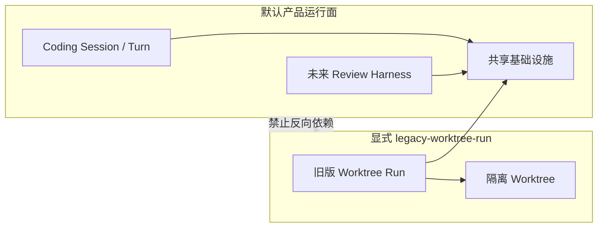

# ADR-0010：旧版 Worktree Run 隔离

- 状态：当前有效
- 日期：2026-09-04

## 背景

旧版 Worktree Run 是“隔离 Worktree + 单轮 Run + 五阶段编排”的早期验证链路，在早期 Roadmap 中称为 M0。正式产品已经演进为“真实 Git 工作区 + Coding Session/Turn”，未来 Review Harness 也只接入正式 Session。两套模型虽然不会争抢执行状态，但散落在相同目录、默认 Spring 上下文、前端构建和默认测试中，会持续制造认知和演进干扰。

## 决策

旧版 Worktree Run 保留为只读维护的回归资产，不再属于默认产品运行面：

1. 后端源码和测试统一收拢到 `com.codingreview.controlplane.legacy.worktreerun`。
2. 只有显式启用 Spring Profile `legacy-worktree-run` 时，才装配旧版 Controller、应用服务、编排器、Worktree 管理器和独立线程池。
3. 默认服务不暴露 `/api/v1/legacy/worktree-runs`，也不创建旧版线程池。
4. 前端旧单轮页面、API 和类型统一收拢到 `src/legacy/worktree-run`，不参与默认 TypeScript 构建和 Vitest。
5. 旧版后端测试使用 JUnit Tag `legacy-worktree-run`；默认 Maven 测试排除该 Tag，使用 Maven Profile `legacy-worktree-run-regression` 显式运行。
6. Claude、Git Diff、Maven、事件日志和 SSE Hub 等仍服务正式链路的基础设施保留在共享目录。
7. 正式代码不得依赖 `legacy.worktreerun` 类型；旧版链路可以单向复用共享基础设施。



## 目录边界

```text
services/control-plane/src/main/java/com/codingreview/controlplane/
├─ api、application、session、workflow/coding   # 正式 Coding 主链路
├─ adapter、observability、verification、workspace  # 共享基础设施
└─ legacy/worktreerun                           # 旧版 Worktree Run 回归链路

apps/web-console/src/
├─ app、features、shared                   # 正式工作台
└─ legacy/worktree-run                               # 无正式路由的旧页面与 API
```

## 运行与回归

默认启动：

```powershell
.\mvnw.cmd -pl services/control-plane spring-boot:run
```

显式启动旧版 Worktree Run：

```powershell
.\mvnw.cmd -pl services/control-plane spring-boot:run "-Dspring-boot.run.profiles=legacy-worktree-run"
```

显式执行旧版 Worktree Run 回归：

```powershell
.\mvnw.cmd -pl services/control-plane -am -Plegacy-worktree-run-regression test
cd apps/web-console
npm run build:legacy-worktree-run
npm run test:legacy-worktree-run
```

## 后果

- IDEA/WebStorm 的目录树能直接区分正式实现与历史资产。
- 默认服务与测试只表达当前产品模型；Java 编译仍检查同模块内的 Legacy 源码可编译性。
- 旧版 Worktree Run 仍可按需验证早期 Claude、Worktree 和五阶段链路。
- 旧版 Worktree Run 只接受缺陷修复或回归维护，不承接 Review Harness 新能力。
