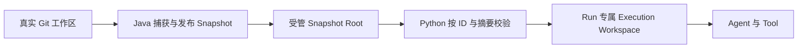
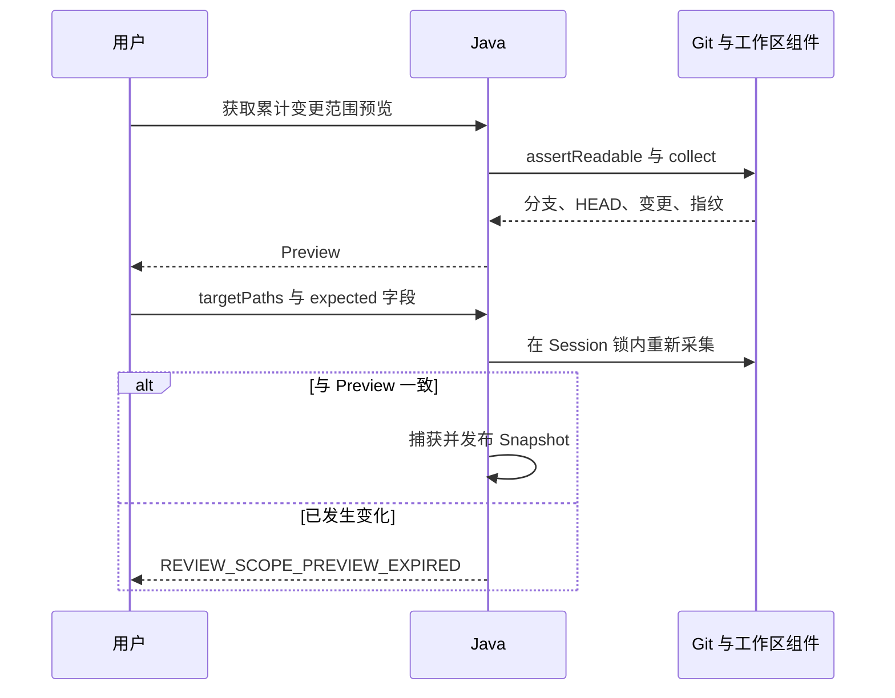
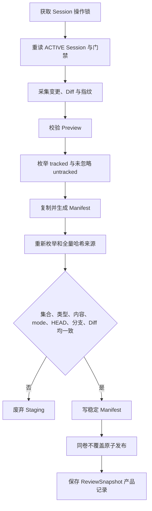
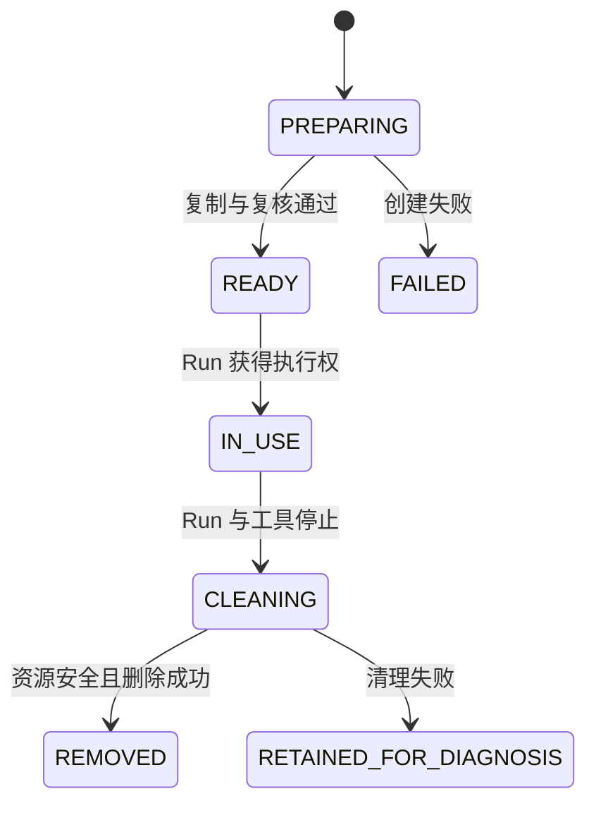

# ADR-0014：不可变 Review Snapshot 与 Run 执行空间

- 状态：已冻结；批次 2 开发完成，待独立审查
- 日期：2026-09-09
- 范围：Review 范围确认、不可变输入、Java/Python 文件职责与执行空间
- 上游：ADR-0008、ADR-0009、ADR-0011、ADR-0013

2026-10-09 批次 2 细化：Manifest v1 机器契约见 `contracts/schemas/review-snapshot-manifest-v1.schema.json`；批次 2 已实现 Snapshot、执行副本及 Java/Python 模拟闭环，待独立审查；交付证据见 `docs/review-harness-batch-2-development-handoff.md`。执行副本准备顺序按第 8 节校正，不能沿用 PENDING 无目录资源的模拟器恢复证明。

## 1. 问题与目标

Coding 继续直接修改用户真实 Git 工作区。若 Review Agent 也直接读取该目录，用户或 IDE 在 Run 期间的编辑会让不同 Tool、Evidence 和报告面对不同代码，结论无法绑定稳定输入。

本 ADR 冻结以下不变量：

- 每个真实 Review Run 只读取已发布的不可变 Snapshot。
- Java 在 Session 操作锁和仓库业务边界内捕获 Snapshot。
- Python 只按 `snapshotId + manifestSha256` 定位和验证，不接收真实仓库路径。
- Python 为每个 Run 创建独立 `ReviewExecutionWorkspace`。
- `workspaceFingerprint` 描述活动基线后的累计变化，完整 Manifest 描述 Snapshot 全部内容，二者不得混用。
- 捕获期间发现漂移时不发布部分 Snapshot。

## 2. 方案与职责

| 方案 | 结果 | 原因 |
|---|---|---|
| Python 直接读取真实仓库 | 不采用 | Run 期间输入会漂移 |
| HTTP 上传完整仓库 | 首版不采用 | 请求、重试、敏感内容和流式协议成本过高 |
| Git Worktree | 不采用 | 难以自然表达未提交最终状态，且重新引入已移除的生命周期 |
| Java 发布本地不可变 Snapshot，Python 按身份读取 | 采用 | 符合首版同机部署，可校验且职责清楚 |



Java 负责范围门禁、真实工作区采集、Staging、Manifest、固定 Diff、全量复核、原子发布、产品记录和 Review 启动预留。Python 负责受管路径解析、Manifest 与内容校验、Run 执行副本、污染检查、资源收敛和清理。

## 3. Snapshot 内容语义

`content/` 固化用户确认时 Git 可见的最终工作树：

- 纳入所有当前存在的 tracked 文件。
- 纳入当前存在、未跟踪且未被 Git ignore 的文件。
- tracked 文件即使匹配 ignore 仍纳入。
- 删除文件不出现在 `content/`，但必须出现在 changes 和固定 Diff 中。
- 重命名在内容中表现为新路径最终状态，在 changes 中保留 `oldPath`。
- 二进制文件按原始字节保存并计算摘要。
- 符号链接不解引用、不在 Snapshot 中创建活动链接，只保存目标文本与摘要。
- `.git/`、ignored 未跟踪文件和空目录不纳入。未被 ignore 的构建产物或 IDE 文件属于 Git 可见未跟踪内容，首版不以硬编码目录名静默排除；应由用户修正 `.gitignore` 或在 Preview 中明确处理。

内容以工作树最终字节为准，不保存暂存区与未暂存区的两份版本。Snapshot 不保存 mtime、ctime、所有者或 ACL；执行权限以 Git mode 表达。

第一版明确拒绝：

- Gitlink/Submodule；
- Sparse Checkout；
- 未解决的 unmerged index entries；
- Merge、Rebase、Cherry-pick 等进行中状态；
- FIFO、Socket、Device 等特殊文件。

Git LFS 只捕获本地工作树已有字节，不自动联网 hydrate。

2026-10-10 B2-R04 实现限制：Git status/diff 的内容转换仍可能调用 clean/process，包括 LFS。当前在业务命令前检查有效 filter 属性，发现任何活动 driver（含 filter=lfs）即拒绝采集，不启动过滤器、不 hydrate，也不关闭过滤器后静默改变 Diff 语义。全局仅注册 LFS、当前文件没有有效 filter 属性不受影响；支持 LFS 固定 Diff 需要后续明确的安全实现。

## 4. 范围预览与确认

Preview 只是可失效的确认依据，不是 Snapshot：



确认请求至少包含：

| 字段 | 用途 |
|---|---|
| `expectedActiveBaselineCommit` | 防止活动审查周期已推进 |
| `expectedHeadCommit` | 防止 HEAD 变化 |
| `expectedBranch` | 防止分支变化 |
| `expectedWorkspaceFingerprint` | 防止累计内容或 mode 变化 |
| `targetPaths` | 用户确认的重点审查路径 |

`targetPaths` 必须由服务端确认来自当前 `changedPaths`，不得接受绝对路径、路径穿越或空范围。被排除的变更文件仍可作为调用链上下文存在，不从 Snapshot 物理删除。

## 5. Manifest 与身份

受管根内的路径布局：

| 路径 | 内容 |
|---|---|
| `.staging/snapshotId/` | 尚未发布的内容 |
| `snapshotId/manifest.json` | 稳定 UTF-8 Manifest |
| `snapshotId/content/` | 最终工作树内容 |
| `snapshotId/artifacts/changes.diff` | 相对活动基线的固定 Diff |

Manifest 至少记录：

- `snapshotFormatVersion`、`snapshotId`、`codingSessionId`；
- `baseCommit`、`capturedHeadCommit`、`branch`；
- `workspaceFingerprint`、`createdAt`；
- `targetPaths`、`excludedChangedPaths`；
- 全部内容 Entry 的相对路径、类型、tracked、Git mode、大小和 `contentSha256`；
- changes 的路径、旧路径、类型、二进制标记、固定 Diff 路径、大小和 `diffSha256`。

| 摘要 | 覆盖范围 | 用途 |
|---|---|---|
| `workspaceFingerprint` | 活动基线后的累计变化 | Preview、Coding 验证和报告新鲜度 |
| `manifestSha256` | `manifest.json` 原始 UTF-8 字节 | 跨服务固定 Snapshot 描述 |
| `contentSha256` | 单文件字节或符号链接目标文本 | 内容完整性 |
| `diffSha256` | 固定 Diff 字节 | Diff 完整性 |

Manifest 使用 UTF-8 无 BOM、`/` 分隔的仓库相对路径和稳定排序。路径不得包含空值、`.`、`..`、NUL、绝对路径或驱动器前缀；目标文件系统上的大小写或规范化冲突必须拒绝。Manifest 不包含自身摘要，Java 在稳定写出后计算原始字节 SHA-256，Python 先验证摘要再解析 JSON。

## 6. 捕获与发布



两次观察不宣称操作系统级原子文件系统快照，但必须覆盖文件集合、类型、大小、内容哈希、Git mode、分支、HEAD、变更清单、Diff 和指纹。捕获后的外部编辑不影响已发布 Snapshot。

文件数、单文件大小、总大小、Diff 大小和捕获时长必须有明确配置。触发任一上限时整次捕获失败，不发布部分 Snapshot，不静默跳过文件。

发布规则：

- Snapshot ID 由 Java 生成，首版使用 UUID。
- Staging 和最终目录位于同一受管根、同一文件系统卷。
- 使用不覆盖原子移动；目标已存在或文件系统不支持所需语义时失败。
- 发布后不由正常业务路径原地修改。
- 发布成功但产品记录保存未知时，重读确认；未确认前不调用 Python。
- Snapshot 不随单个 Run 结束删除，首版不实现自动 GC。

## 7. 真实 Run 输入

真实 Review 请求冻结为：

```json
{
  "protocolVersion": "1.0",
  "runId": "run-uuid",
  "codingSessionId": "session-uuid",
  "reviewThreadId": "review-thread-uuid",
  "snapshot": {
    "snapshotId": "snapshot-uuid",
    "manifestSha256": "sha256:value"
  },
  "input": {
    "message": "请审查当前累计修改"
  }
}
```

请求不传 `repositoryPath`、`snapshotRoot`、重复的 baseline/fingerprint 或尚未稳定的 `projectId`。Python 用自身配置的 `snapshotRoot` 解析规范 UUID，并验证解析结果仍在受管根内、目录不是符号链接或重解析点逃逸、Manifest 摘要及 Session/Snapshot 身份一致。

相同 `runId` 的请求指纹必须包含 Snapshot 引用；相同规范化请求幂等，不同请求冲突。

## 8. ReviewExecutionWorkspace

每个 `runId` 使用独立执行目录：



Python 先在启动事务内检查 Session 隔离与不安全资源证据，提交 `RUNNING + ACTIVE`，再可靠保存执行空间准备意图、校验 Snapshot、创建 Staging Workspace、复制普通文件、复核 Manifest 并原子发布。`PENDING + NOT_ACQUIRED` 不创建目录或持有复制资源。准备失败也要确认线程、句柄与目录清理，无法确认时使用 `FAILED + UNCERTAIN`。绝对执行根只能作为受信 Runtime Context 注入 Tool Adapter，不得成为模型参数。

执行空间有独立持久准备/清理记录，显式迁移后由启动恢复检查。本批只运行确定性模拟器，但文件目录已经是真实资源；不能再仅凭“进程内模拟器已经消失”确认 RELEASED。清理失败保留诊断和 Session 保护。

首版不使用普通硬链接，避免执行空间写入反向修改 Snapshot。执行型工具接入后必须在执行前后比较受保护源码 Manifest；污染结果不能升级为 Evidence，Run 必须失败并保留诊断。普通本地副本不是安全 Sandbox，不得据此承诺可安全运行不可信项目代码。

## 9. 并发和产品门禁

Java 必须在释放 Session 操作锁前保存持久 Review 启动预留，使后到的 Coding Turn、基线推进、另一 Review 启动和 Session Close 都能看到阻断。不能持有进程内锁跨越 Python 网络调用。

Snapshot 发布后、调用 Python 前的失败或关闭请求，按 ADR-0009 的 `SUBMITTING/SUBMISSION_UNKNOWN` 和同一 `runId` 对账收敛。Execution Workspace 只有在工具、进程和读取任务确认释放后才能清理；清理未知时保持执行资源保护。

## 10. 稳定失败码

Java 捕获侧至少包括：

- `REVIEW_SCOPE_PREVIEW_EXPIRED`
- `NO_REVIEW_CHANGES`
- `REVIEW_SCOPE_EMPTY`
- `SNAPSHOT_SOURCE_DRIFTED`
- `SNAPSHOT_LIMIT_EXCEEDED`
- `SNAPSHOT_GITLINK_UNSUPPORTED`
- `SNAPSHOT_SPECIAL_FILE_UNSUPPORTED`
- `SNAPSHOT_SPARSE_CHECKOUT_UNSUPPORTED`
- `SNAPSHOT_UNMERGED_INDEX`
- `SNAPSHOT_REPOSITORY_OPERATION_IN_PROGRESS`
- `SNAPSHOT_CAPTURE_FAILED`
- `SNAPSHOT_ATOMIC_PUBLISH_UNSUPPORTED`
- `SNAPSHOT_STATE_WRITE_FAILED`

Python 校验侧至少包括：

- `SNAPSHOT_NOT_FOUND`
- `SNAPSHOT_PATH_INVALID`
- `SNAPSHOT_MANIFEST_MISMATCH`
- `SNAPSHOT_IDENTITY_MISMATCH`
- `SNAPSHOT_CONTENT_MISMATCH`
- `EXECUTION_WORKSPACE_CREATE_FAILED`

同步请求尚未形成 Run 时使用 Problem Details；Run 已接受后发现问题时形成明确异步失败。不得把宿主绝对路径、Manifest 内容或敏感文件信息写入普通错误响应。

## 11. 验收重点

实现必须用真实临时 Git 仓库、真实临时受管根和可控同步点覆盖：

- 暂存状态改变但最终内容不变；新增、修改、删除、重命名、二进制和 mode；
- ignored/untracked/tracked 边界；
- Preview 后以及复制期间的内容、集合、类型、mode、HEAD、分支漂移；
- 绝对路径、`..`、大小写冲突、受管根逃逸和符号链接替换；
- Gitlink、Sparse Checkout、冲突 index、进行中 Git 操作和特殊文件；
- 原子发布失败、目标已存在、发布后产品保存结果未知；
- Python Workspace 复核失败、污染和清理失败；
- 同一 Snapshot 的多个顺序 Run 使用独立 Workspace。

竞态测试使用 Hook 或阻塞点，不依赖概率性 `sleep`。

## 12. 明确不做

- 不创建 Review 分支、Git Worktree、隐藏提交或修改 Git index。
- 不修改、暂存、提交或推送用户真实仓库。
- 不解决 Session 创建前脏修改的自动排除。
- 不通过 HTTP 上传完整源码，不实现远程多节点 Snapshot 传输。
- 不自动 GC Snapshot，不开放 Maven、Analyzer、MCP 或通用 Shell。
- 不把 Manifest 摘要当作签名或恶意宿主防护。

本 ADR 冻结目标设计，不代表上述组件已经实现。
