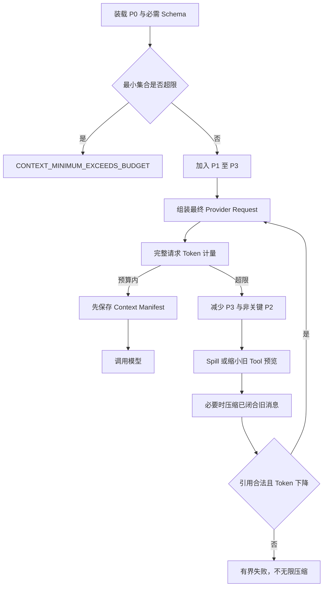
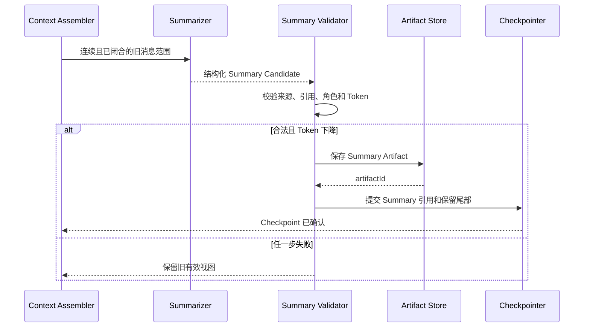
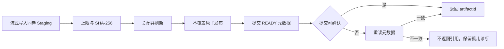
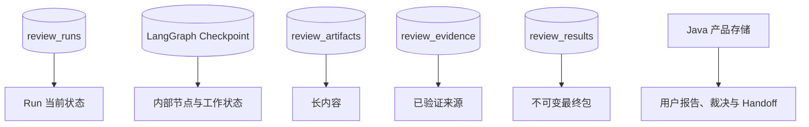

# ADR-0015：Context、Artifact 与 Evidence 治理契约

- 状态：已冻结，尚未实现
- 日期：2026-09-09
- 范围：Review Agent 模型请求、上下文压缩、长内容存储、证据形成与 Result Envelope
- 上游：ADR-0009、ADR-0014

批次 1 已实现本文的空 Result Envelope、原始字节保存与原子成功事务，待独立审查；Context、Artifact、Evidence 和 Finding 的真实能力仍未实现。

## 1. 问题与边界

Review Agent 需要持续读取代码、工具结果、历史消息和项目经验。若把它们全部塞入消息历史，会超出模型窗口；若用一个摘要替换全部事实，则无法证明 Finding 对应哪份代码和证据；若把 Tool Result 直接当 Evidence，则截断、抽样或错误归属会被包装成确定性结论。

因此冻结五个独立边界：

| 对象 | 保存什么 | 不负责什么 |
|---|---|---|
| LangGraph State | 当前 Pass、调查目标、未闭合 Candidate、引用和恢复状态 | 大内容与产品长期历史 |
| Context | 单次模型调用的有界临时投影 | 全部历史或事实唯一副本 |
| Summary | 已闭合旧交互的叙事压缩 | Snapshot、用户裁决、Finding 或 Evidence 的唯一记录 |
| Artifact | 长内容及完整性元数据 | 判断问题是否成立 |
| Evidence | 经服务端验证的来源、范围与 Snapshot 归属 | 模型隐藏思维过程 |

`ReasoningSummary` 解释 Evidence 如何支持 Claim，不产生新的客观 Evidence。Memory 只能提供调查线索，不能直接证明当前 Snapshot。

## 2. 模型请求预算

每个 Model Adapter 必须提供明确 Context Window 和可信 Token Meter：

`inputBudget = contextWindow - reservedOutputTokens - protocolSafetyMargin`

计量点是最终 Provider Request，包括消息角色、内容块、Tool Schema、Skill、包装文本和 Provider 必需开销；不得用字符数、UTF-16 长度或单个 ToolMessage 大小替代。

| 优先级 | 内容 | 预算行为 |
|---:|---|---|
| P0 | System Policy、当前用户请求、Snapshot/范围、当前 Pass、未闭合 Candidate 身份 | 不静默裁剪 |
| P1 | 当前关键 Evidence、最近有效 Tool Result、核心 Tool Schema | 当前调查需要，否则缩小调查或失败 |
| P2 | 当前主 Skill、Summary、最近交互 | 可压缩或减少 |
| P3 | Project Memory、参考资料和较旧非关键上下文 | 可不注入 |



P0 与必需 Schema 已超限时模型调用次数必须为零。Harness 应要求缩小范围、减少本轮工具或换用更大窗口模型，而不是删除安全策略、用户目标或 Snapshot 身份。

## 3. Context Assembly Manifest

每次真实模型调用前可靠保存有界 `ContextAssemblyManifest`，至少记录：

- `modelCallId`、`runId`、`snapshotId`、`passId`、`investigationId`；
- `modelId`、`summaryVersion`；
- 来源消息、Evidence、Artifact 等 `sourceRefs`；
- 实际发送工具名称/Schema/版本形成的 `toolSetDigest`；
- `estimatedInputTokens`、`inputBudget`、`reservedOutputTokens` 和时间。

Manifest 不保存密钥、完整 System Prompt、完整源码或完整 Tool 输出。它作为 Run Diagnostic Artifact 保存，并由 State/Checkpoint 引用。保存失败时返回 `CONTEXT_MANIFEST_WRITE_FAILED`，不得调用模型。响应 Usage 和模型输出通过 `modelCallId` 关联；Manifest 用于诊断和评测，不是 Finding Evidence。

## 4. Compaction

Summary 只压缩叙事、调查经过、已排除假设和仍有价值的未结构化信息。以下事实始终从结构化状态重新注入：

- 用户原始请求与裁决；
- Review Snapshot、固定 Diff 与 Manifest；
- 当前 Pass、范围与未闭合 Candidate；
- 已提交 Artifact、Evidence、Finding、Result 和 Handoff。



Summary 至少记录版本、被替换的完整消息 ID、来源摘要、前一 Summary 版本、正文、引用的 Evidence/Candidate、模型、Token 和时间。

压缩不变量：

- 被替换范围必须连续且已闭合。
- Tool Call 与对应 Tool Result 不得拆开，未完成 Tool Call 不得压缩。
- 不在模型请求或 Tool 批次中途并发替换活动视图。
- Summary 以不可信数据角色注入，不能改变策略或权限。
- 只有 Summary Artifact 和 Checkpoint 均确认保存、引用合法且 Token 实际下降后才替换视图。
- 每次尝试必须推进范围并降低 Token；达到次数或质量阈值后停止。

Checkpoint Namespace 使用 `reviewThreadId + snapshotId`，但每个 Checkpoint 记录 `runId`。遗留 `RUNNING` Run 不因存在 Checkpoint 自动恢复。新 Run 只能继承最后 `SAFE_FOR_NEW_RUN` 状态显式列出的 Summary、Evidence 和 Artifact ID；同 Snapshot 不等于可以读取所有历史 Run 内容。

## 5. Artifact Store

Python 后续持久化 `review_artifacts` 元数据，至少包含：`artifactId/runId/snapshotId/kind/producer/mediaType/encoding/byteSize/sha256/coverage/redactionState/createdAt/integrityState`。

Artifact 类型至少包括 Snapshot Diff、Source Excerpt、Tool Output、Build Report、Static Analysis Report、Context Manifest、Compaction Summary 和可选报告渲染。

`coverage` 语义：

| coverage | 含义 | 可支持的结论 |
|---|---|---|
| `FULL` | 明确范围已完整读取或完整执行并保存 | 可在该范围内表达完整性结论 |
| `PARTIAL` | 因上限、截断或读取范围只获得部分内容 | 可证明已显示的正面事实，不能证明没有其他异常 |
| `SAMPLED` | 有意抽样 | 只支撑样本范围，不能外推全量 |

文件系统和 SQLite 不共享事务，写入顺序冻结为：



只有 READY 且实际大小、SHA-256 匹配的 Artifact 可以被引用。读取发现不一致时标记 `CORRUPTED`，依赖它的 Evidence 不再有效。第一版不做跨 Artifact 去重和自动 GC。

敏感 Tool 输出按类型策略先检测和脱敏，再持久化规范内容；Evidence 必须明确引用脱敏版本。普通日志、SSE 和错误响应不得包含原始秘密。

内部读取接口计划为：

```http
GET /internal/v1/review-runs/{runId}/artifacts/{artifactId}
GET /internal/v1/review-runs/{runId}/artifacts/{artifactId}/content?cursor=opaque
```

读取必须校验认证、原始所有者、当前 Run、Thread、Snapshot 和 SAFE 继承白名单。Cursor 由服务端生成并限制页面大小；UTF-8 文本不能切坏 code point，单个超长行也受限；二进制默认只返回元数据。模型、Java 和浏览器都不能用绝对路径读取 Python Artifact，浏览器仍只经过 Java。

## 6. Evidence 与 Finding

Evidence 类型冻结为：

- `CODE`
- `STATIC_ANALYSIS`
- `BUILD_TEST`
- `RUNTIME`
- `LOAD_TEST`
- `DOMAIN_CONTEXT`

`SEMANTIC_REASONING` 不再是 Evidence 类型。模型推理保存在 `ReasoningSummary`，防止用“模型认为如此”循环证明模型结论。

`review_evidence` 至少记录 `evidenceId/runId/snapshotId/evidenceType/sourceRefs/producer/coverage/summary/capturedAt`。代码引用必须包含 Snapshot 相对路径、行号或 Symbol、完整文件摘要；Artifact 引用必须包含 Artifact ID、摘要、类型、coverage 和必要结构化结果。

模型只提交 Evidence Candidate。服务端从受信 Runtime 注入 `runId/snapshotId`，并验证代码路径、位置、哈希、Artifact 所有权、完整性和 coverage 后，才保存不可变 EvidenceRecord。Tool Result 默认只是调查材料，不自动成为 Evidence。

| Finding 状态 | 证据门禁 |
|---|---|
| `VERIFIED` | 至少一个当前 Snapshot 的有效 Evidence、完整 ReasoningSummary、明确触发条件并检查关键反例 |
| `RISK` | 有当前依据，但仍依赖未验证假设、运行环境或不完整 coverage |
| `SUGGESTION` | 有代码或领域依据、收益与取舍，不得包装成已发生 Bug |
| `REJECTED` | 证据不足、反例成立、重复或不适用；不进入正文 |

确定性语义问题允许 `CODE Evidence + ReasoningSummary` 进入 VERIFIED，不强制测试或双工具证据。性能、流量和量化 Claim 缺少对应 RUNTIME/LOAD_TEST 时最多为 RISK。Memory 不能进入 `evidenceIds`，必须在当前 Snapshot 或环境重新验证。Severity 与 Confidence 必须分开。

## 7. Review Result Envelope

ADR-0009 规定 Result、`SUCCEEDED` 和终态事件同一 SQLite 事务提交。本 ADR 冻结最小 Result：

```json
{
  "resultVersion": "1.0",
  "resultId": "result-uuid",
  "runId": "run-uuid",
  "snapshotId": "snapshot-uuid",
  "manifestSha256": "sha256:value",
  "generatedAt": "2026-09-09T07:57:45Z",
  "passResults": [],
  "evidence": [],
  "findings": [],
  "reportDraft": {
    "markdown": "# Review Report",
    "byteSize": 15
  },
  "diagnostics": {
    "contextManifestArtifactIds": []
  }
}
```

Result 中的 Evidence 是最终不可变打包副本，运行时可变权威位置仍是 `review_evidence`。Result 不嵌入完整源码、Diff 或日志；Markdown 是有界展示层，必须能从结构化 Findings 重建或校验主要条目，不能反向创造 Finding。成功事务前所有 Artifact 引用必须 READY 且摘要一致。

## 8. 持久化事实源



同一事实只有一个可变权威位置；其他位置只保存引用或明确的终态副本。Context Manifest、Summary 和 Memory 都不是 Evidence。Checkpoint 不替代 Run 状态，也不证明工具可以安全重放。

## 9. Prompt Injection 与权限

System Policy 是稳定最高层策略。当前用户输入保留用户指令身份；Snapshot 与 Evidence 锚点是结构化数据而非权限指令。仓库文本、Tool 输出、Summary、Memory 和 MCP 数据均按不可信数据注入；内置 Skill 低于安全策略且只能缩权。

工具是否出现在模型视图不构成授权。所有 Tool、Artifact 和 Evidence 操作必须在执行入口重新校验身份、范围和策略。模型输出、Candidate 与 Evidence Candidate 都是不可信输入。

## 10. 稳定失败码

Context/Compaction 至少包括：

- `CONTEXT_MODEL_CAPACITY_UNKNOWN`
- `CONTEXT_TOKEN_METER_UNAVAILABLE`
- `CONTEXT_MINIMUM_EXCEEDS_BUDGET`
- `CONTEXT_ASSEMBLY_EXCEEDS_BUDGET`
- `CONTEXT_MANIFEST_WRITE_FAILED`
- `COMPACTION_GENERATION_FAILED`
- `COMPACTION_REFERENCE_INVALID`
- `COMPACTION_NO_PROGRESS`
- `CONTEXT_WINDOW_REJECTED_BY_PROVIDER`

Artifact 至少包括：`ARTIFACT_LIMIT_EXCEEDED`、`ARTIFACT_WRITE_FAILED`、`ARTIFACT_STATE_WRITE_FAILED`、`ARTIFACT_NOT_FOUND`、`ARTIFACT_ACCESS_DENIED`、`ARTIFACT_CURSOR_INVALID`、`ARTIFACT_INTEGRITY_FAILED`、`ARTIFACT_CONTENT_UNSUPPORTED`。

Evidence/Finding 至少包括：`EVIDENCE_SOURCE_NOT_FOUND`、`EVIDENCE_SNAPSHOT_MISMATCH`、`EVIDENCE_ARTIFACT_NOT_READY`、`EVIDENCE_REFERENCE_INVALID`、`EVIDENCE_PERSISTENCE_FAILED`、`FINDING_EVIDENCE_INSUFFICIENT`、`FINDING_SCOPE_VIOLATION`。

关键 Evidence 保存失败、Snapshot 错配、Artifact 完整性和最小 Context 预算失败不得降格成普通 ToolMessage 后继续忽略。

## 11. 验收重点

实现必须使用确定性假模型、真实临时 Artifact 目录和临时 SQLite，至少证明：

- 最终请求整体超限会在模型调用前失败，Tool Schema、中文、Emoji 和 Provider 包装计入预算；
- Context Manifest 保存失败时模型调用次数为零；
- 连续压缩不丢 Snapshot、用户目标、Candidate 和 Evidence，未完成 Tool Call 不被压缩；
- Summary 失败、非法引用、Checkpoint 未确认或 Token 无下降时旧视图保持有效；
- 大输出流式保存，半成品不公开，UTF-8 分页和单行上限正确；
- 猜测其他 Run 的 Artifact ID、跨 Snapshot Evidence 和模型伪造身份均被拒绝；
- PARTIAL 可证明已出现异常，但不能证明不存在其他异常；
- `CODE + ReasoningSummary` 可支持确定性 VERIFIED，量化 Claim 无运行证据时最多为 RISK；
- Artifact 存在但 Evidence 保存失败时 Finding 不得 VERIFIED；
- Markdown 不能引入结构化 Findings 中不存在的问题。

测试必须断言失败路径上的模型、Tool 和持久化调用次数，不能只检查错误文字。

## 12. 第一版范围

- 首版只实现 Project Memory，Global Memory 延后；Memory 数据模型在独立批次冻结。
- 不保存模型隐藏思维过程或每次完整 Prompt 明文。
- 不复制 DeepSeek 完整 Session Surface 或事件溯源引擎。
- 不允许无限 Compaction、盲目重试超窗请求或以字符数冒充 Token。
- 不把 Summary、Memory、Context Manifest、截断输出或抽样结果冒充完整 Evidence。
- 不在本 ADR 实现 Memory、Skill、MCP、Maven 或 Analyzer；能力随第一个真实消费者逐批落地。

本 ADR 冻结目标设计，不代表上述组件已经实现。
