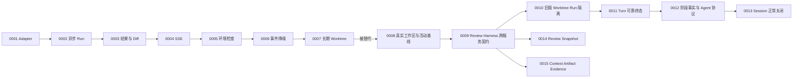

# 架构决策记录索引

最新已实现决策：[ADR-0013：Session 正常关闭与仓库所有权释放](0013-session-close-and-repository-release.md)。最新 Harness 冻结决策：[ADR-0015：Context、Artifact 与 Evidence 治理契约](0015-context-artifact-and-evidence-contract.md)，尚未实现。

| 编号 | 决策 | 状态 | 当前意义 |
|---|---|---|---|
| [ADR-0001](0001-claude-code-adapter-m0.md) | Claude Code Adapter M0 契约 | 历史有效 | 仍约束旧单轮 M0 Run；Session 已演进为上下文续接模式 |
| [ADR-0002](0002-m1-async-run-api.md) | 异步 Run API | 已演进 | 异步接入仍保留，实时展示已由 ADR-0004 的 SSE 取代轮询主通道 |
| [ADR-0003](0003-m2-run-result-api.md) | Run 结果与 Diff API | 历史有效 | 旧 M0 Run 回归接口仍使用 |
| [ADR-0004](0004-m3-sse-run-stream.md) | SSE 实时事件通道 | 当前有效 | 同一套事件基础设施也服务 Coding Turn |
| [ADR-0005](0005-m4-runtime-readiness.md) | 本机环境就绪检查 | 当前有效 | Session 提交 Turn 前继续执行必要检查 |
| [ADR-0006](0006-agent-event-noise-reduction.md) | Claude 高频事件降噪 | 当前有效 | 同时保护磁盘日志、SSE 和浏览器内存 |
| [ADR-0007](0007-coding-session-persistence.md) | 长期 Worktree Session | 已被替代 | 保留 M5 历史背景，不再代表正式 Session 工作区模型 |
| [ADR-0008](0008-direct-workspace-and-review-baseline.md) | 真实工作区与活动审查基线 | 当前有效 | 规定正式 Coding、Review、自测和模块 Commit 的主链路 |
| [ADR-0009](0009-review-harness-service-contract.md) | Review Harness 跨服务运行契约 | Python Runtime 已实现，待独立审查；Java 集成未实现 | 规定状态与资源状态、幂等、Result 原子提交、SSE 消费、恢复和产品门禁 |
| [ADR-0010](0010-legacy-worktree-run-isolation.md) | 旧版 Worktree Run 隔离 | 当前有效 | 旧版单轮链路只在显式 Profile、独立目录与独立回归测试中存在，不进入正式运行面 |
| [ADR-0011](0011-coding-turn-terminal-reliability.md) | Coding Turn 终态、取消与恢复可靠性 | 当前有效 | 规定持久状态、终态事件、取消竞争、进程清理、损坏历史隔离与前端对账顺序 |
| [ADR-0012](0012-coding-stage-facts-and-agent-protocol.md) | 阶段事实事件与统一 Agent 协议 | 当前有效 | 用后端阶段事实替代前端推断，并统一正式 Agent 事件信封 |
| [ADR-0013](0013-session-close-and-repository-release.md) | Session 正常关闭与仓库所有权释放 | 当前有效 | 区分 CLOSED 与释放完成，冻结失败重试、补偿和历史只读边界 |
| [ADR-0014](0014-review-snapshot-and-execution-workspace.md) | 不可变 Review Snapshot 与 Run 执行空间 | 已冻结，尚未实现 | Java 固化用户确认输入，Python 按身份校验并创建每 Run 执行副本 |
| [ADR-0015](0015-context-artifact-and-evidence-contract.md) | Context、Artifact 与 Evidence 治理契约 | 已冻结，尚未实现 | 冻结完整请求预算、压缩、长内容、Evidence 和 Result Envelope 边界 |

## 状态含义

| 状态 | 含义 |
|---|---|
| 当前有效 | 仍是正式主链路必须遵守的决策 |
| 历史有效 | 对保留的旧链路仍成立，但不是新功能默认方案 |
| 已演进 | 核心思想保留，部分实现已被后续 ADR 扩展 |
| 已被替代 | 仅用于理解历史，新代码必须遵循替代 ADR |
| 部分冻结 | 已记录的条目可以实施，文档明确列出的其他条目仍需逐项讨论 |
| 已冻结，尚未实现 | 目标契约可作为开发依据，但不得描述成当前代码事实 |

## Session 关闭

[ADR-0013：Session 正常关闭与仓库所有权释放](0013-session-close-and-repository-release.md)：当前有效；明确 CLOSED 与释放完成的区别、失败重试和历史只读边界。
