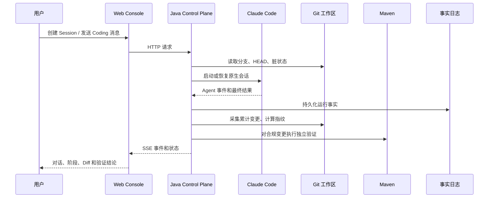
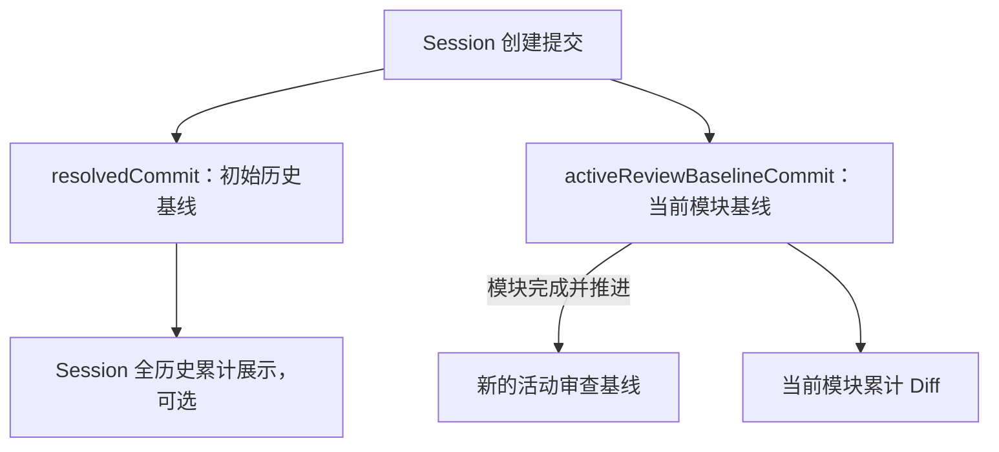

# Code Weave 工程落地复盘与问题追踪

> 本文记录 Code Weave 从设计走向可运行系统时的工程实践、真实难点、解决方案和仍然存在的边界。
> 它不是 API 参考，也不是单次架构决策（ADR）；当前事实以代码和[当前系统架构](../architecture/current-architecture.md)为准，具体取舍以对应 ADR 为准。
>
> 维护约定：后续每发现一个影响系统可信性、可维护性或用户体验的问题，先向用户说明“现象—原因—影响—方案”，方案确认后在本文末尾追加记录，并同步更新相关架构/API/ADR 文档。

## 1. 为什么要沉淀这份文档

Code Weave 不是一次性生成代码的脚本，而是一个持续运行的 Coding—Review 工作台。工程实现中最容易出现的问题，不是某个类能否编译，而是多个事实之间是否一致：


如果只修复其中一层，就可能出现“代码实际改了，但页面没有显示”“Maven 失败却显示通过”“事件已结束但任务仍是运行中”等问题。因此本日志重点记录跨层问题，而不只记录代码变更。

## 2. 当前工程形态

### 2.1 服务和边界

| 部分 | 当前职责 | 当前状态 |
|---|---|---|
| Java Control Plane | Session/Turn 生命周期、Git 事实、Maven 验证、事件持久化、HTTP/SSE | 已落地，正式 Coding 主链路 |
| Claude Code Adapter | 启动或恢复 Claude Code、解析 NDJSON、转换 Agent 事件 | 已落地，保留 Claude 原生 Coding 能力 |
| React Web Console | Session 对话、实时事件、累计 Diff、模块完成门禁 | 已落地，消费后端事实并做中文投影 |
| Python Review Harness | 上下文、记忆、中间件、代码质量 Review | 后续阶段，尚未接入正式链路 |
| Legacy Worktree Run | 旧版隔离 Worktree 单轮回归资产 | 已隔离，只允许维护和回归，不再承载新功能 |

正式 Session 使用用户真实 Git 工作区。平台通过仓库写锁、分支/HEAD 检查和活动审查基线控制并发及审查范围，不自动提交、推送、回滚或合并用户代码。

### 2.2 关键数据流



## 3. 已落地过程中的主要难点与解决方案

### 3.1 保留 Agent 能力，同时建立工程边界

**难点**：如果平台把 Claude Code 拆成大量受限的固定步骤，Agent 的自主分析和修改能力会下降；如果完全放任，又无法保证代码范围和运行安全。

**方案**：

- Claude Code Adapter 只负责启动协议、会话续接、事件解析和进程控制；
- Git、路径策略和 Maven 验证由外层 Control Plane 负责；
- 约束放在工作区、执行门禁和结果验证层，不替模型设计代码方案；
- 用户与 Agent 在同一 Session 内的修改统一视为累计变更，不做修改者归因。

**边界**：当前正式 Coding 仍只覆盖 Spring Boot 3.x + Maven；代码质量级 Review Harness 尚未接入，Maven 不能代替 Review。

### 3.2 从隔离 Worktree 迁移到真实工作区

**难点**：早期单轮流程使用隔离 Worktree，天然安全，但与用户期望的持续 Coding—Review—提交流程不一致；如果直接把两套模型混在一起，后续维护和前端展示都会产生歧义。

**方案**：

- 正式 Session 使用真实源仓库；
- 每个 Session 绑定一个仓库写锁；
- Coding 开始前检查分支与 HEAD；
- 模块完成后由用户 Review、自测并创建一次 Git Commit；
- 用户确认后平台只推进 `activeReviewBaselineCommit`，不执行自动 Commit/Push；
- 旧版 Worktree Run 迁移到 `legacy/worktreerun`，由独立 Profile、目录和测试入口隔离。

**收益**：避免平台自动合并 Worktree 产生冲突，也符合本地主流 Coding Agent 的使用心智。

**边界**：平台不能识别 IDE 中途修改的来源；只能通过执行前后检查和验证前后指纹判断工作区是否稳定。

### 3.3 两类 Git 基线导致的语义冲突

**难点**：Session 初始提交和当前模块基线用途不同。若查询 Diff、执行 Coding、Review 和推进基线使用了不同提交，就会把历史模块混入当前模块。

**当前约定**：



第一批修复已经统一正式 Diff 查询，确保它始终使用活动审查基线，而不是旧的 `resolvedCommit`。

### 3.4 原始 Agent 事件过多，无法直接作为产品界面

**难点**：Claude Code 会产生大量 Token 增量、进程标准输出和内部观察事件。全部持久化并直接展示，会导致日志噪声、重复游标和浏览器压力。

**已落地方案**：

- 保留事实日志，避免丢失追溯证据；
- 对中间 Token 增量做降噪，保留最终精确用量；
- 前端将底层事件映射为中文可读活动；
- 将 Agent 产生的事件归入 Coding Agent 层级；
- SSE 通过游标补发历史、发送实时事件，并按序号去重。

**原则**：事实层可以细，用户展示层必须可读。后续统一事件信封时，不能为了限流而丢失工具关联和必要摘要。

### 3.5 文件持久化既要可读，又要可恢复

**难点**：MVP 采用 JSON/NDJSON 文件便于本地检查，但 Session 快照、Turn 快照、事件日志和 Maven 产物分散在不同文件中，不具备数据库事务的一致性。

**已落地方案**：

- Session、Turn 使用独立快照文件；
- 事件使用追加式 NDJSON，并使用单调序号；
- Maven 日志和 Surefire 摘要按 Turn/attempt 保存；
- 写入采用临时文件、刷盘和原子替换；
- 启动恢复将遗留的 `QUEUED/RUNNING` Turn 标记为可解释的中断状态。

**重要边界**：Session 快照和事件文件不是同一事务。后续修复中，持久化的 Turn 状态将作为任务终态事实，事件发布失败由状态查询、恢复或补偿机制兜底。

### 3.6 前端不能猜测后端没有发生的事实

**难点**：早期前端为了让流程看起来完整，会根据 Agent 事件和终态事件自动补齐阶段。这在正常流程中可用，但在 Git 采集失败、路径策略失败或 Maven 被跳过时会产生虚假的“已完成”。

**当前方向**：

- 后端逐步记录真实阶段开始、完成、失败和跳过；
- 前端只把后端事实投影为中文摘要和用户界面；
- 历史事件没有阶段信息时，使用明确的兼容展示，不伪装成新协议事实。

## 4. 第一批修复的工程落地方案

本节记录已经确认、准备实施的内容。它不是未来愿望，而是下一批开发的边界。

### 4.1 目标

让下面四个对象指向同一份代码事实：

```text
当前累计 Diff
验证时的代码状态
Turn 的验证结论
前端显示的任务状态
```

### 4.2 实施顺序

为了方便逐步审查，不一次性完成整个模块，按以下小步实施：

1. **规范化工作区指纹**：展示 Diff 与身份指纹分离，覆盖新增、修改、删除、重命名和二进制文件；
2. **修复 Maven 结论分类**：报告存在失败/错误时，即使退出码为零也不能通过；
3. **增加验证前后指纹检查**：工作区端点变化时使本次验证失效；
4. **拆分读取门禁与执行门禁**：提交后可读取 Diff，但不能绕过 Coding 执行门禁；
5. **迁移 Session 级累计变更 API**：前端不再按某个 Turn 推断当前模块 Diff。

每一步都应包含：代码修改、针对性测试、手工链路验证、文档追加和独立提交。

### 4.3 已冻结的关键规则

| 规则 | 说明 |
|---|---|
| 累计变更基线 | 统一使用 `activeReviewBaselineCommit` |
| 指纹对象 | 规范化后的最终工作区状态，不依赖补丁文本换行 |
| 修改归因 | 不区分用户、Agent、IDE，统一纳入 Session 累计变更 |
| Maven 验证 | 进程结果与测试报告共同决定，不只看退出码 |
| 验证一致性 | 比较 Maven 前后工作区指纹；这是端点检查，不是全程快照隔离 |
| 执行门禁 | 分支一致、HEAD 等于活动基线、没有其他执行中的 Turn |
| 读取门禁 | 分支一致、活动基线是 HEAD 祖先，允许查看已提交或未提交累计变更 |
| 无自动 Git 操作 | 不自动 Commit、Push、Merge、Rollback |

### 4.4 已完成：规范化工作区指纹

**实现内容**：`WorkspaceFingerprintCalculator` 已从“文件元数据 + 完整 Unified Diff”调整为“版本化算法标识 + 排序后的最终路径状态 + 最终工作区内容摘要 + Git mode”。非删除文件读取当前工作区内容计算 SHA-256；删除文件保留稳定删除标记；重命名统一展开为旧路径删除和新路径写入。展示用 Unified Diff、重命名检测形式和二进制展示标记不再参与正式指纹，因此不会因暂存状态或补丁拼接格式改变结果。

**测试内容**：新增 `WorkspaceFingerprintCalculatorTest`，覆盖以下场景：

- 同一份代码在未暂存、已暂存、已提交状态下指纹一致；
- 文本文件内容变化会改变指纹；
- 二进制文件内容变化会改变指纹；
- 文件顺序和补丁分隔空行不会改变合成快照的指纹；
- 同一重命名从未暂存、已暂存到已提交状态保持同一指纹；
- Windows 下通过 Git index 修改 `100644/100755` 会改变指纹；
- 工作区不存在或不可读时明确失败，不生成替代指纹。

**验证结果**：审查收尾后指纹专项测试 7 项通过；Control Plane 默认测试 123 项通过。Maven 结论、验证前后指纹和 Session 级 `/changes` API 的结果见后续小节。

**当前边界**：指纹计算依赖采集时的最终工作区内容；它不识别修改者，也不保证检测到“验证过程中修改后又恢复”的瞬时变化。已跟踪文件的 mode 来自 Git raw diff；未跟踪文件在 `core.filemode=false` 时按 `100644` 处理，在支持 POSIX 权限且 Git 跟踪 mode 时按真实执行位推导。

### 4.5 已完成：Maven 测试报告优先于退出码

**问题**：原实现先判断 Maven 进程退出码。只要退出码为 `0` 就返回 `PASSED`，因此项目启用 `testFailureIgnore` 时，测试报告中的失败可能被错误地标记为验证通过。

**实现**：`MavenVerifierImpl.classify()` 现在先检查 `MavenTestSummary.hasTestFailures()`，只要报告中的 `failures` 或 `errors` 大于零，就返回 `TEST_FAILED`；只有在没有测试失败且退出码为零时才返回 `PASSED`。非零退出码且没有测试失败时仍归类为 `BUILD_FAILED`，进程取消等状态继续由进程层结果优先处理。

**测试**：扩展 `MavenProcessFixture`，增加“报告有失败但进程退出码为零”的场景，并在 `MavenVerifierImplTest` 中验证该场景不会通过。

**验证结果**：Maven 验证专项测试 9 项通过；Control Plane 默认测试 113 项通过。

**剩余边界**：本次只修复结论分类，还没有把 Maven 前后的工作区指纹接入编排器；因此验证期间发生代码变化的问题仍属于下一小步。

### 4.6 已完成：Maven 验证前后工作区一致性检查

**问题**：原编排器在 Maven 前采集一次变更并计算指纹，Maven 结束后直接使用这份旧快照生成 Turn 结论。验证期间如果工作区被外部编辑，旧的成功结论仍可能被标记为有效。

**实现**：`CodingTurnOrchestratorImpl` 现在在 Maven 完成后重新采集当前工作区并计算指纹。前后指纹不一致时，Turn 返回 `WORKSPACE_DRIFT`，失败码为 `WORKSPACE_CHANGED_DURING_VERIFICATION`，不会产生 `CHANGES_VERIFIED`；指纹一致时才沿用 Maven 的通过/失败结论。

**测试**：增加编排器测试，覆盖验证期间变更导致本轮失效，以及验证前后指纹不变时正常得到 `CHANGES_VERIFIED` 两个场景。

**验证结果**：`CodingTurnOrchestratorImplTest` 4 项通过；与前两步合并后，Control Plane 默认测试 115 项全部通过。

**剩余边界**：这是验证前后两个端点的一致性检查，不是文件系统快照锁；无法发现验证期间短暂修改后又恢复的情况。Maven 取消状态和终态持久化顺序也尚未在本小步处理。

### 4.7 已完成：读取门禁与执行门禁拆分

**问题**：原来的 `assertStable()` 同时被 Coding 启动和变更查询使用，要求 HEAD 必须等于活动审查基线。用户完成模块并创建 Git Commit 后，HEAD 会领先于基线，导致在正式推进基线前无法查看当前累计 Diff。

**实现**：`SessionWorkspaceGuard` 新增 `assertReadable()`：读取时仍检查仓库有效、分支一致和活动基线祖先关系，但允许 HEAD 领先活动基线，也允许工作区存在未提交修改。Coding 提交入口和编排器继续使用严格的 `assertStable()`。变更查询服务现在调用读取门禁，并使用 `activeReviewBaselineCommit` 创建 `WorkspaceHandle`，不再使用 `resolvedCommit`。

**测试**：增加 HEAD 领先且为后继提交时允许读取、HEAD 非活动基线后继时拒绝读取，以及变更查询使用活动基线的测试。

**验证结果**：读取/执行门禁专项测试 11 项通过；后续全量回归通过后再更新最终统计。

**剩余边界**：读取允许查看已提交和未提交的累计变更，但不代表这些变更已经通过 Maven 验证；Turn 执行期间仍由应用层返回“变更尚未稳定”。Session 级 `/changes` 新接口已在本批次最后一步完成，旧兼容接口仍暂时保留。

### 4.8 已完成：Session 级累计变更 API

**问题**：正式前端原来通过最近一个有变更的 Turn 调用 `/turns/{turnId}/changes`。实际返回的却是当前工作区累计 Diff，不是该 Turn 的历史快照，接口归属和数据语义不一致；当只有用户手工修改或基线推进后，前端还可能选错查询对象。

**实现**：新增 `GET /api/v1/coding-sessions/{sessionId}/changes` 和 `WorkspaceChangesResponse`，响应不包含 `runId`/`turnId`。正式前端改为按 Session 和活动审查基线查询，不再寻找“最近一个 changedFiles 大于零的 Turn”，界面文案改为“相对当前活动审查基线”。旧 Turn changes 接口暂时保留为兼容入口，Legacy 继续使用独立的 `RunChanges` 契约。

**验证**：后端新增响应不含 Turn 归属字段的 API 测试；前端详情页和 Diff 组件专项测试 6 项通过；前端生产构建通过。

**剩余边界**：旧 Turn changes 接口仍存在，但正式前端已经不再使用。待确认没有外部调用方后可以在后续清理批次删除；历史事件和 Legacy API 不做改写。

### 4.9 2026-09-08：第一批审查收尾

**现象**：审查使用真实 Git 仓库复现了四个可信性问题：重命名在暂存前后产生不同表示、Windows Git mode 变化未进入指纹、缺失工作区仍生成有效摘要，以及累计 Diff 查询可被平台内部 Turn 提交穿透。

**影响范围**：前三项可能让活动基线错误拒绝合法提交或把未经验证的 mode 变化视为已验证；第四项可能让查询返回 Agent 正在修改中的混合工作区状态。

**根因**：指纹 v2 仍包含 Git 的展示型变更类型，并用操作系统可执行性代替 Git mode；为了合成测试保留了生产回退。changes API 只做了活动 Turn 的瞬时检查，没有和提交 Turn、推进基线共用完整互斥区间。

**决策与实现**：

- 指纹升级到 v3，以最终路径状态为身份，重命名展开为“旧路径删除 + 新路径最终内容”；
- `GitChangeCollectorImpl` 从 `git diff --raw` 读取已跟踪文件的最终 Git mode，未跟踪文件按 Git 的 `core.filemode` 语义推导；
- 删除缺失目录时对 Unified Diff 的生产回退，目录或文件不可读直接失败；
- Session changes 查询从读取 Session 到 Git 采集结束始终持有 `SessionOperationLockManager` 提供的同一把锁。

**验证**：为四个问题分别增加真实仓库或并发红测，修复前全部稳定失败；修复后指纹、Git 采集、Turn 应用服务、Coding 编排器和基线推进共 27 项专项测试全部通过。最终回归结果：Control Plane 默认测试 123 项、Legacy Profile 测试 38 项、正式前端测试 25 项、Legacy 前端测试 3 项全部通过；正式与 Legacy 前端生产构建均通过。

**剩余边界**：Session 操作锁只协调当前 Java 进程内的平台操作，不阻止外部 IDE 编辑；Maven 前后指纹仍是端点比较，不是整个验证期间的文件系统事务快照。

### 4.10 2026-09-08：任务终态与恢复可靠性

**现象**：原实现由编排器提前发布终态事件，应用层随后才保存 Turn；取消接口通过中断 Future 表达意图，却无法证明 Claude/Maven 进程树已经退出；单份损坏 Turn JSON 还可能中断全部启动恢复。前端收到终态事件后直接刷新完整历史，事件丢失时没有状态对账。

**影响范围**：可能出现“页面显示完成但持久状态仍在运行”“取消已显示但子进程仍存活”“服务重启后所有会话都无法恢复”以及终态事件丢失后输入框长期占用等问题。

**根因**：Turn 快照、Session 快照、NDJSON 事件和 SSE 是独立媒介，却被当成一个原子结果使用；执行句柄、取消请求和安全阻断也没有分开表达。

**决策与实现**：

- 持久化 Turn 作为当前状态事实源；编排器只返回候选，应用层锁内重读后保存必要 Session 更新和 Turn 终态，最后尽力追加终态事件；
- 增加 `QUEUED → FAILED`，排队事件写入失败、执行器拒绝和启动状态保存失败均不启动 Agent，也不伪造 `startedAt`；
- 执行句柄单独保存取消请求，运行中取消接口返回真实 `RUNNING`，由 Worker 清理资源后统一裁决；
- Claude/Maven 进程清理返回可判断结果，只有父子进程全部退出才发布进程终止事实；清理失败以 `PROCESS_CLEANUP_FAILED` 阻止 Session 继续运行；
- 对可能“文件已替换但调用仍抛错”的写入重新读取核实；文件 Turn 仓储严格校验完整文件名，并为数据损坏、版本不支持和 I/O 故障提供带 Session 与路径的专用异常；恢复按 Session 隔离，原始文件保留；
- 单 Turn 状态查询直接定位对应快照，前端终态通知后最多五次退避确认，活动任务每五秒低频对账。

**验证**：增加终态事件失败、必要 Session 保存失败及写后异常核实、执行器拒绝及补偿终态写后异常核实、取消先登记、终态持续保存失败、Maven 取消短路、Claude 父子进程取消清理、清理失败注入、损坏历史隔离与严格身份校验、第二次启动仓库保护和前端有限退避测试。并发顺序使用 Latch 控制，不依赖固定睡眠碰运气。最终回归结果：Control Plane 正式测试 148 项、Legacy 后端测试 38 项、正式前端测试 28 项、Legacy 前端测试 3 项全部通过，正式与 Legacy 前端生产构建均通过。

**剩余边界**：文件间仍无事务；内存取消请求不能跨重启；服务重启不证明未知外部进程已退出；当前不自动重跑、不修复损坏 JSON，也不建设通用孤儿进程管理。

**关联决策**：[ADR-0011](../decisions/0011-coding-turn-terminal-reliability.md)。

### 4.11 2026-09-08：第二批独立审查后的五项收尾

**现象与影响**：首轮已有 148 项后端测试通过，但独立审查仍复现取消锁前快照、清理保护被兜底清除、后续事件掩盖清理失败、父进程退出后子进程残留，以及前端已确认终态仍显示连接异常。测试数量不能替代对冻结规则与故障组合的验收。

**原因与修复**：

- 取消标志在取得 Session 锁后实时读取；锁内清除等待期间新增的线程中断，完成持久化后恢复标志。
- `resourceBlocks` 与持久化阻断分别管理。清理风险先登记，再尝试保存 Session 保护；无论该保存是否成功，都保留 `PROCESS_CLEANUP_FAILED` 的 Turn 证据。普通终态写入成功不能清除资源阻断。
- 恢复服务识别 Turn 中的清理失败事实并恢复 Session 保护；提交入口也检查历史清理证据，避免仅靠 Session 状态放行。
- `ProcessTreeCleaner` 在每轮存活期间持续记录已知后代；`RunProcessResources` 让正常、取消、超时和异常退出都核查进程及输出线程。清理失败遇到后续事件错误时，专用清理异常保留为主故障。
- 前端终态 SSE、低频对账、手动确认共用收尾函数；清除提示、关闭连接、取消请求和退避定时器，迟到响应不能覆盖已确认结果。

**验证**：新增 13 项后端用例、4 项前端组件用例。取消顺序使用 Latch 和持锁屏障；真实父子进程使用文件屏障，覆盖独立输出及继承管道；另覆盖读取线程拒绝退出、保护写前失败/写后抛错/重读失败/终态持续写入失败，以及真实 JSON 与仓库文件锁连续两次恢复。正式后端 161 项、Legacy 后端 38 项、正式前端 32 项通过，正式前端生产构建与 `git diff --check` 通过。

**边界**：跟踪范围是当前调用实际观察到的进程句柄。轮询枚举不保证捕获创建后立即脱离、且从未被观察到的后代；不根据不确定 PID 终止其他进程。若所有持久写入均失败，只能保持当前进程内阻断，不能声称已经得到跨重启的持久化证据。诊断目录与旧架构可视化不纳入业务提交。

### 2026-09-08：第三批共享 Agent 载荷映射

**问题**：通用映射器位于 Legacy，正式链路不能反向依赖；旧预览按字节直接截断，可能切断中文或 Emoji，且空白关联 ID 被转换为空值。

**实现**：新增 `observability.agent.AgentEventPayloadMapper`，Legacy 原入口只委托共享实现。统一输出 `agentProtocolVersion = 1`，原样保留关联 ID；以同一份 UTF-8 序列化字节计算大小和 SHA-256，超过 16 KiB 时仅保存合法字符边界的文本预览。完整载荷深复制，避免展示输出与原始业务事件共享可变节点。摘要不是规范化 JSON 哈希。

**验证**：共享 Mapper 3 项测试通过，覆盖等于阈值、阈值两侧、所有多字节截断位置、原始摘要及输入隔离；Legacy Mapper 3 项回归通过。尚未运行本批全量回归。

**后续接入**：正式 Orchestrator 已切换共享 Mapper；阶段与前端收尾见下一条记录。

### 2026-09-08：阶段事实与业务终态分离

**问题**：前端从 RUN_STARTED、Agent 返回结果和 Turn Outcome 补齐阶段，无法区分“执行结束但门禁未通过”“取消”“缺少历史证据”。过程失败的诊断也可能只存在于通知中。

**实现**：新增固定五阶段及每轮独立生命周期，先记录开始再执行工作，实际结束后记录结果。正常、业务失败、取消、无修改分别产生完成、失败或跳过事实；日志写入不确定即停止推进，不用补写日志掩盖故障。资源失败保留最高优先级。应用层只在锁内保存终态，新增可选诊断随 Turn/API/终态通知保留；恢复不猜测补写阶段。

**前端**：集中适配历史两套 Agent 字段及新协议；阶段只读事实，活动与阶段分开，重放去重排序，未知协议降级。查询确认终态后立即停止不完整记录动画，切换 Turn 隔离事件和迟到请求。

**历史读取收尾**：已结束 Turn 改用一次性 HTTP 事件快照，避免缺失终态通知的 SSE 永久等待；区分尚未加载、读取失败和确实缺证据。运行中仍使用 SSE，单 Turn 状态对账保持不变，不轮询历史事件。

**测试设计**：逐阶段注入开始/结束写入失败，验证实际工作不启动或后续阶段不推进；覆盖 Claude/Maven 失败、取消、清理失败优先、实际文件漂移、无修改、路径越界、旧快照空字段、终态通知丢失后的诊断查询。锁内取消测试保留 Latch，并增加“全部阶段完成后取消胜出也不改写阶段事实”断言。

### 2026-09-08：全量回归暴露的夹具协议与数字时间戳精度

**证据**：旧父子进程测试在全量运行中出现 START_TIMEOUT；新增精确时间戳的 Turn 往返测试出现 100 ns 差异，重读对象不相等。

**定位**：按 diagnosing-bugs 的最小反馈循环，先补断言确认父进程未发送 init（两种管道参数均失败）；固定 2026-09-08T06:31:39.136604600Z 后精度问题稳定复现。前者是测试夹具只输出 result，后者是 readTree 默认浮点表示损失纳秒。

**修复**：夹具输出符合协议的 init，不放宽启动时限或清理断言；Turn 仓储私有 Mapper 开启 USE_BIG_DECIMAL_FOR_FLOATS，兼容历史数字时间戳并保持精度，不改变外层文件版本或用户传入 Mapper。两个夹具参数与精度往返共 3 项先失败、修正后通过。

**边界**：这不是通用孤儿进程管理，也不扩大生产 Runner 行为。本批仍不建设可靠消息投递；终态通知丢失由状态查询兜底，阶段记录缺失明确显示不完整。原有 output 诊断目录和架构图保持不动。

**最终验证**：正式后端 `mvn test` 200 项通过；正式前端 `npm test` 51 项通过；`npm run build` 通过（保留既有大于 500 kB 的 chunk 提示）；Legacy 前端 3 项及独立构建通过。Legacy 后端独立 Profile 回归 39 项通过。未暂存、提交或推送本批代码。

**如实记录的波动**：一次并行运行前端构建时，旧 Runner 的 malformed-output 测试返回 PROCESS_CLEANUP_FAILED 而非 PROTOCOL_ERROR；单独用例和后续完整后端 200 项均通过。尚未证明具体环境原因，未放宽清理断言或修改生产 Runner。它与已经确定并修正的“夹具缺初始化事件”是两件不同的事。

## 5. 后续问题的记录模板

以后遇到问题时，按下面结构追加，确保汇报和文档内容一致：

### [日期] 问题标题

**现象**：用户看到了什么，或测试复现了什么。

**影响范围**：影响哪些链路、数据或用户操作；是否影响正式链路、Legacy 或仅影响展示。

**证据**：相关类、接口、日志、测试或 Git 状态。只记录已验证事实，不把推测写成结论。

**根因**：跨模块调用关系或数据语义为什么不一致。

**决策**：与用户确认后的方案，以及明确不做的方案。

**实现**：修改了哪些类、接口、文档和测试。

**验证**：单元测试、集成测试、手工链路和异常场景结果。

**剩余边界**：当前仍不能保证什么，后续是否需要独立设计。

**关联提交 / 文档**：填写提交哈希和相关架构/API/ADR 链接。

## 6. 当前仍然存在的工程边界

- JSON/NDJSON 持久化适合单机 MVP，不等价于多实例数据库事务；
- 工作区前后指纹检查不能发现“中途修改后又恢复”的瞬时变化；
- Maven 验证只能说明构建和测试层面的事实，不能判断业务需求是否满足或代码是否高雅、可维护；
- 当前正式链路只覆盖 Java Spring Boot + Maven，Review Harness 仍需后续接入；
- Legacy 仅用于回归维护，新功能不得写入 Legacy；
- 事件日志可以做到可追溯，但不能保证所有外部 CLI 输出都具备完整、结构化的业务语义。

## 7. 文档状态

| 项目 | 内容 |
|---|---|
| 文档定位 | 工程落地复盘、问题追踪和实现经验沉淀 |
| 初始记录 | Code Weave 正式 Coding 链路和 Review 前置重构 |
| 当前记录 | 第三批阶段事实、统一 Agent 协议及历史兼容已实现；验收命令与结果见本次开发交接 |
| 更新方式 | 每次问题先汇报并确认方案，再追加本文件 |
| 最后更新 | 2026-09-08 |

## 2026-09-08：Session 关闭的跨文件部分成功

- 难点：Session 快照和仓库锁元数据不是事务；保存抛异常可能实际替换成功，不能盲目回滚或提前释放。
- 解决：目标快照精确重读；只有确认保存后按所有者释放。CLOSED + 释放失败保留业务禁写，API 503 明确要求补偿。Session 与仓库互斥分别承担同会话和跨会话保护。
- 难点：释放后删除锁文件存在路径重建竞争，无本地句柄直接返回无法支持重启补偿。
- 解决：保留稳定空锁文件；独占读取、核对、清空，损坏元数据保留证据；句柄失败保留跟踪并在重试前检查实际锁状态。补齐申请锁读取失败后的通道关闭。
- 验证中的实际问题：Windows 的独占文件锁阻止通过另一个通道直接读元数据，最初测试在持锁状态调用 Files.readString 失败。改为先验证新申请仍被拒绝，再关闭进程句柄读取持久 owner；不放宽业务断言。
- 验证资产：CloseApplicationServiceTest 覆盖保存前/后失败、重读故障、补偿及并发；CloseGateTest 与 TurnReliabilityTest 覆盖门禁和终态句柄窗口；LockManagerTest 与 RecoveryServiceTest 覆盖稳定文件、损坏元数据、新 owner、句柄失败和两次重启；页面测试覆盖只读、网络和释放重试。最终测试结果以本批运行报告为准。
本批最终回归（2026-09-08）：正式后端 227 项、Legacy 后端 39 项、正式前端 56 项、Legacy 前端 3 项均通过；正式前端生产构建与 Legacy TypeScript 构建通过，git diff --check 通过。保留既有 Vite 大于 500 kB 的分块提示，未扩大本批范围做打包重构。尚未进行真实 Claude 交互式端到端手测。
