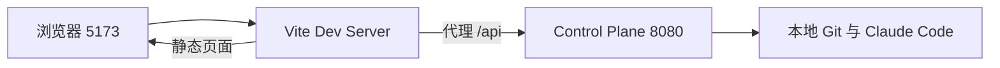
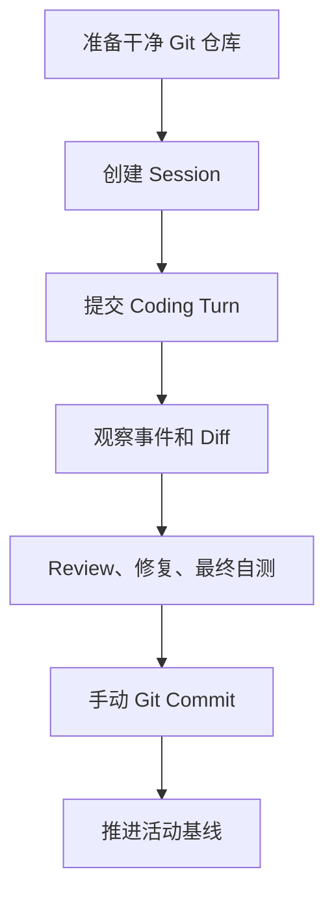

# 本地开发指南

## 1. 环境检查

| 依赖 | 最低版本 | Windows 建议 |
|---|---:|---|
| JDK | 21 | 使用 x64 JDK，并确认 `java -version` |
| Maven | 3.9 | 项目可使用 `mvn` 或已有 Maven Wrapper |
| Git | 2.40 | 确认 `git --version` |
| Node.js | 20.19+ 或 22.12+ | Vite 8 的最低运行版本 |
| Claude Code | 2.1 | 配置 `.cmd`、`.bat` 或 `.exe` 入口 |

```powershell
java -version
mvn -version
git --version
node --version
claude --version
```

## 2. 启动 Control Plane

必须显式配置两个绝对路径：

```powershell
$env:CODE_WEAVE_RUNTIME_ROOT = "D:/code-weave-runtime"
$env:CODE_WEAVE_CLAUDE_EXECUTABLE = "D:/develop/nodejs/claude.cmd"
.\mvnw.cmd -pl services/control-plane spring-boot:run
```

| 环境变量 | 用途 | 是否可由 HTTP 覆盖 |
|---|---|---|
| `CODE_WEAVE_RUNTIME_ROOT` | Session、Turn、事件、产物和锁文件目录 | 否 |
| `CODE_WEAVE_CLAUDE_EXECUTABLE` | Claude Code CLI 入口 | 否 |
| `CODE_WEAVE_RUN_CONCURRENCY` | 旧 M0 Run 并发数，默认 1 | 否 |
| `CODE_WEAVE_RUN_QUEUE_CAPACITY` | 旧 M0 Run 队列容量，默认 10 | 否 |

Control Plane 只监听 `127.0.0.1`。启动后可访问：

```powershell
Invoke-RestMethod http://127.0.0.1:8080/api/v1/system/readiness
```

## 3. 启动 Web 工作台

```powershell
cd apps/web-console
npm install
npm run dev
```

浏览器访问 `http://127.0.0.1:5173`。Vite 会把 `/api` 请求代理到 `127.0.0.1:8080`。



## 4. 手动验证正式链路

1. 准备一个 Spring Boot 3.x + Maven 的本地 Git 仓库。
2. 确认当前分支有至少一个提交。
3. 打开 `/sessions`，输入仓库绝对路径。
4. 仓库有既有未提交修改时，明确决定是否纳入 Session。
5. 创建 Session，提交一轮 Coding 指令。
6. 观察 SSE 阶段、助手 Markdown、Maven 结果和累计 Diff。
7. 在 Review 和自测完成后手动执行一次模块级 Git Commit。
8. 回到页面重新检查并推进活动基线。



## 5. 自动化验证

后端：

```powershell
.\mvnw.cmd -pl services/control-plane -am clean test
```

前端：

```powershell
cd apps/web-console
npm test -- --run
npm run build
```

提交前：

```powershell
git diff --check
git status --short --branch
```

## 6. 常见故障

| 现象 | 原因 | 处理 |
|---|---|---|
| Java 无法启动 Claude | 配置成了 `claude.ps1` | 改为 `claude.cmd`、`.bat` 或 `.exe` |
| `RUNTIME_NOT_READY` | Git、Java、Maven 或 Claude 探测失败 | 查看 readiness 每个检查项的 remediation |
| 创建 Session 返回仓库被占用 | 同一仓库已有活动 Session 或残留锁 | 先检查历史 Session 和服务日志，不手工删除锁文件 |
| 创建 Session 被既有修改阻止 | 仓库有未提交修改 | 提交/撤销修改，或显式选择纳入 |
| Turn 返回工作区漂移 | Session 期间切换分支或创建了未确认提交 | 恢复活动基线，或完成模块基线推进 |
| SSE 中断 | 浏览器、前端或服务连接重置 | 使用事件游标重连，持久日志仍是事实源 |
| Diff 无法展示 | Diff 超过平台上限或采集失败 | 缩小模块范围并查看用户提示与服务日志 |

## 7. 数据安全边界

- 不要把 `runtime` 当成源码目录提交到 Git。
- 不要手工删除仍在使用的仓库锁或 Session 快照。
- 平台不会替用户执行 Commit、Push 或 Merge。
- 测试旧 Worktree 链路时，不要删除其他历史 Run 的 Worktree。
- HTTP 错误只返回可操作信息，内部命令和诊断应从 Control Plane 日志查看。
