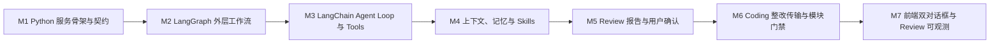

# Code Weave 开发路线图

路线图按产品主链路组织，不再把早期一次性 Run 的 M0–M6 编号当成最终架构层级。

## 已完成

| 阶段 | 交付能力 | 关键结果 |
|---|---|---|
| Coding 基础设施 | Claude Adapter、进程管理、事件映射 | 可以受控启动 Claude Code 并消费结构化 NDJSON |
| 代码事实闭环 | Git Diff、路径门禁、Maven 验证 | 不采信模型自报，使用平台独立事实 |
| 异步与可观测 | 有界执行、事件日志、SSE、前端阶段投影 | 用户可以实时观察并断点恢复 |
| 持续 Coding | Session/Turn 持久化、Claude 上下文续接 | 多轮对话共享真实工作区和原生上下文 |
| 真实工作区重构 | 仓库写锁、HEAD 防漂移、活动审查基线 | 删除正式 Session 的 Worktree 合并流程 |
| 文档重构 | 当前架构、API、开发指南、ADR 索引 | 历史决策与当前事实分离 |
| 阶段事实与事件协议 | 五阶段生命周期、持久诊断、共享 Agent 映射、历史适配 | 不再从 Agent 消息或任务终态推断阶段结果 |
| Session 正常关闭 | 安全关闭、按所有者释放、失败补偿、历史只读 | 不操作代码，CLOSED 与释放确认分离 |

## 下一阶段：Review Harness MVP

### 建议开发顺序

| 顺序 | 开发点 | 首版边界 | 验收条件 |
|---:|---|---|---|
| 1 | Python Review Harness 服务骨架 | 健康检查、Run 创建、状态、SSE、取消 | Java 可启动 Review Run 并稳定转发事件 |
| 2 | LangGraph 固定外层流程 | 输入冻结、调查、审查、报告草稿 | 阶段可恢复，失败有明确位置 |
| 3 | LangChain 有界 Agent Loop | 代码搜索、读取、Git Diff、Maven/Surefire 事实工具 | 模型能自主调查，但受预算与取消控制 |
| 4 | 上下文与渐进式披露 | 项目地图、摘要、Tool Search、Skills 按需加载 | 长审查不会把全部仓库塞入上下文 |
| 5 | Review 报告交互 | 报告草稿与用户多轮交流，确认后结构化 | 用户看到的是清晰报告而非内部字段 |
| 6 | Coding 整改闭环 | 确认报告传给 Coding Agent | Coding 与 Review 互斥且可循环复审 |
| 7 | 前端 Review 工作台 | 双对话框、传输动画、阶段投影 | 活跃侧可交互，非活跃侧只读可展开 |

## 二期能力

| 能力 | 为什么不放首版 | 触发条件 |
|---|---|---|
| 六个审查维度并行 | 首版先验证质量和闭环，避免并发状态过重 | 串行评测稳定后使用 LangGraph 并行分支 |
| 跨项目通用记忆 | 需要先验证经验提取质量和污染风险 | 项目级记忆稳定、可解释、可清理 |
| 多语言 Review | 当前验证器和首版规则聚焦 Maven | Java 审查评测达到可接受水平后扩展 Worker |
| SQLite/数据库 | 当前文件事实足以支撑本机单用户 | 需要分页、组合查询、全文检索或多进程时 |
| 桌面端 | Web 更适合快速验证交互和协议 | Web Coding–Review 闭环稳定后封装桌面壳 |
| Review 评测系统 | 应与在线主链路解耦 | Review Harness MVP 可独立运行后建设 benchmarks |

## 明确不做

- 不为每个 Coding Turn 自动创建 Git Commit。
- 不恢复正式 Session 的 Worktree 自动合并链路。
- 不用固定规则把 Review Agent 限制成只会运行 Maven。
- 不在 Review Harness 首版引入多 Agent 并行、复杂报告版本树或分布式基础设施。
- 不让 Python Review Harness 主动回调 Java；Java 通过 HTTP 控制并消费 Python SSE。
