# Code Weave 开发路线图

路线图按产品主链路组织，不再把早期一次性 Run 的 M0–M6 编号当成最终架构层级。

## 已完成

| 阶段 | 交付能力 | 关键结果 |
|---|---|---|
| Coding 基础设施 | Claude Adapter、进程管理、事件映射 | 可以受控启动 Claude Code 并消费结构化 NDJSON |
| 代码事实闭环 | Git Diff、路径门禁、Maven 验证 | 不采信模型自报，使用平台独立事实 |
| 异步与可观测 | 有界执行、事件日志、SSE、前端阶段投影 | 用户可以实时观察并断点恢复 |
| 持续 Coding | Session/Turn 持久化、Claude 上下文续接 | 多轮对话共享真实工作区和原生上下文 |
| 真实工作区重构 | 仓库写锁、HEAD 防漂移、活动审查基线 | 删除正式 Session 的 Worktree 合并流程 |
| 文档重构 | 当前架构、API、开发指南、ADR 索引 | 历史决策与当前事实分离 |
| 阶段事实与事件协议 | 五阶段生命周期、持久诊断、共享 Agent 映射、历史适配 | 不再从 Agent 消息或任务终态推断阶段结果 |
| Session 正常关闭 | 安全关闭、按所有者释放、失败补偿、历史只读 | 不操作代码，CLOSED 与释放确认分离 |
| Harness 批次 0 设计冻结 | Snapshot、跨服务恢复、Context/Artifact/Evidence | ADR-0009/0014/0015 已成为开发依据，尚未实现 |
| Harness 批次 1 Runtime（待独立审查） | FastAPI、SQLite 原子事实、有界模拟执行、认证、取消、SSE 与恢复 | 独立 Python 服务可运行，真实 Snapshot、模型与 Java 集成尚未接入 |

## 下一阶段：Review Harness MVP

```mermaid
flowchart LR
    A[1 Python 服务骨架] --> B[2 Snapshot 与执行空间]
    B --> C[3 Artifact 与只读 Tool]
    C --> D[4 LangGraph 与 Context]
    D --> E[5 单 Pass 真实闭环]
    E --> F[6 六 Pass 报告与 Handoff]
    F --> G[7 执行型 Tool]
    G --> H[8 Project Memory]
    H --> I[9 Skill 与 MCP]
    I --> J[10 Eval 与可靠性]
```

### 建议开发顺序

| 顺序 | 开发点 | 首版边界 | 验收条件 |
|---:|---|---|---|
| 1 | Python Review Harness 服务骨架（已实现，待独立审查） | FastAPI、认证、Readiness、SQLite Run/Event/Result、幂等、取消、SSE、恢复、确定性模拟器 | 独立服务测试与干净 Python 3.12 验收；Java 消费属于后续集成 |
| 2 | Review Snapshot 与执行空间 | Java 捕获发布、Python 校验和每 Run 副本、产品门禁 | Agent 输入不可变，漂移和路径逃逸被拒绝 |
| 3 | Artifact 与基础只读 Tool | Artifact 完整性、有界读取、read/search/glob/diff | 长输出不挤爆 Context，权限入口不可绕过 |
| 4 | LangGraph State 与 Context | Checkpoint、Token Meter、Context Manifest、Compaction | 锚点不丢、压缩有进展且可追溯 |
| 5 | 单 Pass 真实闭环 | 正确性 Pass、真实模型、Evidence、Finding、Result、Java 报告草稿 | 首条端到端 Review 具有可核查证据 |
| 6 | 六 Pass、报告与 Handoff | 串行六 Pass、去重、用户批准、Coding 交接 | 用户可以审阅并驱动整改复审 |
| 7 | Maven 与 Analyzer | 执行记录、Sandbox 边界、污染检查、进程清理 | 执行型证据不污染源码且可取消恢复 |
| 8 | Project Memory | 项目隔离、提议、用户批准、STALE/REJECTED | 记忆只提供线索，不成为当前证据 |
| 9 | Skill 与 MCP | 渐进加载、只缩权、统一 Tool 治理 | 外部能力不能绕过权限和输出预算 |
| 10 | Eval 与可靠性 | 固定样例、误报遗漏、压缩、恢复和安全测试 | 用结构化证据评估质量，不编造提升比例 |

## 二期能力

| 能力 | 为什么不放首版 | 触发条件 |
|---|---|---|
| 六个审查维度并行 | 首版先验证质量和闭环，避免并发状态过重 | 串行评测稳定后使用 LangGraph 并行分支 |
| 跨项目通用记忆 | 需要先验证经验提取质量和污染风险 | 项目级记忆稳定、可解释、可清理 |
| 多语言 Review | 当前验证器和首版规则聚焦 Maven | Java 审查评测达到可接受水平后扩展 Worker |
| PostgreSQL、Redis 与多 Worker | 首版 SQLite 单进程足以验证事务和恢复语义 | 出现多进程、多节点或跨进程通知需求时 |
| 桌面端 | Web 更适合快速验证交互和协议 | Web Coding–Review 闭环稳定后封装桌面壳 |
| Review 评测系统 | 应与在线主链路解耦 | Review Harness MVP 可独立运行后建设 benchmarks |

## 明确不做

- 不为每个 Coding Turn 自动创建 Git Commit。
- 不恢复正式 Session 的 Worktree 自动合并链路。
- 不用固定规则把 Review Agent 限制成只会运行 Maven。
- 不在 Review Harness 首版引入多 Agent 并行、复杂报告版本树或分布式基础设施。
- 不让 Python Review Harness 主动回调 Java；Java 通过 HTTP 控制并消费 Python SSE。
